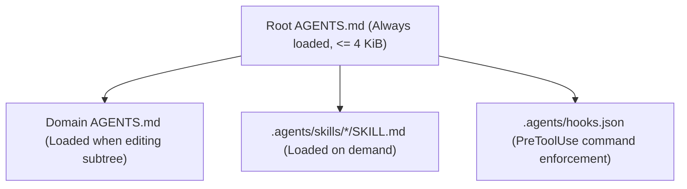

# Agent Governance and Pure-Git Operations

This specification defines how autonomous coding agents operate inside `gosuda/0`. Agents execute standard Git commands guided by `AGENTS.md`, `.gitconfig` aliases, and `.agents/` skill modules. Pre-execution hooks block direct mutations to trunk references.

## 1. Layered Instruction Architecture

The repository splits agent instructions across four hierarchical layers to bound context token consumption. Figure 1 shows the discovery and loading order across these layers.



Table 1 specifies the file path, activation trigger, and owned scope for each customization layer.

| Layer | Path | Activation Trigger | Owned Scope |
| :--- | :--- | :--- | :--- |
| Root Rules | `/AGENTS.md` | Always loaded at session start | Repository reference map, visibility boundaries, and the 6 standard Git commands |
| Subtree Rules | `/<domain>/<project>/AGENTS.md` | Loaded when reading or editing files in `<project>` | Project build commands, test targets, and package-specific invariants |
| Workspace Skills | `/.agents/skills/<name>/SKILL.md` | Loaded when the agent activates `<name>` | Multi-step runbooks for conflict resolution and subtree synchronization |
| Lifecycle Hooks | `/.agents/hooks.json` | Executed before every `run_command` tool call | Deterministic rejection of prohibited `git push` and `git pull` invocations |

## 2. Invariants and Safety Guardrails

Every coding agent operating in `gosuda/0` obeys four operational invariants. The pre-execution hook in `.agents/hooks.json` enforces these boundaries before any shell command runs.

1. **One Task per Workspace Reference**: Every task creates a dedicated branch named `ws/agent-<name>/<task-id>` rooted at `origin/suda/main`. Agents never reuse a workspace reference across unrelated tasks.
2. **Prohibition of Direct Trunk Pushes**: Agents never push directly to `refs/heads/main`, `refs/suda/main`, or `refs/suda/history`. All trunk updates pass through `refs/heads/land/<task-id>`.
3. **Import Boundary Enforcement**: Agents editing public domains (`//web/*`, `//net/*`, `//ipc/*`, `//storage/*`, `//crypto/*`, `//ai/*`, `//devtools/*`) never import packages from `//corp/*` or `//experimental/*`.
4. **Scoped Sparse Checkout**: Agents check out only the domain directories required for the active task.

> [!CAUTION]
> Never execute `git push --force` without `--force-with-lease` on any reference. Unconditional force pushes overwrite commits written by concurrent agents and cause permanent work loss.

## 3. Standard Agent Command Mapping

Agents execute native `git` subcommands or the `.gitconfig` aliases tracked on `refs/heads/main`. Table 2 maps each lifecycle operation to its exact Git command and alias.

| Operation | Native Git Command | `.gitconfig` Alias |
| :--- | :--- | :--- |
| Attach trunk refspec | `git config --add remote.origin.fetch "+refs/suda/*:refs/remotes/origin/suda/*"` | `git suda-init` |
| Set sparse directories | `git sparse-checkout set ipc/hqq web/gosuda` | `git sparse-checkout set ...` |
| Create workspace | `git fetch --filter=blob:none origin && git switch -c ws/<actor>/<id> origin/suda/main` | `git ws-new <actor>/<id>` |
| Create experimental sandbox | `git sparse-checkout add experimental/<actor>/<name> && git switch -c ws/<actor>/exp-<name> origin/suda/main` | `git ws-exp <actor> <name>` |
| Graduate experimental package | `git mv experimental/<actor>/<name> <domain>/<name>` | `git ws-graduate <src> <dst>` |
| Save WIP snapshot | `git push --force-with-lease origin HEAD:refs/ws/<actor>/<id>` | `git ws-save` |
| Open ephemeral GitHub PR | `git push --force-with-lease origin ${base}:refs/heads/base/<id> HEAD:refs/heads/review/<id>` | `git ws-pr` |
| Generate GitHub diff link | `echo "https://magpie.gosuda.org/diff/$(git symbolic-ref --short HEAD)"` | `git ws-diff` |
| Rebase onto latest trunk | `git fetch --filter=blob:none origin && git rebase --onto origin/suda/main $(git rev-list --max-parents=0 HEAD) HEAD` | `git ws-sync` |
| Submit to landing queue | `git push --force-with-lease origin HEAD:refs/heads/land/<id>` | `git ws-land` |
| Query commit history | `git fetch --filter=blob:none origin refs/suda/history && git log FETCH_HEAD -- <path>` | `git suda-log <path>` |

## 4. Control-Plane File Specifications

The control plane on `refs/heads/main` ships three configuration files that configure Git aliases, agent instructions, and command hooks.

### 4.1 Tracked `.gitconfig` Specification

The `.gitconfig` file defines five aliases that wrap the `refs/suda/*`, `refs/ws/*`, and `refs/heads/land/*` reference conventions.

```ini
[alias]
  suda-init = "!git config --add remote.origin.fetch '+refs/suda/*:refs/remotes/origin/suda/*' && git fetch --filter=blob:none origin"
  ws-new    = "!f() { git fetch --filter=blob:none origin && git switch -c \"ws/$1\" origin/suda/main; }; f"
  ws-save   = "!f() { b=$(git symbolic-ref --short HEAD); git push --force-with-lease origin \"HEAD:refs/$b\"; }; f"
  ws-sync   = "!f() { git fetch --filter=blob:none origin && git rebase --onto origin/suda/main $(git rev-list --max-parents=0 HEAD) HEAD; }; f"
  ws-land   = "!f() { id=$(basename $(git symbolic-ref --short HEAD)); git push --force-with-lease origin \"HEAD:refs/heads/land/$id\"; }; f"
  ws-diff   = "!f() { b=$(git symbolic-ref --short HEAD); echo \"https://magpie.gosuda.org/diff/$b\"; }; f"
  suda-log  = "!f() { git fetch --filter=blob:none origin refs/suda/history && git log FETCH_HEAD -- \"$@\"; }; f"
```

### 4.2 Root `AGENTS.md` Specification

The root `AGENTS.md` file provides the normative instructions loaded into every agent session.

````markdown
# gosuda/0 Monorepo Agent Rules

## 1. Reference Boundaries
- `refs/heads/main` holds only control-plane files (`AGENTS.md`, `README.md`, `.gitconfig`, `.github/workflows/`).
- `refs/suda/main` holds the unified `google3` source tree as a single parentless snapshot commit.
- `refs/suda/history` holds the linear commit history for `git blame` and `git log`.
- Do not push source code to `refs/heads/main` or directly to `refs/suda/main`.

## 2. Directory Visibility Rules
- Public domains (`//web/*`, `//net/*`, `//ipc/*`, `//storage/*`, `//crypto/*`, `//ai/*`, `//devtools/*`) sync to `github.com/gosuda/<repo>`.
- Public domains must never import `//corp/*` or `//experimental/*`.
- `//corp/*` holds private internal services and never leaves `gosuda/0`.
- `//third_party/*` holds external vendored code and requires `LICENSE` and `METADATA` files.
- Keep each project's `.github/workflows/` inside its project directory so it executes on the public mirror after export.

## 3. Workspace Procedure

> [!WARNING]
> Never run `git pull` on a workspace branch. Rebase onto `origin/suda/main` using `git ws-sync` instead.

1. Enable repository aliases: `git config include.path ../.gitconfig`.
2. Fetch trunk references: `git suda-init`.
3. Set sparse checkout paths: `git sparse-checkout set <domain>/<project>`.
4. Create a workspace branch: `git ws-new agent-<name>/<task-id>`.
5. Run tests in all modified packages before saving.
6. Commit changes and push WIP: `git ws-save`.
7. Rebase onto the latest trunk snapshot: `git ws-sync`.
8. Enqueue for landing: `git ws-land`.
````

### 4.3 Pre-Execution Hook Specification (`.agents/hooks.json`)

The `git-guard` hook inspects every shell command before execution and rejects prohibited Git reference mutations.

```json
{
  "git-guard": {
    "PreToolUse": [
      {
        "matcher": "run_command",
        "hooks": [
          {
            "type": "command",
            "command": "./.agents/scripts/guard-git.sh",
            "timeout": 5
          }
        ]
      }
    ]
  }
}
```

## 5. Verification Matrix for Agent Workflows

Evaluate agent compliance against the seven behavioral scenarios in Table 3 before deploying changes to `AGENTS.md` or `.agents/hooks.json`.

| Scenario | Input Condition | Expected Observable Outcome |
| :--- | :--- | :--- |
| Standard task landing | Agent modifies one file in `//net/portalite` and runs `git ws-land` | `land.yml` updates `refs/suda/main`, exports to `gosuda/portalite`, and deletes `refs/heads/land/<id>` |
| Trunk advanced without conflict | `refs/suda/main` advances in `//web/gosuda` while agent edits `//net/ivnp` | `git ws-sync` rebases cleanly; `land.yml` merges in memory with exit code `0` |
| Overlapping line conflict | Both `refs/suda/main` and agent workspace modify the same lines | `land.yml` exits `1`; agent runs `git ws-sync`, resolves markers, re-tests, and re-submits |
| Prohibited push to `main` | Agent invokes `git push origin HEAD:main` | `guard-git.sh` denies execution and prints the `git ws-land` command |
| Cross-boundary import violation | Public package in `//web/securl` imports `//corp/lemonsso` | `land.yml` visibility check rejects the merge and leaves `refs/suda/main` unchanged |
| Concurrent landing race | Two agents push to `refs/heads/land/a` and `refs/heads/land/b` simultaneously | `concurrency: land-suda-main` serializes both runs; neither update is lost |
| Credential in staged diff | Agent stages a file containing a private key token | Pre-push check aborts `git ws-save` before objects reach `origin` |
