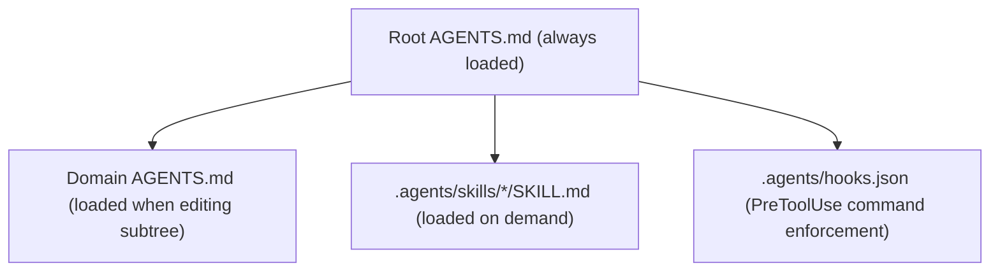

# Agent Governance and Pure-Git Operations

This specification defines how autonomous coding agents operate inside `gosuda/0` and its user repository `gosuda/1`. Agents execute standard Git commands guided by `AGENTS.md`, `.gitconfig` aliases, and `.agents/` skill modules. A pre-execution hook blocks direct mutations of trunk references and pushes to `origin`.

## 1. Layered Instruction Architecture

The repository splits agent instructions across four layers to bound context consumption. Figure 1 shows the discovery and loading order across these layers.



Table 1 specifies the file path, activation trigger, and owned scope for each customization layer.

| Layer | Path | Activation Trigger | Owned Scope |
| :--- | :--- | :--- | :--- |
| Root Rules | `/AGENTS.md` | Always loaded at session start | Reference boundaries, `OWNERS` and visibility rules, and the workspace, review, experimental, and mirror procedures |
| Subtree Rules | `/<domain>/<project>/AGENTS.md` | Loaded when reading or editing files in `<project>` | Project build commands, test targets, and package-specific invariants |
| Workspace Skills | `/.agents/skills/<name>/SKILL.md` | Loaded when the agent activates `<name>` | Runbooks for workspace submission, conflict resolution, repository creation and import, and mirror synchronization |
| Lifecycle Hooks | `/.agents/hooks.json` | Executed before every `run_command` tool call | Deterministic rejection of prohibited `git push` and `git pull` invocations, implemented by `.agents/scripts/guard-git.sh` |

## 2. Invariants and Safety Guardrails

Every coding agent operating in `gosuda/0` obeys these operational invariants. The pre-execution hook enforces the Git-level boundaries before any shell command runs. The lander enforces the rest on every landing.

1. **One Task per Workspace Reference**: Every task creates a dedicated branch named `ws/<actor>/<id>` rooted at `origin/suda/main`. Agents never reuse a workspace reference across unrelated tasks.
2. **No Direct Pushes to the Trunk or to `origin`**: After `git suda-init`, `origin` (`gosuda/0`) has an invalid push URL, and the hook denies any `git push` that names `origin`, `refs/suda/main`, or `refs/suda/history`. All trunk updates pass through `refs/heads/land/<id>` on `gosuda/1`.
3. **Import Boundary Enforcement**: Agents editing public domains (`//web/*`, `//net/*`, `//ipc/*`, `//storage/*`, `//crypto/*`, `//ai/*`, `//devtools/*`) never import packages from `//corp/*` or `//experimental/*`. The lander rejects any landing that violates this.
4. **Scoped Sparse Checkout**: Agents check out only the domain directories required for the active task. The hook rewrites `git sparse-checkout set` so that `.agents` and `.github` stay checked out.
5. **Fetch Control Plane and Trunk Only From `origin`**: Agents never fetch `refs/heads/main`, `refs/suda/*`, or any other trunk reference from `gosuda/1`.

> [!CAUTION]
> Never execute `git push --force` without `--force-with-lease` on any reference. Unconditional force pushes overwrite commits written by concurrent agents and cause permanent work loss.

## 3. Standard Agent Command Mapping

Agents execute native `git` subcommands or the `.gitconfig` aliases tracked on `refs/heads/main`. Table 2 maps each lifecycle operation to its native Git command and its alias. `ws-*` aliases push to the `ws` remote (`gosuda/1`) and fetch from `origin` (`gosuda/0`).

| Operation | Native Git Command | `.gitconfig` Alias |
| :--- | :--- | :--- |
| Attach trunk and `ws` remote | `git remote add ws <origin URL with /1>`, then `git fetch --filter=blob:none origin` | `git suda-init` |
| Set sparse directories | `git sparse-checkout set ipc/hqq web/gosuda` | `git sparse-checkout set ...` or `git ws-sparse <dirs>` |
| Create workspace | `git fetch --filter=blob:none origin && git switch -c ws/<actor>/<id> origin/suda/main` | `git ws-new <actor>/<id>` |
| Create experimental sandbox | `git sparse-checkout add experimental/<actor>/<name> && git switch -c ws/<actor>/exp-<name> origin/suda/main` | `git ws-exp <actor> <name>` |
| Graduate experimental package | `git mv experimental/<actor>/<name> <domain>/<name>` | `git ws-graduate <src> <dst>` |
| Save WIP snapshot | `git push --force-with-lease ws HEAD:refs/ws/<actor>/<id>` | `git ws-save` |
| Open ephemeral GitHub PR or add a patchset | `git push --force-with-lease ws ${base}:refs/heads/base/<id> HEAD:refs/heads/review/<id>` and `git push ws HEAD:refs/ws/cl/<change-id>/<tip>` | `git ws-pr` |
| Add the `Change-Id` trailer | `git commit --amend --only` with a `Change-Id: I<40 hex>` trailer | `git ws-id` |
| List patchsets, diff two of them | `git fetch ws "+refs/ws/cl/<change-id>/*:refs/remotes/ws/ws/cl/<change-id>/*"`, `git range-diff` | `git ws-ps`, `git ws-psdiff <a> <b>` |
| Find a landed change | `git fetch --filter=blob:none origin refs/suda/history && git log FETCH_HEAD --grep '^Change-Id: <id>$'` | `git suda-cl <N\|Change-Id>` |
| Back up and restore the working state | write a temp-index tree, push it to `refs/ws/autosave/<actor>/<id>`; `git read-tree --reset -u` on another machine | `git ws-autosave start\|stop\|once\|status`, `git ws-resume` |
| Extra workspace without a clone | `git worktree add -b ws/<actor>/<id> <dir> origin/suda/main` | `git ws-wt <actor>/<id>` |
| Fetch without racing other worktrees | `git fetch <args>` while holding `suda-fetch.lock` in the common Git directory | `git suda-ws fetch <args>` |
| Install or update the aliases and `ws.sh` | copy `.gitconfig` and `.github/scripts/ws.sh` into the common Git directory | `git suda-init` |
| Generate diff link | `echo "https://magpie.gosuda.org/diff/$(git symbolic-ref --short HEAD)"` | `git ws-diff` |
| Rebase onto latest trunk | `git fetch --filter=blob:none origin && git rebase --onto origin/suda/main $(git rev-list --max-parents=0 HEAD) HEAD` | `git ws-sync` |
| Submit to landing queue | `git push --force-with-lease ws HEAD:refs/heads/land/<id>` | `git ws-land` |
| Query commit history | `git fetch --filter=blob:none origin refs/suda/history && git log FETCH_HEAD -- <path>` | `git suda-log <path>` |
| Fetch staged external changes | `git fetch ws` (the refspec maps `refs/ws/*` to `refs/remotes/ws/ws/*`) | none |

## 4. Control-Plane File Specifications

The control plane on `refs/heads/main` ships the files that configure Git aliases, agent instructions, and the command hook.

### 4.1 Tracked `.gitconfig` Specification

The `.gitconfig` file defines the aliases that wrap the `refs/suda/*`, `refs/ws/*`, and `refs/heads/land/*` reference conventions. Its behavior:

- `suda-init` runs `.github/scripts/ws.sh init` from the checkout, or the installed copy when the checkout has no `ws.sh`. `init` copies `.gitconfig` and `ws.sh` into the common Git directory as `suda.gitconfig` and `suda-ws.sh`. It replaces the files by rename, so a running autosave loop is not disturbed, and keeps the installed files when the checkout predates `ws.sh`. It then includes `suda.gitconfig`, adds the `ws` remote derived from the origin URL, sets `remote.origin.pushurl` to an invalid `no-push://` URL, configures the `refs/suda/*` fetch refspec on `origin`, and fetches from `origin`.
- `suda-ws` runs the installed `suda-ws.sh`, falling back to the checkout's `ws.sh` before the first install. Every other alias that runs the tools goes through it, so all branches and worktrees of the clone use one version.
- `ws-new`, `ws-sync`, `ws-exp`, and `suda-log` fetch from `origin` with `git suda-ws fetch`, which holds the clone-wide fetch lock (`suda-fetch.lock` in the common Git directory). A lock whose owner process is gone is removed. `SUDA_FETCH_LOCK_TIMEOUT` (default 600 seconds) bounds the wait for a live owner.
- `ws-save`, `ws-land`, and `ws-pr` push to `ws` and first make sure the tip carries a `Change-Id` trailer. `ws-land` pushes `HEAD` to `refs/heads/land/<id>` and does not call any API. `ws-pr` also pushes the immutable patchset `refs/ws/cl/<change-id>/<tip>` (or `refs/ws/cl/sec/...` for embargoed work) and opens its pull request with `gh pr create --repo gosuda/1`, or reports the existing one.
- `ws-id`, `ws-ps`, `ws-psdiff`, `ws-autosave`, `ws-resume`, `ws-wt`, and `suda-cl` are thin wrappers of the same script. `ws-autosave` is opt-in.
- `ws-diff` prints the diff link for the current branch.

### 4.2 Root `AGENTS.md`

The root [AGENTS.md](../AGENTS.md) is the normative set of rules loaded into every agent session. This document does not repeat it.

### 4.3 Pre-Execution Hook Specification (`.agents/hooks.json`)

The `git-guard` hook inspects every shell command before execution and rejects prohibited Git invocations.

```json
{
  "git-guard": {
    "PreToolUse": [
      {
        "matcher": "run_command",
        "hooks": [
          {
            "type": "command",
            "command": "./scripts/guard-git.sh",
            "timeout": 5
          }
        ]
      }
    ]
  }
}
```

`.agents/scripts/guard-git.sh` applies these rules, in order:

1. Deny `git pull`. The reason names `git ws-sync` as the replacement.
2. Deny `git push` with an unconditional `--force` or `-f` that does not also carry `--force-with-lease`.
3. Deny `git push` that names `origin`. The reason names `git ws-save` and `git ws-land`.
4. Deny `git push` that names `refs/suda/main` or `refs/suda/history`.
5. Deny `git stash` except `git stash list` and `git stash show`. The stash is shared by every worktree of a clone, and the reason names `git ws-save` and `git ws-autosave once`.
6. Rewrite every plain `git fetch` to `git suda-ws fetch`, which serializes fetches across worktrees, and rewrite `git sparse-checkout set` so that `.agents` and `.github` are included. Both rewrites apply to the same command.
7. Allow every other command.

### 4.4 Parallel Agents

Run parallel agents as one blobless clone per machine with one worktree per agent, created with `git ws-wt <actor>/<id>`. `AGENTS.md` §4.6 lists the rules. The facts behind them were observed on Git 2.54:

| Shared by all worktrees | Private to each worktree |
| :--- | :--- |
| Objects and lazily fetched blobs, branches, remote-tracking refs, `refs/stash`, repository config, installed tools (`suda.gitconfig`, `suda-ws.sh`), the fetch lock | Index, `HEAD`, `FETCH_HEAD`, rebase state, sparse-checkout list (`extensions.worktreeConfig` is enabled automatically), autosave pid and state files |

Without the lock, 14 of 15 rounds of two concurrent fetches from two worktrees failed with `cannot lock ref 'refs/remotes/origin/main'`. Use separate clones only across an isolation boundary: a container, VM, or remote machine, a different GitHub identity for pushes, or agents that must not share Git state.

## 5. Verification Matrix for Agent Workflows

Evaluate agent compliance against the scenarios in Table 3 before deploying changes to `AGENTS.md` or `.agents/`.

| Scenario | Input Condition | Expected Observable Outcome |
| :--- | :--- | :--- |
| Standard task landing | Agent modifies one file in `//net/portalite` and runs `git ws-land` | `suda/land` status `success` on the tip in `gosuda/1`; `refs/suda/main` advances; the land ref is deleted; the mirror `gosuda/portalite` receives the export in the same or a following cycle |
| Trunk advanced without conflict | `refs/suda/main` advances in `//web/gosuda` while the agent edits `//net/ivnp` | `git ws-sync` rebases cleanly; the lander merges in memory with `merge-tree` exit code `0` |
| Overlapping line conflict | Both `refs/suda/main` and the workspace modify the same lines | Status `failure` with the reason `merge conflict`; the agent runs `git ws-sync`, resolves the markers, re-tests, and re-submits |
| Prohibited push to `main` | Agent invokes `git push origin HEAD:main` | `guard-git.sh` denies execution and points to `git ws-land` |
| Cross-boundary import violation | Public package in `//web/securl` imports a `//corp/*` package by its module path | Status `failure` with a visibility reason; `refs/suda/main` unchanged |
| Unknown base | Workspace root is not the tree of any of the last 500 trunk commits | Status `failure` with `unknown base tree; run git ws-sync`; the agent runs `git ws-sync` and re-submits |
| Forged approval | Commit trailers claim `Reviewed-by: @owner` and the author name matches an owner, but the GitHub requester is not an owner and no approval is bound to the tip | Status `failure` with an `OWNERS` reason; trunk unchanged |
| Self-approving `OWNERS` | A new directory adds its own `OWNERS` and files that the same change lands | Rejected unless an ancestor `OWNERS` approves the requester: the chain is read from the base trunk tree, where the new directory has no `OWNERS` yet |
| Experimental path by another login | Requester `alice` lands under `experimental/bob/...` | Rejected unless the `OWNERS` chain approves; `bob` may land freely |
| Concurrent landing race | Two agents push `refs/heads/land/a` and `refs/heads/land/b` in the same interval | Both are processed in push-time order within the cycle; neither update is lost |
| Mirror push by a non-owner | A maintainer without ownership of the prefix pushes to the mirror branch | Not landed. The import is staged as `refs/ws/capy/<wf>-main` for a member to land |
| Break-glass push to `main` | An org owner pushes `refs/heads/main` directly | Next cycle lands an overlay-sync commit with `Suda-Break-Glass:` in the trunk history |
