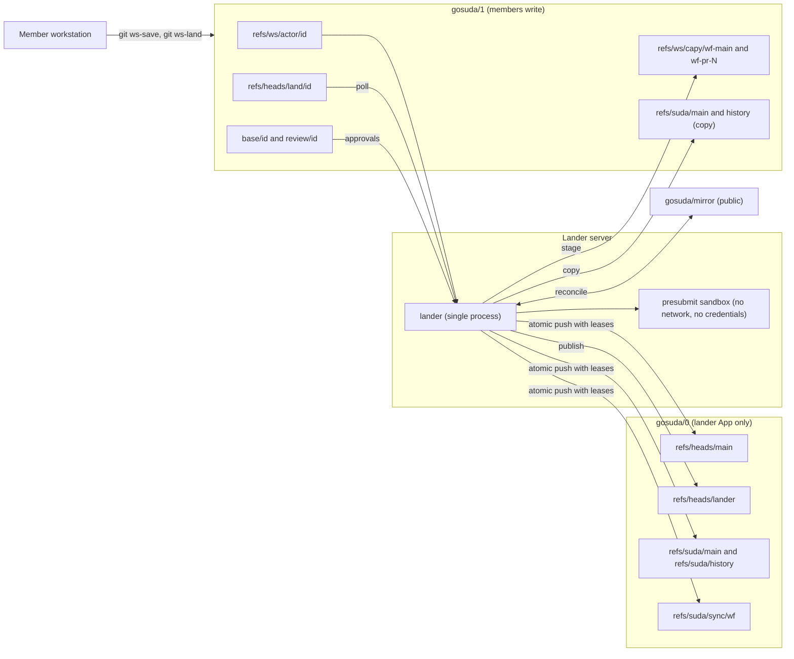
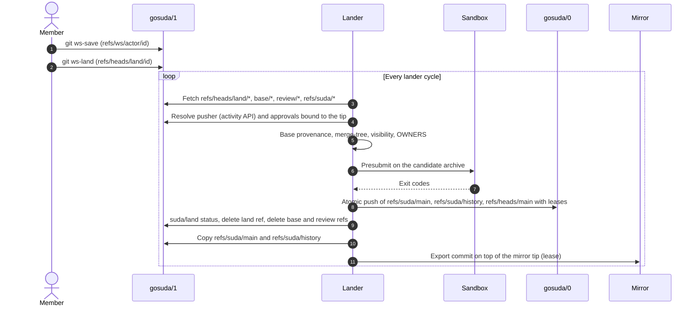

# Monorepo Architecture Specification

The monorepo spans two private repositories and one writer. `gosuda/0` holds the control plane and the single-trunk source tree, and only the lander writes to it. `gosuda/1` holds workspaces, landing requests, and review pull requests, and organization members write to it. The lander is a single process that moves changes from `gosuda/1` to `gosuda/0` and keeps the public mirror repositories in sync with the trunk. Callers interact with the system through standard Git commands and the aliases in `.gitconfig`.

## 1. Layered Subsystem Map

The monorepo organizes all source code inside one root tree at `refs/suda/main`. Every top-level directory belongs to an explicit visibility tier that restricts import directionality.

### 1.1 Repository and Reference Layout

Figure 1 shows the data flow between the two repositories, the lander, its presubmit sandbox, and the public mirrors. The reference namespaces and their writers are listed in [docs/README.md](./README.md) §2.



### 1.2 Directory Taxonomy and Import Directionality

The root tree of `refs/suda/main` classifies packages by technical domain and visibility tier. Table 1 defines the directory hierarchy, the allowed dependencies, and the external synchronization rules.

| Directory Path | Visibility Tier | Permitted Imports | Prohibited Imports | External Mirror Policy |
| :--- | :--- | :--- | :--- | :--- |
| `//web/*`, `//net/*`, `//ipc/*`, `//storage/*`, `//crypto/*`, `//ai/*`, `//devtools/*` | Public Production | Public Production, `//third_party/*` | `//corp/*`, `//experimental/*` | Synchronized 1:1 to `github.com/gosuda/<repo>` when listed in `capy.star` |
| `//corp/*` | Internal Only | Public Production, `//corp/*`, `//third_party/*` | `//experimental/*` | Never exported outside `gosuda/0` |
| `//third_party/*` | External Vendor | Self-contained or `//third_party/*` | `//corp/*`, `//experimental/*` | Synchronized only for public forks |
| `//experimental/<actor>/*` | Sandbox | Any non-corp package | `//corp/*` | Never exported outside `gosuda/0` |

Only the directories listed in `capy.star` are exported. A directory that is not listed stays inside `gosuda/0`.

### 1.3 Mounted Project Tree

Nine mirrored projects are mounted under the domain hierarchy. Sibling placement under `//ipc/hqq/` preserves the relative module replacements in `go.mod`.

```text
// (root of refs/suda/main)
├── OWNERS
├── go.work
├── web/
│   ├── gosuda/                   # Source: gosuda/website (gosuda.org blog and go-import)
│   └── securl/                   # Source: gosuda/securl (securl.click)
├── net/
│   ├── grt/                      # Source: gosuda/GRT (gosuda.org/grt)
│   ├── ivnp/                     # Source: gosuda/IVNP (I2P router and protocol)
│   └── portalite/                # Source: gosuda/portalite (mirror branch master)
├── ipc/
│   └── hqq/
│       ├── HQQ/                  # Source: gosuda/HQQ (core library and spec)
│       ├── hqq-sqlite3/          # Source: gosuda/hqq-sqlite3 (replaces gosuda.org/hqq with ../HQQ)
│       └── hqq-zstd/             # Source: gosuda/hqq-zstd (replaces gosuda.org/hqq with ../HQQ)
├── devtools/
│   └── azure-magpie/             # Source: gosuda/azure-magpie (ordinary public mirror)
├── storage/
├── crypto/
├── ai/
├── corp/
├── third_party/
└── experimental/
```

## 2. Invariants and Resource Ownership

The repository enforces the following invariants. The lander verifies the invariants it can check on every cycle and halts the queue when one is violated.

1. **Control-Plane Separation**: `refs/heads/main` stores only documentation, agent rules, Git aliases, `capy.star`, and lander and capy sources. It never contains project subdirectories (`web/`, `net/`, `ipc/`, `corp/`, and the rest of Table 1).
2. **Overlay Invariant**: Every top-level entry of `refs/heads/main` appears unchanged in `refs/suda/main`. The lander re-establishes it at the start of each cycle by landing an overlay-sync commit when `refs/heads/main` changed out of band.
3. **Tree Identity Between Snapshot and History**: Every update to `refs/suda/main` creates a parentless commit and a parent-linked commit on `refs/suda/history`. Both commits reference the exact same root tree SHA-1 hash.
4. **Root-Commit Base Tracking**: A landing request must have exactly one root commit, and that root's tree must equal the root tree of one of the last 500 commits on `refs/suda/history`. Requests built on an unknown base are rejected.
5. **Authenticated Identity Only**: The requester and the approvers come from GitHub. Commit metadata is copied into the history message for reference and never authorizes a landing.
6. **No Repository Code in the Lander Process**: The lander never executes repository code. Presubmit runs in a sandbox without network access or credentials, as described in [tooling.md](./tooling.md) §3.
7. **Signed Trunk History**: When the lander is configured with a signing key, it signs every `refs/suda/history` and `refs/suda/main` commit it creates. A `refs/suda/history` tip that is not signed by the lander key halts the queue until an operator acknowledges it. The signature is checked locally with an allowed-signers file derived from the key (git matches its principal against the committer email, so every identity that ever signed with the key is listed). GitHub shows these commits as `Unverified` because the key is not registered with any GitHub account; the signature exists for the halting check, not for the badge. Every commit is committed as the App's bot identity, so GitHub renders the App's logo; member-authored landings keep their author.
8. **Export Only From Agreement**: The lander exports a mirror only when the mirror tree equals the sync baseline (Section 4.2). Export never overwrites a mirror change that the trunk has not incorporated.
9. **Read Origin Separation**: Clients fetch the control plane and the trunk only from `gosuda/0`. `gosuda/1` holds copies of the trunk refs only as a negotiation base.

> [!CAUTION]
> Never store credentials, API keys, or private tokens in any `refs/ws/*`, `refs/heads/land/*`, or other custom reference. Every user with read access to a repository can list and fetch its custom references with `git ls-remote`. Rotate any exposed credential immediately. Deleting a reference does not purge unreachable objects from GitHub storage.

## 3. Lander Process and Landing Pipeline

The lander is one process in one container and the only writer of `gosuda/0`. It is level-triggered. Each cycle fetches refs, compares trees, and performs whatever work is outstanding. A lost, delayed, or duplicated wake-up therefore changes nothing.

### 3.1 Cycle

`lander run` executes the following stages in order, then waits for the poll interval or a wake-up:

1. **Fetch and verify**: Fetch `refs/heads/*` and `refs/suda/*` from `gosuda/0`. When signing is configured, verify the `refs/suda/history` tip and stop the cycle if it is neither signed nor acknowledged.
2. **Control-plane sync**: When the overlay entries of `refs/suda/main` differ from `refs/heads/main`, land an overlay-sync commit.
3. **Drain landing requests**: Process every `refs/heads/land/*` in `gosuda/1` in order (Section 3.2).
4. **Publish the lander**: When the deployable tree built from `.github/scripts/lander` and `.github/scripts/capy` differs from `refs/heads/lander`, publish it there (Section 3.4).
5. **Copy trunk refs**: Copy `refs/suda/main` and `refs/suda/history` to `gosuda/1` with leases. A member who moves these refs is undone on the next cycle. The copies are `refs/suda/*` on purpose and never branches or tags: a plain `git clone` of `gosuda/1` fetches every branch and tag, so a branch into the trunk would make every naive clone download the whole monorepo and its history. The current tree is browsed through the `/head` redirect of magpie instead.
6. **Publish the front page**: Render `docs/user-repo/` of the control plane as the root of `refs/heads/main` in `gosuda/1` (the README and the onboarding guide). A member who overwrites that branch is undone on the next cycle. Executable files are never published there, because every member can write `gosuda/1`.
7. **Reconcile mirrors**: Reconcile only the mirrors that need it (Section 4.6): those whose project changed in the trunk, that a wake hint named, that are unsettled or failed, or that a periodic sweep found changed. Reconciling a mirror also stages its external pull requests, and closes with a comment the pull requests whose exact head already landed (Section 4.4).
8. **Garbage collection**: At most once every 24 hours, prune stale references in `gosuda/1` (Section 3.5).

The lander reads `capy.star` from `refs/heads/main` on every cycle. A change to the mirror list takes effect without a redeploy.

Wake-up sources:

- The poll interval (`LANDER_INTERVAL`, 1 minute by default) and the mirror reconcile interval (`LANDER_MIRROR_INTERVAL`, 5 minutes by default; a landing that advanced the trunk reconciles on the next cycle).
- An optional `/wake` request. It requires `LANDER_WAKE_SECRET`, must carry a valid `X-Hub-Signature-256` HMAC, and only shortens the wait. The payload is never read.

### 3.2 Landing Request Lifecycle

Each landing request is one `refs/heads/land/<id>` in `gosuda/1`. The lander processes requests in the order of the activity-API timestamp of the push that set each tip. Each request runs through these checks. The first failing check rejects the request, and the trunk does not change.

1. **Identity**: The requester is the pusher of the tip, as reported by the `gosuda/1` activity API for `refs/heads/land/<id>`. The approvers are the reviewers whose `APPROVED` review is bound to the tip, and only when `refs/heads/review/<id>` points at the same commit. When the activity entry is not visible yet, the request is deferred to a later cycle without a status.
2. **Base provenance**: The request must have exactly one root commit, and that root's tree must equal the tree of one of the last 500 `refs/suda/history` commits. Otherwise the request is rejected with `unknown base tree <sha>: run git ws-sync`.
3. **Merge**: When the trunk tree differs from the base, the lander runs `git merge-tree --write-tree --name-only --merge-base=<base tree> <trunk tree> <request tree>`. A conflict rejects the request and lists the conflicting paths.
4. **Visibility**: The lander runs the visibility check of Section 3.3 on the changed files. A violation rejects the request.
5. **OWNERS**: The lander checks the change against the `OWNERS` files of the trunk tree, using the requester and approvers from step 1 ([AGENTS.md](../AGENTS.md) §2.1). A missing approval rejects the request.
6. **Presubmit**: The lander runs the tests of the affected projects in a sandbox ([tooling.md](./tooling.md) §3). Go modules listed in the trunk's `go.work` are tested together in one generated workspace against the local code of their internal dependencies; other Go modules run with `GOWORK=off`. A failure rejects the request with the presubmit summary.
7. **Commit and publish**: The lander creates the snapshot commit (parentless) and the history commit (parent `refs/suda/history`) for the new tree. Both copy the author and date of the request tip and carry these trailers:
   - `Suda-Landed-From: refs/heads/land/<id>`
   - `Suda-Requester: <login>` and one `Suda-Approved-By: <login>` for each approver

   When the change edits control-plane paths, the lander also creates a commit on `refs/heads/main` as a child of the previous control-plane commit. Then it pushes everything in one `--atomic` push to `gosuda/0`, with a lease on every updated reference (`refs/suda/main`, `refs/suda/history`, and `refs/heads/main` when it changed).
8. **Post-commit**: Each action is idempotent and repeated by later cycles until it succeeds:
   - Set a `suda/land` status with state `success` on the tip in `gosuda/1`, with the description `landed as <history commit>`.
   - Delete `refs/heads/land/<id>` with a lease on the tip.
   - Delete `refs/heads/base/<id>` and `refs/heads/review/<id>`. This closes the review pull request.
   - Copy the trunk refs to `gosuda/1` and reconcile the mirrors.

Rejected requests get a `suda/land` status of `failure` with the reason, truncated to 140 characters. The land ref is deleted with a lease on its tip, and the base and review refs are left in place. A rejection never stops the queue. An already-contained request (the trunk tree already matches) gets `success` and is cleaned up the same way.

When the atomic push fails, the lander refetches the trunk and re-evaluates the request, up to three attempts in total. A failure is expected only when a trunk ref moved after the lander read it, which takes a break-glass push. If all three attempts fail, the lander halts the remaining work of that cycle and logs the error. The next cycle starts from fresh refs.

Figure 2 shows the sequence of a landing from a member push to the trunk and mirror updates.



### 3.3 In-Memory Merge and Checks

The lander never checks files out. It computes the merged root tree in memory with `git merge-tree --write-tree`:

- If the trunk tree equals the request's base tree, the request tree is the merged tree.
- Otherwise `git merge-tree --write-tree --merge-base=<base tree> <trunk tree> <request tree>` produces the merged tree. Exit code `1` is a conflict. Any other failure stops the cycle for that request.
- If the merged tree equals the trunk tree, the request is already landed.

The visibility check resolves references rather than matching text. It builds a module map from every `go.mod` in the trunk tree, parses the imports of changed Go files with `go/parser` in `ImportsOnly` mode, and resolves `go.mod` requirements, Cargo `path` dependencies, `package.json` `file:` and `link:` dependencies, and relative TypeScript and JavaScript imports to tree directories. Vanity module paths resolve through the module map. Comments never count as references. The check reads git objects only and never runs a toolchain.

### 3.4 Control-Plane Changes and the Lander Branch

`refs/heads/main` and the overlay of `refs/suda/main` move together:

- **Landing edits**: A landing request that edits overlay paths advances `refs/heads/main` as a regular child commit in the same atomic push as the trunk.
- **Break-glass edits**: When an org owner pushes `refs/heads/main` directly, the next cycle lands an overlay-sync commit whose message carries `Suda-Break-Glass: <sha>`. Until then the trunk overlay lags the control plane.

`refs/heads/lander` is the deployable tree: `Dockerfile` and `.dockerignore` at the root, with `lander/` and `capy/` holding `.github/scripts/lander` and `.github/scripts/capy`. The lander publishes it whenever that tree differs from the published one, as a commit whose parent is the previous `refs/heads/lander`. Deployment is described in [tooling.md](./tooling.md) §1.

### 3.5 Garbage Collection

Once every 24 hours, the lander fetches `refs/ws/*`, `refs/heads/base/*`, and `refs/heads/review/*` from `gosuda/1` without blobs and deletes:

- `refs/ws/*` whose tip commit is older than 14 days, including staged refs.
- `refs/ws/capy/<wf>-pr-<N>` whose pull request is no longer open.
- `refs/heads/base/<id>` and `refs/heads/review/<id>` pairs whose review pull request is no longer open and that are more than a day old.

When the lander cannot list open pull requests, it deletes no base or review pair and no staged pull request ref on the basis of pull request state. Staged refs still age out under the 14-day rule. GitHub manages pack pruning.

## 4. Mirror Synchronization

Each `capy.star` workflow maps a monorepo prefix to a public mirror branch. The lander keeps the mirror and the prefix in agreement. When both sides changed, it merges the mirror change into the trunk with a 3-way merge against the baseline. A mirror change that conflicts is staged for a member.

### 4.1 Sync Baseline

`refs/suda/sync/<wf>` records the last point where the trunk and the mirror agreed. It is a parentless commit with an empty tree (an export tree would carry the project's root `.github/workflows`, and GitHub refuses ref updates containing workflow files without the `workflows` permission) whose message carries two trailers:

```text
tree <empty tree>

suda: sync baseline for <wf>

Suda-Sync-Mono: <refs/suda/history commit>
Suda-Sync-Mirror: <mirror commit>
```

When the export of the trunk equals the mirror tree and no baseline exists, the lander writes the baseline. A mirror that differs from the trunk without a baseline is logged and left unchanged until one exists.

### 4.2 Reconcile Algorithm

For each workflow, the lander compares three trees: `B` (the export of the baseline monorepo commit), `M` (the export of the current trunk), and `X` (the mirror tip, normalized to drop excluded paths). Table 2 maps the states to actions.

| `M == B` | `X == B` | Action |
| :---: | :---: | :--- |
| Yes | Yes | No change to the mirror or the trunk. The baseline trailers are refreshed to the current history commit and mirror tip when either moved. |
| No | Yes | Export `M` on top of the mirror tip, with a lease on the tip. Then advance the baseline. |
| Yes | No | Import the mirror change (Section 4.3). Export waits until the change is incorporated. |
| No | No | Import first (the 3-way merge keeps both sides), then export. |

Export rules:

- Export never runs while the mirror tip differs from the baseline mirror tree. This preserves mirror commits that have not been imported.
- The exported commit's parent is the mirror tip. Its message squashes the trunk commits since the baseline that touched the prefix, and it ends with `GitOrigin-RevId: <refs/suda/history commit>`.
- The exported tree replaces the mirror's tree under the project, including `.github/workflows/`. Monorepo copies of workflows are authoritative.
- If the mirror push succeeds and the baseline update is lost, the next cycle finds the mirror tip carrying the current history commit with `M == X`, and advances the baseline. The state heals itself.

### 4.3 Import Construction

An inbound change is a mirror tip whose tree differs from the baseline export. The import is built so that only the mirror's changes reach the trunk:

- The request's root commit is a new parentless commit of `B`, the baseline monorepo tree.
- Its tip tree is `B` with the prefix replaced by the mirror tree, plus every export-excluded path from the baseline prefix. Excluded paths (for example `internal_notes/**`, and every `OWNERS` file: ownership is declared in the monorepo and never exported) therefore survive an import. A mirror that carries an excluded path while agreeing with the trunk otherwise gets one cleanup commit that removes it; the trunk is not changed.
- The 3-way merge of Section 3.2 then keeps monorepo-only changes made since the baseline.

The lander applies the request through the normal landing checks, with the mirror pusher as the requester. The pusher is the activity-API actor of the mirror branch tip. The change lands automatically only when that login owns the prefix under the `OWNERS` rules. Otherwise the import is staged. A staged change never lands automatically.

Inbound handling outcomes:

- **Landed**: The trunk contains the mirror change. The next pass finds the trees in agreement and advances the baseline.
- **Already contained**: The trunk already holds the change. The export proceeds.
- **Staged**: The import is published as `refs/ws/capy/<wf>-main` on `gosuda/1` for a member to land. Export for that workflow waits.
- **Deferred**: The pusher is not visible in the activity API yet. The next cycle retries.

Changes to mirrors that are not invertible are always staged (Section 4.5).

### 4.4 External Pull Request Staging

For each open pull request on a mirror, the lander first replays the pull request onto the mirror state of the sync baseline: a three-way merge of the head with the baseline's mirror commit over their merge base, so mirror commits made after the branch point are not reverted. It then builds the import construction above from the merged tree and publishes it as `refs/ws/capy/<wf>-pr-<N>` on `gosuda/1`. The staged commit's parent is a root commit carrying the baseline tree, so the diff between them shows only the pull request's changes.

- The lander republishes a staged ref when the pull request head changes or the mirror baseline moves (the staged commit records the mirror commit it was replayed onto in `Suda-Staged-On`). A pull request whose merge with the mirror conflicts, or whose head the mirror already contains, is not staged, and a ref or review pull request staged earlier is dropped; the contributor has to update the branch.
- Each staged pull request also gets a review pull request on `gosuda/1` (`review/capy-<wf>-pr-<N>` into `base/capy-<wf>-pr-<N>`, title `[<wf>#<N>] <original title>`, body with the original link, the magpie diff `LANDER_MAGPIE_URL/diff/heads/base/<id>..heads/review/<id>`, and the landing command). The branches carry the staged base and staged commit, so the pull request shows only the contributor's change. The lander updates it when the head or the baseline changes, closes it when the mirror pull request closes or no longer applies, and keeps at most 40 open. Landing deletes the branches, which closes it.
- Staged refs never land automatically. A member who reviews one lands it with `git ws-land` (see [AGENTS.md](../AGENTS.md) §4.4). The member is the requester, and the `OWNERS` rules apply.
- The lander deletes the staged ref when the pull request closes.
- **Closing after landing.** The staged commit carries the trailer `Suda-Inbound-From: <repo>#<N>@<head sha>`, which the landing keeps. When a mirror is settled (its default branch holds the exported content) and an open pull request's exact head appears in that trailer among the last trunk commits, the lander closes the pull request and posts a comment that names the monorepo commit and the mirror commit. A pull request that received new commits after the landing has a different head and stays open. The lander strips `Suda-*` lines from mirror commit messages before it adds its own trailer, so a contributor cannot forge one. Closing needs `pull_requests: write` on the mirror.

### 4.5 Export-Only Workflows

Content transforms (`core.replace`, `gomod.strip_local_replaces`, and `cargo.standalone_workspace`) rewrite content and cannot be inverted. A workflow that enables one is export-only. Its inbound changes are always staged, never landed automatically. No workflow in `capy.star` enables a content transform today.

Exclusions (`core.exclude`) are invertible. Excluded paths are carried over from the monorepo on import, as Section 4.3 describes.

### 4.6 Choosing Which Mirrors to Reconcile

A reconcile fetches the mirror and may push, so the lander runs it only when something indicates a change. In every cycle it reconciles a mirror when:

- the workflow's prefix tree in the trunk differs from the one seen at its last reconcile (one `rev-parse` per mirror),
- a wake hint named the mirror (an organization webhook delivers the repository name; unrelated repositories are ignored),
- the mirror has not been reconciled yet, or its last attempt failed or ended unsettled (retried every two minutes), or
- `refs/suda/sync/<wf>` changed or disappeared out of band (the baseline is rewritten).

Every `LANDER_MIRROR_INTERVAL` (default 30 minutes) a sweep also probes the quiet mirrors, eight at a time: `git ls-remote` of the branch and one pull request listing. A mirror whose tip or pull request set differs is reconciled. The sweep covers changes that arrive without a wake. Each reconcile logs its reason (`wake`, `trunk-changed`, `sweep`, `unsettled-retry`, `baseline-changed`, `first-or-retry`). The in-memory state is an optimization only: a restart causes one full pass.

## 5. Failure Modes and Recovery

Table 3 lists the failure modes the lander reports and the action that recovers from each.

| Failure | Detection | Recovery |
| :--- | :--- | :--- |
| Rejected landing request | `suda/land` status `failure` with the reason | Fix the reason, then `git ws-sync`, `git ws-save`, and `git ws-land` again. The reason names the failing check. |
| `unknown base tree` | Base provenance check | Run `git ws-sync` so the request is rebased onto the current trunk. |
| `merge conflict` | `merge-tree` exit code `1` | Run `git ws-sync`, resolve the conflicts, and land again ([suda-resolve-conflicts](../.agents/skills/suda-resolve-conflicts/SKILL.md)). |
| Deferred request | Activity API has no entry for the tip yet | None. The request is processed on a later cycle. |
| Trunk ref moved during landing | Atomic push lease failure | Refetch and retry up to three attempts. Then the cycle halts the remaining work and the next cycle starts again. |
| Unsigned history tip | Verification at the start of the cycle | The cycle performs no writes until an operator sets `LANDER_ACK_TIP` for that tip. |
| Export push fails | Mirror tip still at the baseline | Retried on the next cycle. |
| Baseline update lost | Mirror tip carries the current history commit and `M == X` | Self-heals: the next cycle advances the baseline (Section 4.2). |
| Inbound conflict | Merge conflict during import | The import is staged as `refs/ws/capy/<wf>-main`. Export waits until a member lands the resolution. |
| Mirror repository missing | Fetch of the mirror fails | Logged on every cycle; the mirror is skipped. An org owner creates the repository. |
| Lander down | Health check on `/healthz` | Restart resumes from refs. Requests wait in `gosuda/1`. |
| Trunk copy deleted or rewritten in `gosuda/1` | Copy step compares SHAs | Rewritten on every cycle. Base provenance rejects fabricated bases. |
