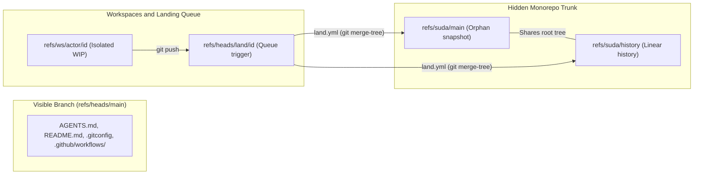
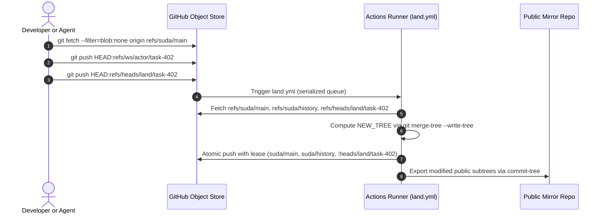

# Monorepo Architecture Specification

The `gosuda/0` repository implements a single-trunk monorepo backed by the GitHub Git object store. It separates the visible control plane (`refs/heads/main`) from the unified source tree (`refs/suda/main`). Callers interact with the repository through standard Git commands and automated GitHub Actions workflows.

## 1. Layered Subsystem Map

The monorepo organizes all source code inside a single root tree at `refs/suda/main`. Every top-level directory belongs to an explicit visibility tier that restricts import directionality.

### 1.1 Reference Namespace Layout

Git references partition control metadata, trunk snapshots, audit history, and active workspaces. Figure 1 illustrates the data flow across these reference namespaces.



### 1.2 Directory Taxonomy and Import Directionality

The root tree of `refs/suda/main` classifies packages by technical domain and visibility tier. Table 1 defines the directory hierarchy, allowed dependencies, and external synchronization rules.

| Directory Path | Visibility Tier | Permitted Imports | Prohibited Imports | External Mirror Policy |
| :--- | :--- | :--- | :--- | :--- |
| `//web/*`, `//net/*`, `//ipc/*`, `//storage/*`, `//crypto/*`, `//ai/*`, `//devtools/*` | Public Production | Public Production, `//third_party/*` | `//corp/*`, `//experimental/*` | Synchronized 1:1 to `github.com/gosuda/<repo>` |
| `//corp/*` | Internal Only | Public Production, `//corp/*`, `//third_party/*` | `//experimental/*` | Never exported outside `gosuda/0` |
| `//third_party/*` | External Vendor | Self-contained or `//third_party/*` | `//corp/*`, `//experimental/*` | Synchronized only for public forks |
| `//experimental/<actor>/*` | Sandbox | Any non-corp package | `//corp/*` | Never exported outside `gosuda/0` |

### 1.3 Pilot Directory Tree

The initial deployment maps seven repositories into the domain hierarchy under `refs/suda/main`. Sibling placement under `//ipc/hqq/` preserves existing `../HQQ` relative module replacements in `go.mod`.

```text
// (root of refs/suda/main)
├── OWNERS
├── go.work
├── web/
│   ├── gosuda/                   # Source: gosuda/website (gosuda.org blog and go-import)
│   └── securl/                   # Source: gosuda/securl (securl.click)
├── net/
│   ├── ivnp/                     # Source: gosuda/IVNP (I2P router and protocol)
│   └── portalite/                # Source: gosuda/portalite
├── ipc/
│   └── hqq/
│       ├── HQQ/                  # Source: gosuda/HQQ (core library and spec)
│       ├── hqq-sqlite3/          # Source: gosuda/hqq-sqlite3 (replaces gosuda.org/hqq with ../HQQ)
│       └── hqq-zstd/             # Source: gosuda/hqq-zstd (replaces gosuda.org/hqq with ../HQQ)
├── storage/
├── crypto/
├── ai/
├── devtools/
├── corp/
├── third_party/
└── experimental/
```

## 2. Invariants and Resource Ownership

The repository enforces four storage and metadata invariants across all commits. The landing workflow (`land.yml`) rejects any push that violates these invariants.

1. **Control-Plane Separation**: `refs/heads/main` stores only documentation, agent rules, Git aliases, and workflow definitions. It never contains project subdirectories (`web/`, `net/`, `ipc/`, `corp/`).
2. **Tree Identity Between Snapshot and History**: Every update to `refs/suda/main` creates a parentless commit and a parent-linked commit on `refs/suda/history`. Both commits reference the exact same root tree SHA-1 hash.
3. **Root-Commit Base Tracking**: Every workspace branch starts from the current `refs/suda/main` orphan commit. Consequently, `git rev-list --max-parents=0 <workspace-sha>` always resolves to the exact base snapshot commit.
4. **Mandatory Vendor Metadata**: Every subdirectory under `//third_party/` contains a `LICENSE` file and a `METADATA` file recording the upstream URL and commit hash.

> [!CAUTION]
> Never store credentials, API keys, or private tokens in `refs/ws/*` or `refs/heads/land/*`. Every user or token with read access to `gosuda/0` can list and fetch all custom references via `git ls-remote`. Rotate any exposed credential immediately; deleting a reference does not purge unreachable objects from GitHub storage.

## 3. Execution and Concurrency Model

The landing pipeline executes on GitHub Actions runners triggered by pushes to `refs/heads/land/<id>`. It serializes concurrent submissions and commits state transitions atomically.

### 3.1 Serialization and Compare-and-Swap Protocol

The `land.yml` workflow sets `concurrency: { group: land-suda-main, cancel-in-progress: false }`. GitHub Actions runs one landing job at a time and queues subsequent pushes in arrival order.

Figure 2 shows the sequence of operations during workspace creation, synchronization, and landing.



### 3.2 In-Memory 3-Way Merge Mechanics

The runner computes the merged root tree in memory using `git merge-tree --write-tree --merge-base=<base-tree> <main-tree> <work-tree>`. It does not check out files into a working directory.

If `refs/suda/main` has not changed since the workspace branched (`MAIN_TREE == BASE_TREE`), the runner reuses `WORK_TREE` directly. Otherwise, `git merge-tree` synthesizes the merged tree objects and writes them to the local object store.

## 4. Operational Procedures

Follow these procedures to initialize a local checkout, synchronize with the trunk, and execute server-side landing.

### 4.1 Workspace Initialization and Sparse Checkout

Create an isolated local workspace containing only the directories required for your task.

1. Clone `gosuda/0` with blob filtering and sparse checkout enabled.
2. Include the repository `.gitconfig` file to load helper aliases.
3. Register the fetch refspec for `refs/suda/*`.
4. Fetch trunk commits and tree objects from `origin`.
5. Set the sparse-checkout paths for your target domain directories.
6. Switch to a new workspace branch rooted at `origin/suda/main`.

```bash
git clone --filter=blob:none --sparse ssh://github-lmmt.com/gosuda/0
cd 0
git config include.path ../.gitconfig
git config --add remote.origin.fetch "+refs/suda/*:refs/remotes/origin/suda/*"
git fetch --filter=blob:none origin
git sparse-checkout set ipc/hqq web/gosuda
git switch -c ws/dalgona/fix-hqq origin/suda/main
```

### 4.2 Workspace Synchronization and Submission

Rebase local workspace commits onto the latest trunk snapshot before submitting to the merge queue.

> [!WARNING]
> Never run `git pull` on a workspace branch. Because `refs/suda/main` is replaced with a new parentless commit on each landing, `git pull` fails with an unrelated-histories error. Use `git rebase --onto` to transplant commits onto the updated snapshot.

1. Stage and commit all modified files in your workspace.
2. Push the workspace branch to `refs/ws/<actor>/<id>` using `--force-with-lease`.
3. Fetch the latest `origin/suda/main` snapshot from `origin`.
4. Locate the root commit of your current branch using `git rev-list --max-parents=0 HEAD`.
5. Rebase your commits onto `origin/suda/main` starting from that root commit.
6. Push `HEAD` to `refs/heads/land/<id>` to enqueue the change for landing.

```bash
git add -A
git commit -m "ipc/hqq: optimize frame header encoding"
git push --force-with-lease origin HEAD:refs/ws/dalgona/fix-hqq

git fetch --filter=blob:none origin
BASE=$(git rev-list --max-parents=0 HEAD)
git rebase --onto origin/suda/main "$BASE" HEAD
git push --force-with-lease origin HEAD:refs/heads/land/fix-hqq
```

### 4.3 Server-Side Landing Procedure (`land.sh`)

The `land.yml` workflow executes `.github/scripts/land.sh` to merge a queued branch into `refs/suda/main`.

> [!CAUTION]
> Always pass `--atomic` and explicit `--force-with-lease` arguments for every target reference during the landing push. Using an unconditional `--force` flag overwrites concurrent updates and causes irreversible commit loss.

1. Fetch `refs/suda/main`, `refs/suda/history`, and the triggering `refs/heads/land/<id>` reference.
2. Resolve the unique root commit of the workspace chain as the merge base.
3. Compute `NEW_TREE` using `git merge-tree --write-tree --merge-base="$BASE_TREE" "$MAIN_TREE" "$WORK_TREE"`.
4. Create the parentless snapshot commit `SNAP` and the parent-linked history commit `HIST`.
5. Push `SNAP`, `HIST`, and the deletion of `refs/heads/land/<id>` in a single atomic transaction.

```bash
#!/usr/bin/env bash
set -euo pipefail
LAND_REF="${1:?usage: land.sh refs/heads/land/<id>}"

git fetch --filter=blob:none origin \
  "+refs/suda/main:refs/remotes/origin/suda/main" \
  "+refs/suda/history:refs/remotes/origin/suda/history" \
  "+${LAND_REF}:${LAND_REF}"

OLD_MAIN=$(git rev-parse refs/remotes/origin/suda/main)
OLD_HIST=$(git rev-parse refs/remotes/origin/suda/history)
WORK_SHA=$(git rev-parse "$LAND_REF")

BASE=$(git rev-list --max-parents=0 "$WORK_SHA")
if [ "$(wc -l <<<"$BASE" | tr -d ' ')" -ne 1 ]; then
  echo "error: workspace has multiple root commits" >&2
  exit 2
fi

BASE_TREE=$(git rev-parse "${BASE}^{tree}")
MAIN_TREE=$(git rev-parse "${OLD_MAIN}^{tree}")
WORK_TREE=$(git rev-parse "${WORK_SHA}^{tree}")

if [ "$MAIN_TREE" = "$BASE_TREE" ]; then
  NEW_TREE="$WORK_TREE"
elif OUT=$(git merge-tree --write-tree --merge-base="$BASE_TREE" "$MAIN_TREE" "$WORK_TREE"); then
  NEW_TREE=$(head -n1 <<<"$OUT")
else
  rc=$?
  echo "$OUT" >&2
  exit "$rc"
fi

MSG=$(git log -1 --format="%B" "$WORK_SHA")
SNAP=$(git commit-tree "$NEW_TREE" -m "$MSG" -m "Suda-Landed-From: ${LAND_REF}")
HIST=$(git commit-tree "$NEW_TREE" -p "$OLD_HIST" -m "$MSG" -m "Suda-Landed-From: ${LAND_REF}")

git push --atomic origin \
  --force-with-lease="refs/suda/main:${OLD_MAIN}" \
  --force-with-lease="refs/suda/history:${OLD_HIST}" \
  --force-with-lease="${LAND_REF}:${WORK_SHA}" \
  "${SNAP}:refs/suda/main" \
  "${HIST}:refs/suda/history" \
  ":${LAND_REF}"
```

## 5. Fault Isolation and Exit Codes

Table 2 maps exit codes and error outputs from `land.sh` and Git plumbing commands to root causes and recovery actions.

| Exit Code / Symptom | Root Cause | Recovery Action |
| ---: | :--- | :--- |
| `0` | Merge and atomic push succeeded. | None required; `refs/heads/land/<id>` is deleted automatically. |
| `1` (`CONFLICT` in `merge-tree` output) | Concurrent change modified overlapping lines in `refs/suda/main`. | Run `git ws-sync` locally, resolve conflict markers, commit, and push to `refs/heads/land/<id>` again. |
| `2` (`multiple root commits` or usage error) | Workspace branch contains a merge commit from an unrelated history. | Recreate the workspace branch from `origin/suda/main` and cherry-pick the task commits. |
| `128` (`stale info` / `atomic push failed`) | Another landing job updated `refs/suda/main` or the caller pushed to `LAND_REF` mid-flight. | Re-run the landing job; the compare-and-swap guard left all remote refs unchanged. |
