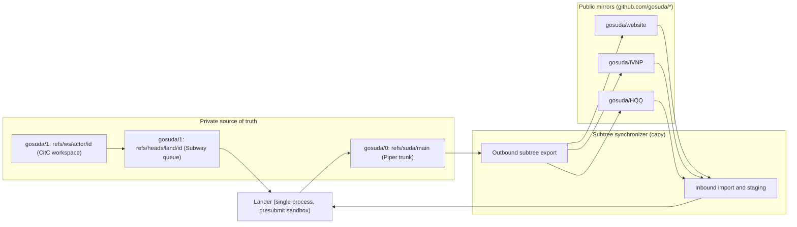

# Organization Audit, `google3` Parity, and Starlark Subtree Synchronization

This document records the repository inventory for the `gosuda` GitHub organization, maps `google3` infrastructure subsystems to their `gosuda/0` equivalents, and specifies the `capy` subtree synchronization engine that the lander runs.

## 1. Organization Repository Audit

A query of the `gosuda` GitHub organization via `gh repo list` returned 125 repositories totaling 2,044,066 KB (1,996 MB). Table 1 summarizes the inventory distribution and its structural consequences for `gosuda/0`.

| Audit Dimension | Measured Value | Architectural Consequence |
| :--- | :--- | :--- |
| Visibility distribution | 105 public repositories; 20 private repositories | Git lacks per-directory read access controls. Because `gosuda/0` stores private `//corp/*` services alongside public packages, `gosuda/0` remains private and exports public subtrees to standalone repositories. `gosuda/1` is private for the same reason. |
| Language distribution | 65 Go (1,547 MB), 14 Rust (193 MB), 9 TypeScript (7 MB), 8 Python (43 MB), 29 other | Build and lint scripts must support Go, Rust, TypeScript, and Python toolchains. |
| Storage concentration | Top 5 repositories consume 1,155 MB (57%); median repository size is under 1 MB | `loGos` (432 MB Go compiler fork) belongs in `//third_party/loGos` as a shallow vendor snapshot. Stripping historical binary revisions reduces the remaining 120 repositories below 250 MB uncompressed. |
| Existing organization tools | `ruk` (Rust VCS), `rukie` (Go forge), `dalgona` (Rust agent), `sloplint` (23-language linter), `cohotfs` (Go container workspace) | `dalgona` and `sloplint` already parse Starlark, enabling a shared configuration grammar across the monorepo. |

## 2. `google3` Subsystem Parity

Combining the private `gosuda/0` repository, the user repository `gosuda/1`, and automated subtree synchronization reproduces the core `google3` workflow using GitHub storage. Figure 1 illustrates the data flow between the repositories and the lander.



Table 2 compares each `google3` subsystem against its implementation in `gosuda/0`.

| `google3` Subsystem | `gosuda/0` Implementation | Operational Difference |
| :--- | :--- | :--- |
| Piper (central trunk and CAS) | GitHub object store, `refs/suda/main`, and `refs/suda/history` on `gosuda/0`, with copies on `gosuda/1` as a push base | GitHub enforces a 100 MB per-file ceiling and recommends pack sizes below 5 GB. |
| CitC (cloud workspaces) | `git clone --filter=blob:none --sparse` and `refs/ws/<actor>/<id>` on `gosuda/1` | Uses Git sparse checkout and on-demand blob fetching instead of a FUSE virtual filesystem. |
| Critique and `OWNERS` | Directory `OWNERS` files, read from the trunk, checked by the lander against GitHub-authenticated approvals | Reviews run on `refs/heads/review/*` pull requests in `gosuda/1`, or on mirror pull requests. Approval counts only for the landed tip. |
| TAP and Subway (merge queue) | One lander process drains requests in push order. Each request runs the merge, checks, and presubmit, then publishes in one atomic push with leases. | Serialization is a property of the single process, not of CI concurrency groups. |
| Copybara (repository synchronization) | `capy` (Starlark evaluator paired with Git tree plumbing) and the lander's reconciler | Mutates Git trees in memory without checking files out to disk. Mirror changes land through the same checks as member changes. |
| Rosie (large-scale changes) | Coding agents creating directory-sharded `refs/ws/lsc-<id>/*` branches | Agents generate and verify cross-package edits directly. |

## 3. Two-Tier CI Execution Model

The monorepo divides verification between the lander and the public mirror repositories.

1. **Tier 1 (Lander and presubmit)**: The lander runs the import checks, `OWNERS` checks, and the affected projects' tests in a sandbox on the lander server before it publishes a trunk change. `gosuda/0` has no GitHub Actions workflows, so landing consumes no GitHub Actions runner minutes on the private repositories. Presubmit is specified in [tooling.md](./tooling.md) §3.
2. **Tier 2 (Project CI in public mirrors)**: Every project keeps its own `.github/workflows/*.yml` files inside its domain directory (for example, `//ipc/hqq/HQQ/.github/workflows/ci.yml`). GitHub Actions ignores workflow files stored in subdirectories of `gosuda/0`. When the lander exports `//ipc/hqq/HQQ` to the root of `github.com/gosuda/HQQ`, those workflow files land at `/.github/workflows/` in the public repository and run on public runners after the export.

## 4. Starlark Subtree Synchronizer (`capy`)

The `capy` module synchronizes subtrees between `refs/suda/main` in `gosuda/0` and standalone repositories on GitHub. It embeds the `go.starlark.net/starlark` interpreter and manipulates Git tree objects directly through a temporary index, so no working tree is created.

### 4.1 Zero-Checkout Subtree Export and Import

A Git `tree` object stores only relative entry names and child hashes. Consequently, any subtree hash inside `refs/suda/main` is already a valid root tree for a standalone repository.

- **Export**: `capy` computes the export tree of the workflow prefix from the trunk tree. Exclusions are removed, content transforms rewrite the affected blobs in memory, and the tree is written through a temporary index. The lander then creates a commit on top of the mirror's current tip with `git commit-tree`, appends the `GitOrigin-RevId` trailer, and pushes with a lease on that tip. An unmodified subtree involves no blob rewrites.
- **Inbound import**: `capy` builds the monorepo tree that corresponds to a mirror tree. It replaces the prefix with the mirror content and keeps every export-excluded path from the baseline. The lander then merges that tree with the trunk in memory, as [architecture.md](./architecture.md) §4.3 specifies.
- **Inbound pull request import**: The lander builds the same tree from each open mirror pull request and publishes it as `refs/ws/capy/<wf>-pr-<N>` on `gosuda/1`.

### 4.2 Starlark Configuration Grammar (`capy.star`)

The root `capy.star` file on `refs/heads/main` declares the bidirectional mapping for every exported project. Each entry is a tuple of `(name, monorepo prefix, mirror repository, strip_replaces)`, with an optional fifth element that names the mirror branch. The branch defaults to `main`. The lander reads this file on every cycle.

```python
load("//.github/scripts/capy/defs.star", "capy", "core", "gomod", "metadata")

PILOT_REPOS = [
    ("website", "web/gosuda", "gosuda/website", False),
    ("portalite", "net/portalite", "gosuda/portalite", False, "master"),
]

# Entries are (name, monorepo prefix, mirror repo, strip_replaces[, branch]); branch defaults to "main".
for entry in PILOT_REPOS:
    name, prefix, repo, strip_replaces = entry[0], entry[1], entry[2], entry[3]
    branch = entry[4] if len(entry) > 4 else "main"
    transforms = [
        core.exclude(["internal_notes/**", "**.local.toml"]),
        metadata.expose_label("GitOrigin-RevId"),
    ]
    if strip_replaces:
        transforms.append(gomod.strip_local_replaces())
    capy.workflow(
        name = name,
        origin = capy.monorepo_path(prefix),
        destination = capy.github_repo(repo, branch = branch),
        mode = "SQUASH",
        transformations = transforms,
    )
```

Set `strip_replaces` to `True` only for a workflow that exports a Go module with local `replace` directives. Such a workflow is export-only (Section 4.4 of this document and [architecture.md](./architecture.md) §4.5).

### 4.3 Starlark Built-in Modules

Table 3 defines the Starlark modules exposed by the `capy` interpreter.

| Module | Exported Functions | Behavior |
| :--- | :--- | :--- |
| `capy` | `workflow(name, origin, destination, mode?, transformations?)`, `monorepo_path(prefix)`, `github_repo(repo, branch?)` | Registers a mapping between a `refs/suda/main` subtree prefix and a branch of an external GitHub repository. `branch` defaults to `main`. |
| `core` | `exclude(paths)`, `replace(before, after, paths?)` | `exclude` keeps matching paths out of the export and preserves them on import. `replace` rewrites matching content in memory. |
| `gomod` | `strip_local_replaces()` | Removes monorepo-relative `replace` directives from `go.mod` when exporting a standalone module. |
| `cargo` | `standalone_workspace()` | Synthesizes a standalone `[workspace]` table in `Cargo.toml` during Rust crate export. |
| `metadata` | `expose_label(label)`, `scrubber(pattern)` | `expose_label` appends a `<label>: <refs/suda/history commit>` trailer to exported messages. `scrubber` removes text matching the regular expression from exported messages. |

### 4.4 Invertibility

A workflow is invertible when its inbound changes can be mapped back into the monorepo without loss. `core.exclude` keeps the workflow invertible. `core.replace`, `gomod.strip_local_replaces`, and `cargo.standalone_workspace` rewrite content, so a workflow that uses any of them is export-only. The lander stages its inbound changes and never lands them automatically. No workflow in `capy.star` uses a content transform today.
