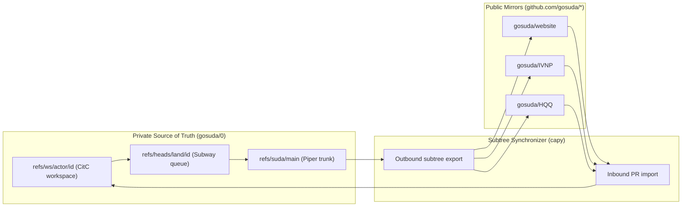

# Organization Audit, `google3` Parity, and Starlark Subtree Synchronization

This document records the repository inventory for the `gosuda` GitHub organization, maps `google3` infrastructure subsystems to `gosuda/0` equivalents, and specifies the `capy` subtree synchronization engine.

## 1. Organization Repository Audit

A query of the `gosuda` GitHub organization via `gh repo list` returned 125 repositories totaling 2,044,066 KB (1,996 MB). Table 1 summarizes the inventory distribution and its structural consequences for `gosuda/0`.

| Audit Dimension | Measured Value | Architectural Consequence |
| :--- | :--- | :--- |
| Visibility distribution | 105 public repositories; 20 private repositories | Git lacks per-directory read access controls. Because `gosuda/0` stores private `//corp/*` services alongside public packages, `gosuda/0` remains private and exports public subtrees to standalone repositories. |
| Language distribution | 65 Go (1,547 MB), 14 Rust (193 MB), 9 TypeScript (7 MB), 8 Python (43 MB), 29 other | Build and lint scripts must support Go, Rust, TypeScript, and Python toolchains. |
| Storage concentration | Top 5 repositories consume 1,155 MB (57%); median repository size is under 1 MB | `loGos` (432 MB Go compiler fork) belongs in `//third_party/loGos` as a shallow vendor snapshot. Stripping historical binary revisions reduces the remaining 120 repositories below 250 MB uncompressed. |
| Existing organization tools | `ruk` (Rust VCS), `rukie` (Go forge), `dalgona` (Rust agent), `sloplint` (23-language linter), `cohotfs` (Go container workspace) | `dalgona` and `sloplint` already parse Starlark, enabling a shared configuration grammar across the monorepo. |

## 2. `google3` Subsystem Parity

Combining the private `gosuda/0` repository with automated subtree synchronization reproduces the core `google3` workflow using free GitHub storage and runners. Figure 1 illustrates the bidirectional data flow between `gosuda/0` and the standalone public repositories.



Table 2 compares each `google3` subsystem against its implementation in `gosuda/0`.

| `google3` Subsystem | `gosuda/0` Implementation | Operational Difference |
| :--- | :--- | :--- |
| Piper (central trunk and CAS) | GitHub object store, `refs/suda/main`, and `refs/suda/history` | GitHub enforces a 100 MB per-file ceiling and recommends pack sizes below 5 GB. |
| CitC (cloud workspaces) | `git clone --filter=blob:none --sparse` and `refs/ws/<actor>/<id>` | Uses Git sparse checkout and on-demand blob fetching instead of a FUSE virtual filesystem. |
| Critique and `OWNERS` | Directory `OWNERS` files verified by `land.yml` | Reviews run either on `refs/ws/*` diffs or on mirrored pull requests. |
| TAP and Subway (merge queue) | `land.yml` running `git merge-tree --write-tree` and atomic leased pushes | Serializes landings per repository via GitHub Actions concurrency groups. |
| Copybara (repo synchronization) | `capy` (Starlark evaluator paired with Git tree plumbing) | Mutates Git trees in memory without checking files out to disk. |
| Rosie (large-scale changes) | Coding agents creating directory-sharded `refs/ws/lsc-<id>/*` branches | Agents generate and verify cross-package edits directly. |

## 3. Two-Tier CI Execution Model

The monorepo divides continuous integration between `gosuda/0` and the standalone public mirror repositories. This split preserves existing project workflows and keeps GitHub Actions execution free.

1. **Tier 1 (Monorepo Control Plane)**: The root `/.github/workflows/` directory on `refs/heads/main` runs only `land.yml` and `ws-gc.yml`. It validates import boundaries, merges trees in memory, exports subtrees, and prunes stale workspaces within 15 seconds.
2. **Tier 2 (Project CI in Standalone Public Mirrors)**: Every project retains its own `.github/workflows/*.yml` files inside its domain directory (for example, `//ipc/hqq/HQQ/.github/workflows/ci.yml`). GitHub Actions ignores workflow files stored in subdirectories of `gosuda/0`. When `capy` exports `//ipc/hqq/HQQ` to the root of `github.com/gosuda/HQQ`, those workflow files land at `/.github/workflows/` in the public repository and execute on free public runners.

## 4. Starlark Subtree Synchronizer (`capy`)

The `capy` tool synchronizes subtrees between `refs/suda/main` in `gosuda/0` and standalone repositories on GitHub. It embeds the `go.starlark.net/starlark` interpreter and manipulates Git tree objects directly.

### 4.1 Zero-Checkout Subtree Export and Import

A Git `tree` object stores only relative entry names and child hashes. Consequently, any subtree hash inside `refs/suda/main` is already a valid root tree for a standalone repository.

- **Unmodified Subtree Export**: When a project requires no file transformations, `capy` resolves `SUBTREE=$(git rev-parse "${NEW_TREE}:${prefix}")`. It then creates a commit on the target repository with `git commit-tree "$SUBTREE" -p "$EXT_MAIN"` and appends the `GitOrigin-RevId` trailer. Zero blobs are rewritten.
- **Transformed Subtree Export**: When `capy.star` declares exclusions or replacements, `capy` loads `git ls-tree -r -z "$SUBTREE"` into memory. It writes only the modified blobs via `git hash-object -w --stdin`, rebuilds the tree via `git mktree`, and pushes with `--force-with-lease`.
- **Inbound Pull Request Import**: When a contributor opens pull request `N` on `github.com/gosuda/<repo>`, `capy` reads the `GitOrigin-RevId` trailer from the base commit. It splices the pull request tree into that `refs/suda/main` snapshot at `<prefix>` using `git read-tree --prefix` and pushes to `refs/ws/capy/<repo>-pr-<N>`.

### 4.2 Starlark Configuration Grammar (`capy.star`)

The root `capy.star` file on `refs/heads/main` declares the bidirectional mapping for every exported project.

```python
load("//.github/scripts/capy/defs.star", "capy", "core", "gomod", "metadata")

PILOT_REPOS = {
    "web/gosuda": "gosuda/website",
    "net/ivnp": "gosuda/IVNP",
    "ipc/hqq/HQQ": "gosuda/HQQ",
    "ipc/hqq/hqq-sqlite3": "gosuda/hqq-sqlite3",
    "ipc/hqq/hqq-zstd": "gosuda/hqq-zstd",
    "web/securl": "gosuda/securl",
    "net/portalite": "gosuda/portalite",
}

for prefix, repo in PILOT_REPOS.items():
    capy.workflow(
        name = repo.split("/")[1],
        origin = capy.monorepo_path(prefix),
        destination = capy.github_repo(repo, branch = "main"),
        mode = "SQUASH",
        transformations = [
            core.exclude(["internal_notes/**", "**.local.toml"]),
            metadata.expose_label("GitOrigin-RevId"),
        ],
    )
```

### 4.3 Starlark Built-in Modules

Table 3 defines the Starlark modules exposed by the `capy` interpreter.

| Module | Exported Functions | Behavior |
| :--- | :--- | :--- |
| `capy` | `workflow`, `monorepo_path`, `github_repo` | Registers a mapping between a `refs/suda/main` subtree prefix and an external GitHub repository branch. |
| `core` | `move`, `exclude`, `replace`, `transform` | Filters tree entries or rewrites matched blob contents in memory before calling `git mktree`. |
| `gomod` | `strip_local_replaces` | Removes monorepo-relative `replace` directives from `go.mod` when exporting a standalone module. |
| `cargo` | `standalone_workspace` | Synthesizes a standalone `[workspace]` table in `Cargo.toml` during Rust crate export. |
| `metadata` | `expose_label`, `scrubber` | Appends `GitOrigin-RevId` trailers and strips internal lines from exported commit messages. |
