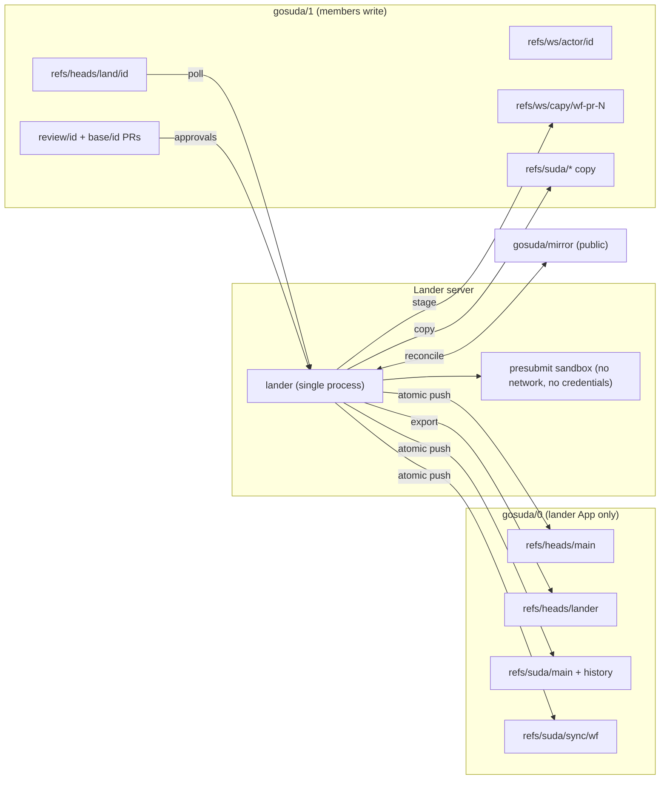

# Trunk Hardening and Lander Migration Plan

This document consolidates the 2026-10-30 architecture review of `gosuda/0` into a single execution plan. It defines the target two-repository topology (`gosuda/0` as the system of record, `gosuda/1` as the user repository), the self-hosted lander that replaces `land.sh` and `sync-inbound.sh`, and a phased migration with exit criteria.

> [!NOTE]
> Status: **Implemented**; see [Section 15](#15-implementation-status) for what was verified and the operator steps that remain.

## 1. Decisions

Table 1 lists the decisions this plan builds on. Each later section cites the decision it implements.

| ID | Decision | Rationale |
| :--- | :--- | :--- |
| D1 | Split repositories. `gosuda/0` holds the control plane and trunk, and only the lander GitHub App writes to it. `gosuda/1` holds workspaces, landing requests, and review pull requests, and org members write to it. | The `gosuda` organization is on GitHub Free and `gosuda/0` is private, so branch protection and rulesets are unavailable (`GET /repos/gosuda/0/rulesets` and `.../branches/main/protection` return HTTP 403). Rulesets also cannot target `refs/suda/*` (ruleset targets are `branch`, `tag`, `push`, `repository`). Repository permissions are the only enforcement available. |
| D2 | The lander runs as a single Docker image on a dedicated server, built from `refs/heads/lander` of `gosuda/0`. | Removes public Actions logs, GitHub Actions concurrency-group semantics, and the org-wide App token from the public product mirror `gosuda/azure-magpie`. |
| D3 | The lander source of truth is `.github/scripts/lander` (with `.github/scripts/capy`) on the control plane. The lander publishes a deployable tree (`Dockerfile`, `lander/`, `capy/`) to `refs/heads/lander`. | Lander changes pass the same `OWNERS` and landing path as all other control-plane code, and `capy` ships in the same image without a cross-module dependency on the trunk. Rollback is a previous image tag on the server. |
| D4 | Authorization uses only GitHub-authenticated identities: the pusher reported by the repository activity API and pull request reviews. Commit author, committer, and trailers are informational. | Commit metadata is self-asserted (finding F2). |
| D5 | All asynchronous work is level-triggered. Events and polls only wake the lander; the lander computes work by comparing refs and trees. | Lost, cancelled, or duplicated triggers become harmless (findings F7, F8). |
| D6 | Repository code never executes in a process that holds credentials. | `land.sh` already satisfies this property; presubmit must not break it. |
| D7 | The monorepo is the source of truth for mirror `.github/workflows/`, as `AGENTS.md` §2.2 states. The export token carries `workflows: write` scoped to mirrors. | Today `land.sh` preserves existing mirror workflows, so monorepo edits never reach the mirror and inbound syncs overwrite the monorepo copy. |

Non-goals: a hermetic build system, batched merge queues, and a highly available multi-instance lander.

## 2. Current-State Findings

Table 2 ranks the findings that motivate this plan. Section 11 maps each finding to the phase that resolves it.

| ID | Severity | Finding | Evidence |
| :--- | :--- | :--- | :--- |
| F1 | Critical | Any GitHub user can land code into the trunk and the public mirrors: open a PR on a public mirror, wait for the worker to stage `refs/ws/capy/<wf>-pull-<N>-head`, then call unauthenticated `GET /api/land?ref=refs/ws/capy/...`. | `worker.ts` `handleGithubWebhook` dispatches staging for every opened or synchronized PR; `handleApiLand` promotes any `ws/*` ref. A probe with a nonexistent ref reached the GitHub lookup stage without an auth challenge. The full chain was not executed. |
| F2 | Critical | `OWNERS` approval is forgeable. Author name tokens, the email local part, and `Reviewed-by:` trailers count as actors. A new directory can carry its own `set noparent` `OWNERS` and self-approve because `readOwners` falls back to the new tree. Any actor can edit any `experimental/` sandbox. The `*` and `gosuda/core` entries accept any actor. Root `OWNERS` is `*`. | All five bypasses reproduced with `capy check-owners` against a synthetic tree. |
| F3 | Critical | All 54 org members can push to `gosuda/0` (org base permission `write`). `refs/suda/*` cannot be protected. Six Apps hold `contents: write` on all org repositories: `claude`, `chatgpt-codex-connector`, `devin-ai-integration`, `gormes-agent`, `cloudflare-workers-and-pages`, `azure-winged-magpie`. | `GET /orgs/gosuda`, `GET /repos/gosuda/0/collaborators`, `GET /orgs/gosuda/installations`. |
| F4 | Critical | Inbound sync replaces the project prefix wholesale (`SpliceSubtree`). It reverts monorepo changes that never reached the mirror and deletes export-excluded files (`internal_notes/**`, `**.local.toml`). | Reproduced: after a landing set `a=2` and the mirror kept `a=1` plus a new file, inbound produced `a=1` and dropped `internal_notes/`. |
| F5 | Critical | Export commits the monorepo tree on top of the mirror tip. That reverts mirror commits not yet imported, and the next inbound run skips because the tip carries `GitOrigin-RevId == SUDA_MAIN`. External changes are lost on both sides. | `land.sh` export loop; `sync-inbound.sh` skip condition. |
| F6 | High | The landing pipeline runs in the public product mirror `gosuda/azure-magpie`. Its App token has no `repositories:` restriction. The mirror's existing workflows win over the monorepo copy. Public logs print merge conflicts, violating file paths, and source lines. | `suda-sync.yml`; the workflow-preservation block in `land.sh`. |
| F7 | High | The concurrency group keeps one running and one pending run, and a newer pending run cancels the older one. Inbound PR staging shares the group. `git ws-land` dispatches twice (land ref push webhook plus `curl /api/land`). | `suda-sync.yml` has no `queue:` key; GitHub concurrency documentation. |
| F8 | High | Export fails after the trunk commit, and nothing reconciles. Two of the last seven runs failed this way: 40914618336 (`upload-pack: not our ref` while prefetching mirror-side blobs from `gosuda/0`) and 40979110632 (missing blob during the mirror push). A failure aborts the remaining mirrors, and later landings export only their own prefixes. | `gh run list --repo gosuda/azure-magpie`. |
| F9 | High | `gosuda/portalite` has only a `master` branch, while `capy.star` declares `main`. Any landing that touches `//net/portalite` fails at export, and the worker ignores portalite pushes. | `git ls-remote https://github.com/gosuda/portalite`. |
| F10 | Medium | No presubmit tests run before landing. | `land.sh` runs only static checks. |
| F11 | Medium | The visibility check matches lines with a regular expression. It misses vanity module paths (every mounted module uses one, such as `gosuda.org/hqq`) and flags comments. | `forbiddenPublicImportRe` in `capy.go`. |
| F12 | Medium | `GitOrigin-RevId` records the parentless snapshot commit, which becomes unreachable after the next landing. | `land.sh` passes `-source-rev "$SNAP"`. |
| F13 | Medium | Echo suppression checks whether the head commit message contains `GitOrigin-RevId:`. An external commit containing that string is never imported. | `worker.ts`. |
| F14 | Medium | Some writers bypass the landing pipeline: `create-repo.sh`, `import-repo.sh`, `sync-control-plane.sh`, and local `land.sh` runs. The activity API shows a land ref created and deleted by a personal account seven seconds apart, with no matching Actions run. | `GET /repos/gosuda/0/activity`. |
| F15 | Low | `go.work` omits `./net/grt`. `sync-inbound.sh` pushes with `--force`. Workspace GC has not been scheduled since commit 2d2c814 and never covered `land/`, `base/`, or `review/` refs. `/api/refs` exposes private ref names. Several docs describe the removed `land.yml`, `ws-gc.yml`, and `sync-inbound.yml`. | Repository contents. |

Measured baseline, 2026-10-30: successful landing runs took 25–38 s. Exported trees for all nine mirrors matched the mirror tips with zero differing paths (portalite compared against `master`). GitHub reports `gosuda/0` at 21,864 KB.

## 3. Target Topology

### 3.1 Repositories and Write Authority

Table 3 assigns write authority per repository (D1).

| Repository | Visibility | Content | Writers | Readers |
| :--- | :--- | :--- | :--- | :--- |
| `gosuda/0` | Private | System of record: control plane, lander branch, trunk, sync baselines | `suda-lander` App; the two org owners for break-glass only | Org members |
| `gosuda/1` | Private | User repository: workspaces, landing requests, review PRs, staged external PRs, trunk object copy | Org members (team `suda-contributors`); `suda-lander` App | Org members |
| `gosuda/<mirror>` | Public | Standalone exports listed in `capy.star` | `suda-lander` App (export); mirror maintainers (merging external PRs) | Public |

Figure 1 shows the data flow between the repositories and the lander.



### 3.2 Reference Layout

Table 4 defines the references in `gosuda/0`. Only the lander writes them, except for documented break-glass pushes by org owners.

| Reference | Content |
| :--- | :--- |
| `refs/heads/main` | Control plane (`AGENTS.md`, `README.md`, `.gitconfig`, `capy.star`, `.agents/`, `.github/`, `docs/`) |
| `refs/heads/lander` | Dockerfile, `lander/`, and `capy/` published by the lander from `.github/scripts/{lander,capy}` |
| `refs/suda/main` | Parentless trunk snapshot |
| `refs/suda/history` | Linear history sharing root trees with `refs/suda/main` |
| `refs/suda/sync/<wf>` | Sync baseline per mirror workflow (Section 6.1) |

Table 5 defines the references in `gosuda/1`.

| Reference | Writer | Content | Trust |
| :--- | :--- | :--- | :--- |
| `refs/heads/main` | Lander | README stub pointing to `gosuda/0` (keeps a member branch from becoming the default branch) | None |
| `refs/suda/main`, `refs/suda/history` | Lander | Byte-identical copies of the `gosuda/0` trunk refs | None. They exist only as a push negotiation base. |
| `refs/ws/<actor>/<id>` | Members | Work in progress | None |
| `refs/heads/land/<id>` | Members | Landing request | Requester resolved through the activity API |
| `refs/heads/base/<id>`, `refs/heads/review/<id>` | Members (`git ws-pr`) | Review pull request pair | Approvals resolved through the reviews API |
| `refs/ws/capy/<wf>-pr-<N>`, `refs/ws/capy/<wf>-main` | Lander | Staged external changes (Section 6.3) | None. Landing requires a member landing request. |

`gosuda/1` needs the trunk copy because `receive-pack` advertises `refs/suda/*` (verified with a `GIT_TRACE_PACKET` dry-run push against `gosuda/0`). Pushes from `--filter=blob:none` clones therefore send only workspace deltas. Without an advertised base, `pack-objects` needs blobs the client never fetched.

### 3.3 Client Configuration

Clients use two remotes:

- `origin` points to `gosuda/0` and is fetch-only.
- `ws` points to `gosuda/1` and receives every push.

> [!CAUTION]
> Never fetch the control plane or the trunk from `gosuda/1`. Every member can rewrite refs there, and `.gitconfig` aliases prefixed with `!` execute shell commands on the client.

Table 6 lists the alias changes.

| Alias | Change |
| :--- | :--- |
| `suda-init` | Adds the `ws` remote (`gosuda/1`) and sets `remote.origin.pushurl` to an invalid URL. |
| `ws-new`, `ws-sync`, `ws-exp`, `suda-log` | Unchanged; they fetch from `origin`. |
| `ws-save` | Pushes to `ws`. |
| `ws-land` | Pushes `HEAD` to `ws` `refs/heads/land/<id>`; the `curl` call is removed. |
| `ws-pr` | Pushes the `base/` and `review/` branches to `ws` and opens the PR on `gosuda/1`. |
| `suda-sync-ctrl`, `suda-sync-in` | Removed; the lander owns both functions. |

## 4. Lander

### 4.1 Process Model

The lander is one process in one container and the only writer to `gosuda/0`. Its main loop runs these stages in order and repeats:

```text
loop:
  drain landing requests          # Section 4.3
  copy trunk refs to gosuda/1     # Table 5
  reconcile every mirror workflow # Section 6.2
  stage external PRs              # Section 6.3
  daily: garbage collection       # Section 9
  sleep until next poll or wake
```

- **Wake sources (D5)**:
  - One cycle every `LANDER_INTERVAL` (default 1 minute) polls trunk refs and landing requests. Mirrors (tips and open pull requests) are reconciled at most every `LANDER_MIRROR_INTERVAL` (default 5 minutes), or on the next cycle after a landing advanced the trunk.
  - An optional HMAC-verified `/wake` request (sent by the magpie webhook) shortens the wait. Its payload is never read as input.
- **State**: All durable state lives in refs and commit statuses. A restart resumes without recovery steps. Running a second instance is prohibited; leases make it harmless but wasteful.
- **Object cache**: A full clone of `gosuda/0` (21,864 KB) without a blob filter. `gosuda/1` and the mirrors are fetched into separate namespaces of the same store. This removes the partial-clone failure class behind F8.
- **Credentials**:
  - The App private key is a mounted file that child processes never see.
  - Installation tokens are minted per operation, narrowed with the `repositories` and `permissions` fields of `POST /app/installations/{id}/access_tokens`.
  - Tokens never enter the presubmit sandbox.
- **Signing**: The lander signs `refs/suda/history` and `refs/suda/main` commits with an SSH signing key stored only on the server.

### 4.2 GitHub App

A new App, `suda-lander`, replaces `azure-winged-magpie` for every write path. It is installed on selected repositories only: `gosuda/0`, `gosuda/1`, and the mirrors listed in `capy.star`. Table 7 lists its permissions.

| Permission | Repositories | Purpose |
| :--- | :--- | :--- |
| `contents: write` | `gosuda/0`, `gosuda/1`, mirrors | Ref updates |
| `workflows: write` | Mirrors | Exporting `.github/workflows/` (D7) |
| `pull_requests: read` | `gosuda/1`, mirrors | Review approvals; external PR staging |
| `statuses: write` | `gosuda/1` | `suda/land` and `suda/presubmit` statuses |
| `members: read` | Organization | Resolving `@gosuda/<team>` entries in `OWNERS` |

### 4.3 Landing Request Lifecycle

Each landing request is one `refs/heads/land/<id>` in `gosuda/1`. The lander processes requests in the order of the activity-API timestamp of the push that set each tip.

1. **Identity**: Resolve the requester and approvers (Section 5.1). If the activity entry for the tip is not visible yet, defer the request to the next cycle.
2. **Base provenance**: The tree of the request's root commit must equal the tree of one of the last 500 `refs/suda/history` commits. Otherwise reject with "unknown base; run `git ws-sync`". This makes a poisoned trunk copy in `gosuda/1` irrelevant.
3. **Merge**: `git merge-tree --write-tree --merge-base=<base tree> <trunk tree> <request tree>`. On conflict, reject and list the conflicting paths.
4. **Policy**: Run `OWNERS` (Section 5.2) and visibility (Section 8). Changes under control-plane paths follow Section 4.4.
5. **Presubmit**: Test the affected projects in the sandbox (Section 7).
6. **Commit**: Build the snapshot and history commits, plus a `refs/heads/main` commit and sync-ref updates when they apply. Push everything to `gosuda/0` in one `--atomic` push with a lease on every ref. Because the lander is the only writer, the trunk cannot move between steps 3 and 6. A lease failure therefore means a break-glass push: refetch and retry up to three times, then halt the queue and alert.
7. **Post-commit**: Each action is idempotent and repeated by later cycles until it succeeds:
   - Delete the land ref with a lease on its tip.
   - Delete `base/<id>` and `review/<id>`, and close the review PR with a link to the history commit.
   - Copy the trunk refs to `gosuda/1`.
   - Set `suda/land=success` on the tip.
   - Reconcile the affected mirrors.
   - Publish `refs/heads/lander` when `.github/scripts/{lander,capy}` changed.
8. **Rejection**: Set `suda/land=failure` on the tip with the reason, then delete the land ref with a lease. The workspace ref stays untouched. Rejections never block the queue.

Review pull requests in `gosuda/1` are for discussion and approval only. Landing always goes through `git ws-land`. An approval counts only when its `commit_id` equals the landed tip.

### 4.4 Control-Plane Changes

The trunk snapshot keeps the overlay invariant: every top-level entry of `refs/heads/main` appears unchanged in `refs/suda/main`. The lander now accepts edits in both directions:

- A landing request that edits overlay paths is a control-plane change. After `OWNERS` approval, the lander applies those edits to `refs/heads/main` as a regular commit (parent: the previous `main`) inside the same atomic push.
- `create-repo` and `import-repo` become client-side helpers. They build one workspace commit containing the project subtree, the `capy.star` entry, and the `docs/README.md` explorer row, then push a landing request. Creating the public GitHub mirror repository stays a manual org-owner action; until it exists, reconcile reports `destination missing`.
- `sync-control-plane.sh` is removed. If an org owner pushes `refs/heads/main` directly (break-glass), the next cycle lands an overlay-sync commit carrying `Suda-Break-Glass: <main sha>`.

### 4.5 Deployment

The lander deploys itself from its own source:

- `.github/scripts/lander` is a Go module that requires `.github/scripts/capy` through `replace ../capy`. The same relative layout holds on `refs/heads/lander` (`lander/`, `capy/`), so the module builds in both places.
- The lander publishes `refs/heads/lander` itself (`PublishLanderBranch`): `Dockerfile` and `.dockerignore` at the branch root, everything else under `lander/` and `capy/`.
- `lander/deploy/deploy.sh` runs on the server. It polls `refs/heads/lander`, builds an image tagged with the commit SHA, runs `lander check` as a health check, and rolls back when the new container does not stay up for 20 s. It keeps the last three images.
- The presubmit sandbox must run on a Docker daemon that is separate from the lander's host (`DOCKER_HOST` to a dedicated sandbox daemon). Mounting the host socket into the lander container would hand it host root.
- Rollback runs a previous image tag and needs no GitHub write access. If a broken release cannot land its own fix, an org owner pushes a previous commit to `refs/heads/lander`.
- The lander reads configuration (`capy.star`) from `refs/heads/main` on every cycle. Configuration changes need no redeploy.

## 5. Identity and `OWNERS`

### 5.1 Actor Resolution

Table 8 defines where each actor comes from (D4).

| Source | Actor | API |
| :--- | :--- | :--- |
| Landing request | Pusher of the land ref tip | `GET /repos/gosuda/1/activity?ref=refs/heads/land/<id>`, taking the entry whose `after` equals the tip. The response shape (`actor.login`, `after`, `activity_type`) was verified on `gosuda/0`. |
| Approvals | Reviewers whose review state is `APPROVED` and whose `commit_id` equals the tip | `GET /repos/gosuda/1/pulls?head=gosuda:review/<id>`, then `GET .../pulls/{n}/reviews` |
| Mirror inbound | Pusher of the mirror branch tip (the merger) | `GET /repos/<mirror>/activity?ref=refs/heads/<branch>` |

The history commit message keeps commit author, committer, and trailers as information. They never authorize anything.

### 5.2 Rule Changes in `capy check-owners`

1. `OWNERS` files are read only from the base trunk tree. A new `OWNERS` file takes effect after it lands, and a new directory inherits from its nearest existing ancestor.
2. The `*` entry and the literal `gosuda/core` shortcut are removed. A `@gosuda/<team>` entry resolves through `GET /orgs/gosuda/teams/<team>/memberships/<login>` (state `active`).
3. A path under `experimental/<actor>/` is approved only when the requester login equals `<actor>` or the `OWNERS` chain approves.
4. A path is approved when the requester or any approver belongs to its owner set.
5. A new directive, `set require-review`, requires an approver other than the requester. It applies to the control plane under `.github/` (`.github/OWNERS`).
6. Root `OWNERS` lists named owners instead of `*`.
7. A mirror inbound change lands automatically only when the mirror pusher owns the prefix. Otherwise the lander stages it as `refs/ws/capy/<wf>-main` for a member to land.

The command takes `-actor <login>` and `-approver <login>` flags; `-author` and `-msg` are removed. The five bypasses in F2 become regression tests in `capy_test.go`.

## 6. Mirror Synchronization

### 6.1 Sync Baseline

`refs/suda/sync/<wf>` records the last point where the trunk and the mirror agreed:

```text
tree <empty tree>
(no parents)

suda: sync baseline for <wf>

Suda-Sync-Mono: <refs/suda/history commit>
Suda-Sync-Mirror: <mirror commit>
```

- **Invariant**: `export(tree(Suda-Sync-Mono)) == tree(Suda-Sync-Mirror)`, including `.github/workflows/` (D7).
- **Empty tree**: The baseline commit carries no files. An export tree contains the project's root `.github/workflows/`, and GitHub rejects ref updates with workflow files unless the token has `workflows` permission.
- **Bootstrap**: Write the baseline for every workflow at cutover, after confirming zero drift (the 2026-10-30 measurement found none).
- **Trailer change**: `GitOrigin-RevId` records the history commit instead of the snapshot commit (F12).

### 6.2 Reconcile Algorithm

For each workflow, the lander compares three trees: `B` (the baseline export tree), `M` (the export of the current trunk), and `X` (the mirror tip tree). Table 9 maps the states to actions.

| `M == B` | `X == B` | Action |
| :---: | :---: | :--- |
| Yes | Yes | None |
| No | Yes | Export `M` on top of the mirror tip with a lease on the tip, then advance the baseline |
| Yes | No | Import through a landing request |
| No | No | Import first (the lander's 3-way merge combines both sides), then export |

Export rules:

- Export never runs while the mirror tip differs from `Suda-Sync-Mirror`. This closes F5.
- If the mirror push succeeds but the baseline update is lost, the next cycle finds the mirror tip carrying `GitOrigin-RevId` equal to the current history commit with `M == X`, and advances the baseline. The state heals itself.

Import construction (closes F4):

- The request's root commit is a new parentless commit of `tree(Suda-Sync-Mono)`.
- Its tip tree is `tree(Suda-Sync-Mono)` with the prefix replaced by `X`, plus every export-excluded path from the baseline prefix.
- The existing 3-way merge in step 3 of Section 4.3 then keeps monorepo-only changes. The reproduction for F4 produced `a=2`, the new mirror file, and the preserved `internal_notes/` under this construction.
- The same atomic push that lands the import advances the baseline.
- On conflict, the lander stages `refs/ws/capy/<wf>-main`, marks the workflow `diverged`, and blocks its exports until a member resolves the conflict with the `suda-resolve-conflicts` skill.

Other rules:

- Content transforms (`gomod.strip_local_replaces`, `cargo.standalone_workspace`) cannot be inverted. Workflows that enable them are export-only: their inbound changes are staged and never landed automatically. No workflow enables them today.
- Tree comparison replaces echo suppression, so the worker's substring check is deleted (F13).
- The destination branch in `capy.workflow` applies end to end. `capy.star` sets portalite to `master` (F9).
- Export uses the full-object cache and retries 5xx and secondary rate-limit responses with jittered exponential backoff from 1 s to 5 min. The reconcile loop guarantees eventual convergence.

### 6.3 External Pull Request Staging

For each open mirror PR whose head changed, the lander builds `refs/ws/capy/<wf>-pr-<N>` in `gosuda/1` using the import construction above. Its diff against the trunk shows only the PR's changes.

- Staged refs never land automatically. A member who reviews one may land it with `git ws-land`; that member is the requester, and the `OWNERS` rules apply.
- The lander deletes the staged ref when the PR closes.
- The `-pr-<N>` name matches `AGENTS.md`. The current script emits `-pull-<N>-head`.

## 7. Presubmit

### 7.1 Isolation

Table 10 splits presubmit into stages so the lander process never executes repository code (D6).

| Stage | Runs in | Work |
| :--- | :--- | :--- |
| Prepare | Lander process | Computes the merged candidate and the affected set, writes a `git archive` of the affected project directories, and populates dependency caches with commands that do not execute package code: `go mod download` with `GOPROXY=https://proxy.golang.org` (no `direct`), `cargo fetch`, `bun install --ignore-scripts`. |
| Run | Sandbox container | Runs with `--network none`, a read-only root filesystem, and a tmpfs work directory. It has no credentials, enforces CPU, memory, and time limits, and mounts only the candidate archive and read-only caches. |
| Verdict | Lander process | Records exit codes as the `suda/presubmit` status. |

The sandbox runs on the private lander server, so `//corp/*` code never leaves it.

### 7.2 Affected Set

1. Map each changed path to its owning project: the nearest ancestor directory containing `go.mod`, `Cargo.toml`, or `package.json`.
2. Add reverse dependencies:
   - Go: the `require` graph of the modules in `go.work`. Today `//ipc/hqq/hqq-sqlite3` and `//ipc/hqq/hqq-zstd` depend on `//ipc/hqq/HQQ`.
   - Cargo: `path` dependencies.
   - `package.json`: workspace dependencies.
3. Add `./net/grt` to `go.work` (F15).

### 7.3 Test Commands

`capy.star` gains a project registry entry, `project(prefix, test = [...])`. Go projects without an entry run `go vet ./...` and `go test ./...`. Other projects must declare commands; a project without commands passes and its status says `no tests declared`.

Presubmit runs inside the serialized loop, so landing latency includes test time. Because the lander is the only writer, a passing result stays valid through the commit step. Mirror CI remains post-submit.

## 8. Visibility Check

`capy check-visibility` replaces line matching with import resolution:

1. Build a module map by reading every `go.mod` in the trunk tree with `git cat-file`: module path, then directory, then visibility tier.
2. Parse changed `.go` files with `go/parser` in `ImportsOnly` mode. Resolve each import by longest module-path prefix and apply the existing tier matrix.
3. Resolve `go.mod` `require` and `replace` targets, Cargo `path` dependencies, `package.json` `file:` and workspace dependencies, and relative TypeScript and JavaScript imports to tree directories.
4. When a `go.mod` module path changes, re-check every importer of the old and new paths.

The check only parses files, so it runs safely inside the lander process.

## 9. Magpie, Garbage Collection, and Documentation

- **Magpie worker**:
  - Delete `/api/land`, the Land button, and all `repository_dispatch` code.
  - Replace the webhook dispatch logic with an optional `/wake` forwarder to the lander.
  - Put the site behind Cloudflare Access, exempting only the webhook path.
  - Read workspaces from `gosuda/1` and the trunk from `gosuda/0`.
- **`gosuda/azure-magpie`**: Delete `suda-sync.yml` and its secrets (`MAGPIE_APP_PRIVATE_KEY`, `MAGPIE_APP_ID`). The repository becomes an ordinary mirror.
- **Garbage collection** (daily, in the lander), all in `gosuda/1`:
  - `refs/ws/*` whose tip is older than 14 days.
  - `base/` and `review/` pairs whose PR is closed.
  - `refs/ws/capy/*-pr-*` whose PR is closed.
  - The lander also records `size` from `GET /repos/{repo}` for both repositories. GitHub manages pack pruning.
- **Documentation**: Rewrite to match this plan:
  - `architecture.md` §2–§3, `tooling.md`, `google3-and-copybara.md` §3, and `agents.md` (reference table and failure scenarios).
  - `README.md` quickstart, and `AGENTS.md` §1 and §4.
  - The `suda-workspace`, `suda-import-repo`, `suda-create-repo`, and `suda-copybara` skills.

## 10. Migration Phases

### 10.1 Phase 0: Containment on the Current System

These steps run on the existing pipeline before the lander exists.

1. Delete `/api/land` and the Land button from the magpie worker. Remove the `curl` call from the `ws-land` alias. Put magpie behind Cloudflare Access, exempting the webhook path. Closes F1.
2. Switch mirror-push inbound in the worker from `land` mode to `ws` mode, so imports are staged for review instead of landed. This stops F4 from silently reverting the trunk.
3. In `capy`:
   - Remove the new-tree `OWNERS` fallback.
   - Restrict `experimental/<actor>/` to `<actor>`.
   - Replace `*` and `gosuda/core` with explicit logins.
   - Name the owners in root `OWNERS`.
   Commit-derived identity remains until Phase 2, so insiders can still forge trailers.
4. Add `repositories:` (`gosuda/0` plus the `capy.star` mirrors) to `actions/create-github-app-token` in `suda-sync.yml`.
5. Set the portalite branch to `master` in `capy.star`, and make the worker take inbound branches from `capy.star`.
6. Change the six Apps in F3 from "All repositories" to a selection that excludes `gosuda/0`. Confirm that no selected-repository installation with `contents: write` includes `gosuda/0`.

Exit criteria:
- `GET https://magpie.gosuda.org/api/land` returns 404 or an Access challenge.
- The five F2 regression tests are rejected.
- A mirror push creates only a staged ref.

### 10.2 Phase 1: Lander Build and Shadow Run

1. Implement `.github/scripts/lander` (Sections 4–6 and 8), including the Dockerfile and branch publishing.
2. Create the `suda-lander` App with selected repositories and install its key on the server.
3. Create `gosuda/1` as a private repository.
4. Run the lander in dry-run mode against the legacy `gosuda/0` land refs and mirrors. It computes merge results, policy decisions, and reconcile actions without pushing, and compares them with what `land.sh` produced.

Exit criteria:
- Dry-run trees equal legacy landing trees for every landing during a one-week window.
- Reconcile dry-run reports zero drift.
- End-to-end tests pass for:
  - five concurrent landing requests;
  - landing plus a stale mirror plus an external commit (both sides preserved);
  - preservation of excluded files;
  - recovery from an export failed mid-push;
  - a rejected request not blocking the queue.

### 10.3 Phase 2: Cutover to the Two-Repository Topology

1. Announce a freeze and disable the legacy dispatch in the worker.
2. Create the team `suda-contributors` with every current member and write access to `gosuda/1`. Create the teams that preserve members' current write access on every other org repository, enumerated by script. Then set the org base permission to `read`.

   > [!WARNING]
   > The base permission applies to every org repository (127 on 2026-10-30) and cannot be lowered per repository. Skipping the team step removes members' write access everywhere.

3. Downgrade `azure-winged-magpie` to read-only, rotate its key, and delete its secrets from `gosuda/azure-magpie`.
4. Write the sync baselines (Section 6.1) after a final drift check.
5. Enable lander writes. Its first landing is the control-plane change that updates `.gitconfig`, `AGENTS.md`, and the skills (Sections 3.3 and 9), which exercises the path in Section 4.4.
6. After the exit criteria hold, delete `.github/scripts/{land.sh,sync-inbound.sh,sync-control-plane.sh,ws-gc.sh,create-repo.sh,import-repo.sh,import-pilot.sh}` and `suda-sync.yml`.

Exit criteria:
- A member push to `gosuda/0` fails with HTTP 403.
- A landing from `gosuda/1` completes end to end.
- One pilot mirror completes an export and import cycle.
- A break-glass test push to `refs/heads/main` is detected and overlay-synced.

Rollback before step 6: restore the base permission to `write` and re-enable the legacy dispatch.

### 10.4 Phase 3: Presubmit

Implement Section 7.

Exit criteria:
- A change to `//ipc/hqq/HQQ` tests exactly HQQ, hqq-sqlite3, and hqq-zstd.
- A failing test leaves the trunk unchanged and sets `suda/presubmit=failure`.
- A probe test confirms the sandbox has no network access and no credentials in its environment.

### 10.5 Phase 4: Visibility, Garbage Collection, and Documentation

Implement Sections 8 and 9.

Exit criteria:
- A `//web/*` file importing a `//corp/*` module through its vanity path is rejected.
- A comment that mentions a `corp/` path passes.
- GC removes refs in every category listed in Section 9.
- The documentation set describes only the two-repository topology.

## 11. Finding Traceability

Table 11 maps each finding to the phase that mitigates it and the phase that resolves it.

| Finding | Mitigated | Resolved |
| :--- | :--- | :--- |
| F1 external landing path | Phase 0 | Phase 2 |
| F2 forgeable `OWNERS` | Phase 0 (rules) | Phase 2 (identity) |
| F3 write access and Apps | Phase 0 (Apps) | Phase 2 (permissions) |
| F4 inbound revert | Phase 0 (staging only) | Phase 2 |
| F5 export revert | — | Phase 2 |
| F6 public runner and logs | Phase 0 (token scope) | Phase 2 |
| F7 queue drops | — | Phase 2 |
| F8 export failures | — | Phase 2 |
| F9 portalite branch | Phase 0 | Phase 0 |
| F10 no presubmit | — | Phase 3 |
| F11 regex visibility | — | Phase 4 |
| F12 snapshot provenance | — | Phase 2 |
| F13 echo suppression | — | Phase 2 |
| F14 out-of-band writers | — | Phase 2 |
| F15 hygiene items | Phase 3 (`go.work`) | Phase 4 |

## 12. Security Invariants

The lander verifies these invariants continuously and alerts on any violation.

1. Only `suda-lander` and the org owners can write to `gosuda/0`. A daily audit lists collaborators and App installations with `contents: write` on `gosuda/0`.
2. The lander process never executes repository code.
3. Authorization uses only GitHub-authenticated identities.
4. Every `refs/suda/history` commit is signed by the lander key or carries `Suda-Break-Glass:`. A violating trunk tip halts the queue.
5. Export never pushes while the mirror tip differs from the baseline mirror commit.
6. Clients fetch the control plane and the trunk only from `gosuda/0`.

## 13. Failure Modes

Table 12 lists the expected failure modes and their recovery paths.

| Failure | Detection | Recovery |
| :--- | :--- | :--- |
| Lander down | Health check; requests age in `gosuda/1` | Restart resumes from refs; no data loss |
| GitHub 5xx or secondary rate limit | Push or API error | Backoff, then the next reconcile cycle |
| Export push fails | Mirror tip still at baseline | Retried every cycle |
| Baseline update lost | Mirror tip ahead of baseline with matching `GitOrigin-RevId` | Self-heals (Section 6.2) |
| Inbound conflict | Merge conflict during import | Workflow marked `diverged`; member resolves the staged ref |
| Broken lander release | Dry-run health check fails | Old image keeps running; otherwise roll back the tag |
| Unsigned trunk tip | Invariant 4 | Queue halts until an org owner acknowledges |
| Trunk copy in `gosuda/1` deleted or rewritten | Copy step compares SHAs | Rewritten each cycle; base provenance rejects fabricated bases |

## 14. Open Questions

1. Server hosting, operational ownership, and the alert channel.
2. The sandbox image toolchain set (Go, Rust, Bun) and per-run resource budgets.
3. Whether mirror maintainers outside the organization may auto-land inbound changes. The default in Section 5.2 requires prefix ownership.

## 15. Implementation Status

### 15.1 Delivered

Table 13 lists what exists in the repository and how it was verified. "Tests" means automated tests that pass locally (`go test ./...` in `.github/scripts/capy` and `.github/scripts/lander`, `bun test` in `devtools/azure-magpie`).

| Area | Location | Verification |
| :--- | :--- | :--- |
| `OWNERS` identity model (F2): requester and approvers from GitHub, new-tree `OWNERS` ignored, `*` matches nobody, team entries, `experimental/<login>/`, `set require-review`, fail-closed | `capy.go` `CheckOwners`, `Identity` | Tests, including all five bypasses of F2 as regression cases |
| GitHub identity client: activity-API pusher with timestamp, approvals bound to the tip, team membership | `capy/github.go`, `lander/github.go`, `lander/app.go` | Tests against fake servers (JWT signature, token narrowing and caching, retry on 429, pagination) |
| Import-resolution visibility check (F11) | `capy/visibility.go` | Tests; zero violations on the real trunk (1,106 tiered Go files, 9 `go.mod`) |
| Sync library: `ImportTree`, `NormalizeMirrorTree`, baseline messages (F4, F5, F12) | `capy/sync.go` | Tests, including the F4 reproduction through a real `git merge-tree` |
| Lander: drain loop, provenance and merge checks, atomic push, control-plane overlay, break-glass sync, lander-branch publishing, trunk copy, signing halt | `lander/land.go`, `overlay.go`, `store.go` | Tests against bare repositories: authorship, atomicity, forged identity, sandbox protection, queue behaviour (five requests, conflict does not block), deferral, crash idempotence, overlay invariant, signing |
| Mirror reconcile, inbound 3-way import, staging of non-owner pushes and open PRs, export lease, baseline self-healing, outage recovery (F4, F5, F7, F8) | `lander/sync.go` | Tests, including stale mirror plus external commit (both sides preserved, excluded files kept) |
| Presubmit: affected set, archive export, no-network read-only sandbox | `lander/affected.go`, `presubmit.go` | Tests; container isolation checked against a local Docker daemon |
| Garbage collection | `lander/gc.go` | Tests |
| Magpie: no land endpoint, staging-only inbound, webhook only wakes the lander, workspaces read from `gosuda/1` | `devtools/azure-magpie` | `bun test` |
| Legacy pipeline hardening (Phase 0): identity from the activity API, portalite on `master` | `land.sh`, `capy.star` | Tests (`e2e_test.go` runs `land.sh` against bare repositories) |
| Cutover artifacts: two-remote aliases, hook, docs, helper scripts | branch `cutover/two-remote` | Smoke test against local bare repositories |

### 15.2 Deviations from the plan

1. `capy check-owners` takes `-requester`, `-approvers`, `-team`, and `-github-*` flags (not `-actor`/`-approver`).
2. The lander runs every stage each cycle instead of per-stage cadences (Section 4.1).
3. Presubmit failures are reported through the `suda/land` status (`presubmit: FAILED: <dirs>`); no separate `suda/presubmit` status exists.
4. Only REST calls retry with backoff. A failed `git push` waits for the next cycle, which re-derives the work.
5. Not implemented: the `capy.star` `project(prefix, test=[...])` registry (Go projects use the built-in `go vet`/`go test`; other kinds run only when they declare tests the default command can find), the `gosuda/1` `refs/heads/main` stub, recording repository size in GC, and the daily collaborator and installation audit (Section 12, invariant 1).
6. The sandbox runs with `GOWORK=off`. Modules that depend on siblings need `replace` directives (the HQQ modules have them).
7. Gap in the affected set: dependents of a deleted Go module or directory are found only if their own files changed.
8. npm `workspace:` dependencies are not resolved by the visibility check; `file:` and `link:` are.
9. `.github/OWNERS` applies `set require-review` to the whole control plane, so every control-plane landing needs an owner other than the requester.

### 15.3 Operator runbook

Everything below changes systems outside this repository or lands code through the legacy pipeline. Run the steps in order; each states its check.

**Phase 0 (legacy system).**

1. Land the trunk workspace branch `ws/agent-phase0/containment` first, while the deployed `land.sh` is still the old one (it contains the named root `OWNERS`, `net/grt` in `go.work`, and the magpie containment). Push it as `refs/heads/land/phase0-containment`.
   Pushing the control-plane commits from `main` first would reject every landing, because the trunk root `OWNERS` is still `*` and `*` now matches nobody.
2. Push `main` (control plane: new `land.sh` identity lookup, `capy` rules, `capy.star`, `.github/OWNERS`, lander sources).
3. Check: `curl -i https://magpie.gosuda.org/api/land?ref=refs/heads/land/x` returns no dispatch; a push to a mirror's default branch creates `refs/ws/capy/...` and no landing.
4. The deployed `suda-sync.yml` lives in `gosuda/azure-magpie` (workflows are preserved on export). Apply the `repositories:` list and the job-level concurrency change from the trunk workspace to the mirror's `.github/workflows/suda-sync.yml` directly, and keep `SYNC_MODE: ws`.
5. In the GitHub UI, change the apps with `contents: write` on all repositories (`claude`, `chatgpt-codex-connector`, `devin-ai-integration`, `gormes-agent`, `cloudflare-workers-and-pages`, `azure-winged-magpie`) to selected repositories that exclude `gosuda/0`. Verify with `gh api orgs/gosuda/installations`.
6. Put magpie behind Cloudflare Access, exempting `/webhook`.

**Phase 1 (build and shadow run).**

1. `gh repo create gosuda/1 --private`.
2. Create the `suda-lander` GitHub App, installed on `gosuda/0`, `gosuda/1`, and the mirrors in `capy.star`. Permissions: Contents write, Workflows write (mirrors), Pull requests read, Commit statuses write, Members read (organization). Verify that `lander check` can mint a token for each repository; the `members` narrowing against a repository-scoped token has not been verified against live GitHub, so check team lookups with a real `@gosuda/<team>` entry.
3. Generate an SSH signing key and an allowed-signers file. On first start set `LANDER_ACK_TIP` to the current `refs/suda/history` tip.
4. Provision the server with Docker, a separate sandbox daemon (`DOCKER_HOST`), and `deploy/deploy.sh`. The first image is built from `refs/heads/lander`, which the lander publishes on its first cycle; for the very first start build from the control-plane sources: `docker build` with a context containing `capy/` and `lander/` copied from `.github/scripts`.
5. Run `LANDER_DRYRUN=1 lander once` and read the log: reconcile decisions must show no export or inbound action for the nine mirrors, and no baseline is written in dry-run.

**Phase 2 (cutover).** Follow Section 10.3. Concrete commands:

1. Teams: `gh api -X POST orgs/gosuda/teams -f name=members -f privacy=closed`, add every member, grant `push` on every repository except `gosuda/0` (`gh api -X PUT orgs/gosuda/teams/members/repos/gosuda/<repo> -f permission=push`), then `gh api -X PATCH orgs/gosuda -f default_repository_permission=read`. Create `suda-contributors` with `push` on `gosuda/1`.
2. Land `ws/agent-phase0/cutover-magpie` (worker wake forwarder, `suda-sync.yml` removal) and the control-plane change from branch `cutover/two-remote` through the first lander landing. The latter touches `.github/**`, so open it with `git ws-pr`, obtain approval from the other owner, then `git ws-land` the approved tip.
3. Set `LANDER_WAKE_URL` and `LANDER_WAKE_SECRET` for magpie, delete the `MAGPIE_APP_PRIVATE_KEY`-based secrets from `gosuda/azure-magpie`, and rotate the old App key.
4. Remove legacy scripts only after the exit criteria in Section 10.3 hold (the cutover branch already deletes them).

