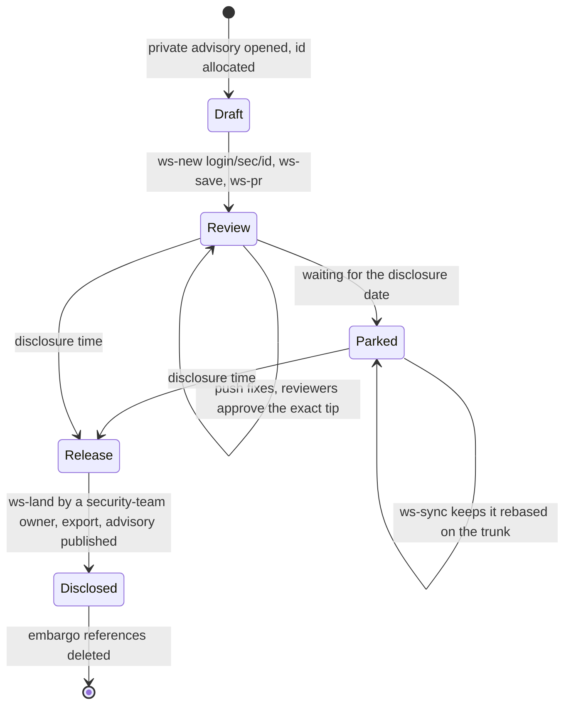

# Embargoed Security Work

This document specifies how a security fix is developed, reviewed, and kept alive inside the organization without reaching a public mirror, and how it is released. It defines the naming scheme, the lifecycle, the enforcement points in the lander and magpie, and the limits of the design.

## 1. Problem and Threat Model

Every change that lands in the trunk is exported to the public mirror of its project within one lander cycle. Landing therefore equals disclosure. An embargoed fix must stay out of the trunk until the disclosure time, yet it must be reviewable, rebaseable, and durable for weeks.

Table 1 lists the ways an embargo can leak and the control that closes each.

| ID | Leak path | Control |
| :--- | :--- | :--- |
| L1 | A member runs `git ws-land` on the embargoed branch; the lander lands and exports it. | The lander refuses `sec-*` landing requests unless the requester belongs to the security team (Section 5.1). |
| L2 | `magpie.gosuda.org` is public and lists workspace and review reference names. | Magpie never lists references with a `sec` path segment and answers `404` for them (Section 5.2). |
| L3 | Reference or commit names describe the vulnerability (project, CVE, bug class). | Opaque names; descriptive text lives only in the private advisory (Section 3). |
| L4 | The 14-day workspace GC deletes the embargoed branch, or a reviewer cannot find it. | Embargoed references have their own TTL (Section 5.3). |
| L5 | The release commit message discloses details early or contains internal notes. | The release commit is authored with approved public text; internal trailers are scrubbed by the exporter (Section 6). |
| L6 | A public mirror pull request is staged internally and an embargoed fix is mistaken for a public change (or the reverse). | Embargoed work never touches mirrors; staged external pull requests use the separate `capy/` namespace. |
| L7 | Everyone in the organization, and every GitHub App installed on all repositories, can read `gosuda/1`. | A restricted repository for high-severity embargoes (Section 4.3). Accepted residual risk otherwise. |

Out of scope: protecting against a malicious security-team member, and the disclosure timing decisions themselves.

## 2. Tracks

Table 2 chooses between the two ways to develop an embargoed fix.

| | Track A: advisory fork on the mirror | Track B: internal workspace |
| :--- | :--- | :--- |
| Where the fix lives | A GitHub Security Advisory with a temporary private fork of the public mirror | A workspace branch and review pair in the user repository (or the restricted repository, Section 4.3) |
| Hidden from the public by | GitHub (private fork) | Reference names and the controls in Table 1 |
| Release | A maintainer merges the advisory pull request into the mirror's default branch. The lander imports it (inbound), because the merger is a project owner. | A security-team owner runs `git ws-land` on the final commit. The lander lands it and exports it. |
| Use when | The fix touches one public project and standard CVE handling suffices. | The fix spans projects, needs trunk-only tooling (presubmit, visibility), or touches code with no public mirror yet. |
| Naming | GitHub-managed | Section 3 |

Track A needs no lander change: the advisory pull request is invisible to the lander because private-fork references are not published. It requires the merger to be an `OWNERS` owner of the project (inbound lands automatically only for owners; otherwise it is staged for a member).

The rest of this document specifies Track B.

## 3. Naming Scheme

### 3.1 Embargo id

An embargo id is `sec-<YYYYMM>-<8 hex>`, for example `sec-202610-0a1b2c3d`.

- The month is the creation month. The eight hex digits are random (use `openssl rand -hex 4`), so ids cannot be guessed from a sequence.
- The mapping from id to advisory, CVE, project, and severity exists only in the private tracker (the draft advisory or the private issue). It never appears in a reference name, commit subject, pull request title, or status.
- One id per advisory. Follow-up changes of the same advisory use `-2`, `-3` suffixes of the workspace branch, not new ids.

### 3.2 References

Table 3 lists every reference of an embargoed change. The lander and magpie treat any path segment equal to `sec` or starting with `sec-` as embargoed, so a typo in the format still fails closed.

| Purpose | Reference | Written by |
| :--- | :--- | :--- |
| Workspace | `refs/ws/<login>/sec/<id>` (a follow-up: `refs/ws/<login>/sec/<id>-2`) | The author, with `git ws-save` |
| Review pair | `refs/heads/base/<id>`, `refs/heads/review/<id>` | The author, with `git ws-pr` |
| Landing request (release only) | `refs/heads/land/<id>` | A security-team member, with `git ws-land` |

`git ws-new <login>/sec/<id>` creates the branch; `git ws-pr` and `git ws-land` derive the id from the last path segment, which is the embargo id.

### 3.3 Text

- Commit subject while embargoed: `<id>: <neutral summary>` such as `sec-202610-0a1b2c3d: harden input handling`. Never name the vulnerability class, the affected function, or the CVE.
- Pull request title: the id only. The pull request body says "Security response change; details in the private advisory".
- Do not paste exploit details, proofs of concept, or affected version ranges into any reference name, commit message, comment, or status in `gosuda/1`.

## 4. Lifecycle

### 4.1 Draft and review

1. Open a draft security advisory (or a private issue in the restricted repository) and allocate the id.
2. `git ws-new <login>/sec/<id>`, implement and test the fix locally, `git ws-save`.
3. `git ws-pr` opens the review pair in the user repository. Approvals are bound to the exact tip like any other change (`OWNERS` applies; a `.github/` change also needs another owner).

### 4.2 Parked

While waiting, the branch is kept rebased with `git ws-sync` (the base provenance check rejects workspaces whose root is older than the last 500 trunk commits). Embargoed references are not pruned by the 14-day workspace GC (Section 5.3).

### 4.3 Restricted repository (high severity)

For severe issues, or when the circle must be smaller than the organization, use a dedicated private repository (for example `gosuda/security`) granted to the `security-response` team only. It needs the same advertised trunk copy as the user repository so blob-less workspace pushes work, so the lander would copy `refs/suda/main` and `refs/suda/history` to it in the same step that copies them to `gosuda/1`. Embargoed references then live there with the names of Table 3, and the release step pushes the final commit to `gosuda/1` as `refs/heads/land/<id>`. This variant requires a lander change (a list of satellite repositories) and is not implemented yet.

### 4.4 Release

1. At the disclosure time, the owner prepares the **release commit**: squash the fix into one commit whose message is the public text approved in the advisory, with `Security-Advisory: GHSA-xxxx-xxxx-xxxx` as a trailer. Embargo ids must not appear in it.
2. A member of the security team pushes it as `refs/heads/land/<id>` with `git ws-land` from the embargoed branch. The id is the land ref name, so the embargo guard applies and checks team membership.
3. The lander lands it (`OWNERS`, visibility, presubmit as usual) and exports the affected projects. Publish the advisory immediately after the export.

### 4.5 Cleanup

The landing consumes `land/<id>`, `base/<id>`, and `review/<id>`. The author deletes the workspace branch (`git push ws :refs/ws/<login>/sec/<id>`), or leaves it for the embargo TTL.

## 5. Enforcement

### 5.1 Lander landing guard

A landing request is embargoed when its id, or the subject of its tip commit, carries the marker (a segment `sec` or starting `sec-`).

- If `LANDER_EMBARGO_TEAM` (`org/slug`) is unset, an embargoed request is rejected. This is the safe default.
- Otherwise the requester must be an active member of that team (`GET /orgs/{org}/teams/{slug}/memberships/{login}`). The check precedes every other check, and membership does not bypass `OWNERS`.
- The rejection text is generic ("embargoed change: only the security response team may land it") because commit statuses are visible to every organization member.

The subject marker catches an embargoed commit submitted under an ordinary id.

### 5.2 Magpie

Magpie is public. `isHiddenRef` rejects any reference path with a `sec` or `sec-*` segment: such references are filtered from `/api/refs` and the diff UI, and `/diff`, `/commit`, and the JSON endpoints answer `404` before contacting GitHub, so existence is not disclosed.

### 5.3 Garbage collection

References whose name is embargoed are pruned only after `LANDER_EMBARGO_TTL` (default 180 days) since their tip commit date, and a `base/<id>` and `review/<id>` pair with an embargoed id is kept for the same period even if its pull request is closed.

## 6. Residual Risks and Rules

1. **Organization-wide visibility.** All 54 members and every GitHub App installed on all repositories can read `gosuda/1`, including AI agents that process repository content. For severe embargoes use Track A or the restricted repository (Section 4.3), and tighten the App installations first.
2. **Commit author and date metadata** travel into the export. Use a neutral commit identity for release commits when the authorship itself is sensitive.
3. **Review comments** on the pull request are visible to the organization. Keep technical detail in the private advisory.
4. **Presubmit logs** stay in the lander log (private). They are not published in statuses.
5. **Rotation of the exposed id.** Ids are opaque; treat an id that reached a public place (a log, a chat) as burned and allocate a new one with a new branch.
6. **Mirror pull requests with embargoed content.** A public contributor's pull request is staged as `refs/ws/capy/<project>-pr-<N>`. If it turns out to be a security report, stop discussing it on the public pull request, move the work to Track A, and ask the contributor to continue in the advisory.

## 7. Verification Matrix

| Scenario | Expected outcome |
| :--- | :--- |
| A member lands `refs/heads/land/sec-202610-0a1b2c3d` with no security team configured | Rejected, generic status, trunk unchanged |
| A non-member of the team lands it | Rejected, trunk unchanged |
| A team member who is not an owner of the path lands it | Passes the embargo guard; `OWNERS` rejects it |
| A team owner lands it | Lands and exports |
| An ordinary id carries `sec-...:` as its commit subject | Rejected the same way |
| `GET /api/refs` while an embargoed workspace exists | The reference is absent from the response |
| `GET /diff/ws/<login>/sec/<id>?format=json` | `404`, and no GitHub request names the id |
| An embargoed workspace is 30 days old | Kept; an ordinary workspace of that age is pruned |
| An embargoed workspace is older than the embargo TTL | Pruned |
