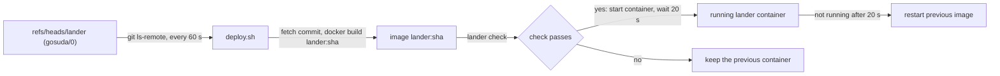
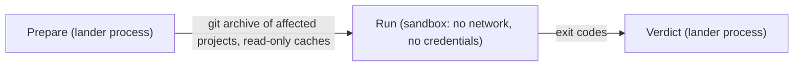

# Server-Side Tooling and Operations Specification

The landing pipeline runs in one process, the lander, on a dedicated server. The lander is built from `.github/scripts/lander` and `.github/scripts/capy` on the control plane and deployed from `refs/heads/lander` of `gosuda/0`. Workstations need only Git and the aliases in `.gitconfig`. Running the `capy` checks locally needs a Go toolchain. `gosuda/0` runs no GitHub Actions workflows.

## 1. Control-Plane Directory Layout

The `refs/heads/main` branch contains the agent rules, Git aliases, the Starlark synchronization config, the agent skills, and the sources of the lander and `capy`.

```text
/ (refs/heads/main)
├── AGENTS.md
├── README.md
├── .gitconfig
├── capy.star
├── docs/
├── .agents/
│   ├── hooks.json
│   ├── scripts/
│   │   └── guard-git.sh
│   └── skills/
└── .github/
    ├── OWNERS
    └── scripts/
        ├── create-repo.sh        # workspace commit for a new project
        ├── import-repo.sh        # workspace commit importing an existing repository (unmodified copy)
        ├── go-work-add.sh        # workspace commit adding a project's Go modules to the root go.work
        ├── ws.sh                 # the workspace tools behind the aliases (installed by suda-init): Change-Id, patchsets, autosave, worktrees, fetch lock
        ├── test-workspace-scripts.sh  # offline smoke test of the helpers above and ws.sh
        ├── capy/                 # Starlark evaluator, visibility and OWNERS checks, export and import
        └── lander/               # the lander service and its deployment (deploy/deploy.sh)
```

`refs/heads/lander` holds the deployable tree that the lander publishes from the two source directories (Section 1.1). It contains `Dockerfile` and `.dockerignore` at the root, `lander/` (the lander sources and `deploy/`), and `capy/`.

### 1.1 Image and Deployment

The `Dockerfile` builds the lander binary in a Go stage from `lander/` and `capy/`. The runtime stage is `debian:bookworm-slim` with `git`, `openssh-client`, `ca-certificates`, the Go toolchain (used only to download module caches for presubmit), and the Docker CLI. The container runs as UID `10001` with `/var/lib/lander` as its volume. It exposes port `8080` and starts `lander run`.

Figure 1 shows the deployment loop. `lander/deploy/deploy.sh` runs on the server, outside the container.



`deploy.sh` behaves as follows:

- It deploys a commit when `refs/heads/lander` moves to it. A commit whose image fails to stay up is recorded and is not retried. The next commit is deployed normally.
- It mounts the state directory at `/var/lib/lander` and the key directory read-only at `/etc/lander`. It binds the health port to `127.0.0.1:8080`.
- It keeps the three newest `lander:<sha>` images.

Rollback needs no GitHub write access. An operator runs a previous `lander:<sha>` image. If a broken release cannot land its own fix, an org owner pushes a previous commit to `refs/heads/lander`.

> [!IMPORTANT]
> The lander container never mounts the host Docker socket, because that would give the lander host root. Presubmit containers run on a dedicated sandbox daemon named by `DOCKER_HOST`.

## 2. GitHub App and Configuration

The `suda-lander` GitHub App performs every write. It is installed on `gosuda/0`, `gosuda/1`, and each repository listed in `capy.star`. Table 1 lists its permissions.

| Permission | Repositories | Purpose |
| :--- | :--- | :--- |
| `contents: write` | `gosuda/0`, `gosuda/1`, mirrors | Trunk and control-plane pushes, trunk copies, staged refs, mirror exports |
| `contents: read` | `gosuda/1`, mirrors | Activity API for the pusher of a tip |
| `workflows: write` | Mirrors | Exporting `.github/workflows/` |
| `pull_requests: read` | `gosuda/1` | Approvals bound to a tip |
| `pull_requests: write` | Mirrors | Open mirror pull requests; close a landed mirror pull request and comment on it |
| `statuses: write` | `gosuda/1` | `suda/land` statuses on landing request tips |
| `members: read` | Organization | Active team membership for `@org/team` owners |

The lander mints an installation token for each operation. Every token is narrowed to one repository and to the permissions that operation needs. A fetch uses `contents: read`. A trunk push uses `contents: write`. A mirror export also requests `workflows: write`. Tokens are cached until five minutes before they expire and never enter a sandbox.

Table 2 lists the settings an operator provides. The lander README (`.github/scripts/lander/README.md`) lists every variable.

| Variable | Default | Meaning |
| :--- | :--- | :--- |
| `LANDER_APP_ID`, `LANDER_APP_KEY_FILE` | required | App ID and PEM private key of `suda-lander` |
| `LANDER_STORE` | `/var/lib/lander/store.git` | Bare object store shared by all remotes |
| `LANDER_INTERVAL` | `1m` | Poll interval between cycles; a `/wake` request ends the wait early |
| `LANDER_MIRROR_INTERVAL` | `5m` | Minimum gap between mirror reconciles; a landing that advanced the trunk reconciles on the next cycle |
| `LANDER_DRYRUN` | unset | Decide and log, push nothing |
| `LANDER_SIGNING_KEY`, `LANDER_ALLOWED_SIGNERS` | unset | SSH key that signs lander commits, and the allowed signers that verify the history tip. The key requires the signers file. |
| `LANDER_COMMITTER_NAME`, `LANDER_COMMITTER_EMAIL` | App bot identity | Identity on commits the lander creates. Default: the App's bot identity (`<slug>[bot]`, `<bot user id>+<slug>[bot]@users.noreply.github.com`), which GitHub attributes to the App and renders with its logo. The id in the email is the bot user's id, not the App id |
| `LANDER_ACK_TIP` | unset | Accepts one unsigned history tip after an operator reviews it |
| `LANDER_PRESUBMIT` | `docker` | `docker` runs the sandbox; `off` skips presubmit |
| `LANDER_WAKE_SECRET` | unset | Enables `/wake`, which accepts HMAC-SHA256 signed requests only |

Mirror repositories are created by an org owner. Until a mirror exists, its reconciliation fails on every cycle and the lander skips it. The App private key is read only by the lander process. Git reads the signing key file only when it signs a commit the lander creates.

## 3. Presubmit Sandbox

Presubmit tests the affected projects of a candidate before it lands. Figure 2 and Table 3 show the stages. The lander process never executes repository code, so the tests run in a separate container.



Table 3 lists the work of each stage.

| Stage | Runs in | Work |
| :--- | :--- | :--- |
| Prepare | Lander process | Computes the merged candidate and the affected set, writes the affected closure of project directories from the object store, and generates the staging `go.work`. It warms dependency caches with commands that run no package code: `go list -e -m -json all` and one `go mod download` naming the external modules for the trunk workspace's Go modules, `go mod download` per module with `GOWORK=off` for the others, all with `GOPROXY=https://proxy.golang.org`; `bun install --ignore-scripts --frozen-lockfile` when a lockfile exists; and `cargo fetch --locked` unless the repository carries a Cargo configuration file. Each command receives only a fixed list of host variables. |
| Run | Sandbox container | Runs the project's test commands in a fresh container, one per project, with no network and no credentials. The source archive and the caches are mounted read-only. |
| Verdict | Lander process | A failing project rejects the request. The `suda/land` status reads `presubmit: FAILED: <project directories>`, and the output tail stays in the lander log. A passing run with nothing to test passes with a summary of `no tests declared`. |

Each sandbox container runs with these properties:

- `docker run --pull=never --network none --read-only --cap-drop ALL --security-opt no-new-privileges`. The image must already exist on the sandbox daemon.
- A non-root user (`65534:65534`), `--pids-limit 512`, and CPU and memory limits from `LANDER_PRESUBMIT_CPUS` (default `2`) and `LANDER_PRESUBMIT_MEMORY` (default `4g`). Memory swap equals memory.
- Writable `tmpfs` mounts at `/tmp` and at the work directory. The sources are copied into the work directory, and the project's commands run there.
- The source archive is mounted read-only at `/src`, and the dependency cache is mounted read-only at `/cache`.
- A fixed environment (`HOME=/tmp`, `GOPROXY=off`, `GOFLAGS=-mod=readonly`, `GOWORK=/work/go.work`, `GOTOOLCHAIN=local`, `CARGO_NET_OFFLINE=true`, and cache paths). The host environment never enters the container. A Go module outside the trunk's workspace runs `GOWORK=off` on its own commands.
- The timeout is `LANDER_PRESUBMIT_TIMEOUT` (default `15m`) per container and per prepare command. The sandbox image is `LANDER_PRESUBMIT_IMAGE` (default `golang:1.27`).

Go modules are tested in workspace mode. The staging `go.work` lists the closure's modules that the trunk's root `go.work` lists in `use`, with the trunk's local replace directives whose targets lie in the closure; the trunk's own `go.work` is never exported. Presubmit depends on this convention: a committed `go.mod` never contains a local `replace`; the root `go.work` resolves sibling modules; a `require` of an internal module names a published version.

The affected set starts from the changed paths. Each changed path belongs to its nearest ancestor project, which is a directory holding a `go.mod`, `Cargo.toml`, or `package.json`. The set then adds every project that transitively depends on one of them. Dependencies are read from the manifests: Go `require` directives and local `replace` targets, Cargo `path` dependencies, and `package.json` `file:`, `link:`, and `workspace:` references. Only the affected projects run tests, but the closure of their dependencies is exported and warmed so that they can build.

Test commands are chosen by project kind:

- **Go**: `go vet ./...` and `go test ./...`.
- **Cargo**: `cargo test --offline --locked`, only when `Cargo.lock` exists.
- **Node**: `bun test`, only when `package.json` declares a test script or the project has `*.test.ts` files.
- Any other project has no commands and passes without running anything. The summary counts such projects, or reads `no tests declared` when none of the affected projects has commands.

A candidate that touches no project passes with the summary `no affected projects`. The commands above are the only test configuration; `capy.star` does not list test commands.

Presubmit runs inside the serialized cycle, so landing latency includes test time. Because the lander is the only writer, a passing result stays valid until the commit step. Mirror CI runs after the export and does not gate landing.

## 4. `capy` Command Set

`capy` is the Go module at `.github/scripts/capy`. Its CLI is `go -C .github/scripts/capy run ./cmd/capy <command>`. Table 4 lists the commands. The lander calls the same functions directly.

| Command | Flags | Behavior |
| :--- | :--- | :--- |
| `list` | `-config capy.star`, `-json` | Prints each workflow as name, prefix, destination repository, and branch. |
| `check-replaces` | `-repo`, `-base-tree`, `-tree` | Prints each `go.mod` local `replace` directive that leaves the module directory (`replace x => ../y` or an absolute path) and exits `1` when there is any. With `-base-tree`, it reads only `go.mod` files added or modified since the base, and a replace that already exists unchanged in the base file is grandfathered. `.github/` is exempt. The lander runs it on every landing. |
| `check-visibility` | `-repo`, `-base-tree`, `-tree` | Prints each violation and exits `1` when there is any. With `-base-tree`, it evaluates only files added or modified since the base, files whose nearest `go.mod` or `package.json` changed, and Go files that import a changed module path. |
| `check-owners` | `-repo`, `-base-tree`, `-tree`, `-requester`, `-approvers`, `-team org/slug=login,...`, `-github-repo`, `-github-ref`, `-github-sha`, `-github-review-head` | Applies Section 2.1 of [AGENTS.md](../AGENTS.md). `OWNERS` files are read from `-base-tree`. Identity comes from `-requester` and `-approvers`, or from the GitHub API with `-github-*` (requires `GITHUB_TOKEN`). Exits `1` on violations. |
| `export-tree` | `-config`, `-workflow`, `-tree` | Prints the export tree of a workflow for a root tree. |
| `import-tree` | `-config`, `-workflow`, `-base-tree`, `-sub-tree` | Prints a root tree in which the workflow prefix is replaced by `-sub-tree`. This command replaces the whole prefix and does not keep excluded paths. The lander's inbound path keeps them (architecture §4.3), so do not use this command to land a mirror change. |
| `format-msg` | `-config`, `-workflow`, `-source-rev`, `-msg` | Prints an export commit message with the configured `GitOrigin-RevId` trailer. |

Starlark configuration is evaluated by the built-in modules listed in [google3-and-copybara.md](./google3-and-copybara.md) §4.3. `go -C .github/scripts/capy test ./...` runs the tests of the module.

## 5. Magpie Routes and Mirror Repository

The `//devtools/azure-magpie` project serves the web UI (overview, changes and patchsets, diff links) and resolves `refs/suda/*` and `refs/ws/*` at the edge. The site is read-only. It accepts no landing requests; a landing is submitted only with `git ws-land`. The site sits behind Cloudflare Access, and the webhook path is the only exception. The worker reads the trunk from `gosuda/0` and workspaces from `gosuda/1`.

`gosuda/azure-magpie` is an ordinary public mirror of `//devtools/azure-magpie`. It holds no landing workflow and no landing secrets.

Table 5 lists the supported routes.

| Request Path | Target Redirect Location or Response |
| :--- | :--- |
| `GET /`, `GET /changes`, `GET /changes/<change-id or N>`, `GET /diff` | `200` HTML UI: overview, the list of changes, one change with its patchsets, approvals per patchset, and the interdiff between two patchsets, and the diff link generator |
| `GET /api/changes` | `200` JSON list of changes built from the patchset refs `refs/ws/cl/<change-id>/<tip>` of `gosuda/1`. `refs/ws/cl/sec/*` and changes with a `sec-` subject are never listed |
| `GET /api/changes/<change-id>` or `GET /api/changes/<N>` | `200` JSON detail: patchsets with their base snapshot and files, the review pull request and its approvals when the App may read pull requests; `N` is the review pull request number. `404` for hidden or unknown changes |
| `GET /tree` or `GET /tree/<path>` | `302` to `https://github.com/gosuda/1/tree/<suda-main-sha>/<path>` |
| `GET /head` or `GET /head/<path>` | `302` to `https://github.com/gosuda/1/tree/<suda-history-sha>/<path>`, the tree view at the head of `refs/suda/history` |
| `GET /blob/<path>` | `302` to `https://github.com/gosuda/1/blob/<suda-main-sha>/<path>` |
| `GET /commit` or `GET /commit/<ref>` | `302` to `https://github.com/gosuda/1/commit/<resolved-sha>` |
| `GET /history/<path>` | `302` to `https://github.com/gosuda/1/commits/<suda-history-sha>/<path>` |
| `GET /blame/<path>` | `302` to `https://github.com/gosuda/1/blame/<suda-history-sha>/<path>` |
| `GET /diff` | `200` HTML Diff Link Generator UI listing the active `refs/ws/*` and `refs/heads/land/*` references of `gosuda/1` |
| `GET /diff/ws/<actor>/<id>` | `302` to two-dot compare `https://github.com/gosuda/1/compare/<suda-main-sha>..<ws-sha>` |
| `GET /diff/<base>..<head>` | `302` to two-dot compare `https://github.com/gosuda/1/compare/<base-sha>..<head-sha>` |
| `GET /refs.json` or `GET /sha` | `200` JSON payload containing the `suda/main` and `suda/history` commit hashes |
| `POST /webhook` | Verifies `X-Hub-Signature-256` and forwards a wake request to the lander's `/wake`. It dispatches nothing. |

Magpie resolves refs and builds every link on `gosuda/1` (`GITHUB_REPO`) and never contacts `gosuda/0`. The links resolve there because the lander keeps byte-identical copies of the trunk refs ([architecture.md](./architecture.md) §3.1). The copy carries no trust and lags the trunk by at most one lander cycle. The mirror project list is read from `capy.star` at `refs/suda/main` of `gosuda/1`.

An organization webhook (`push`, `pull_request`) can post directly to the lander's `/wake`, which then ignores repositories it does not watch; magpie's `/webhook` forwarding is optional.
