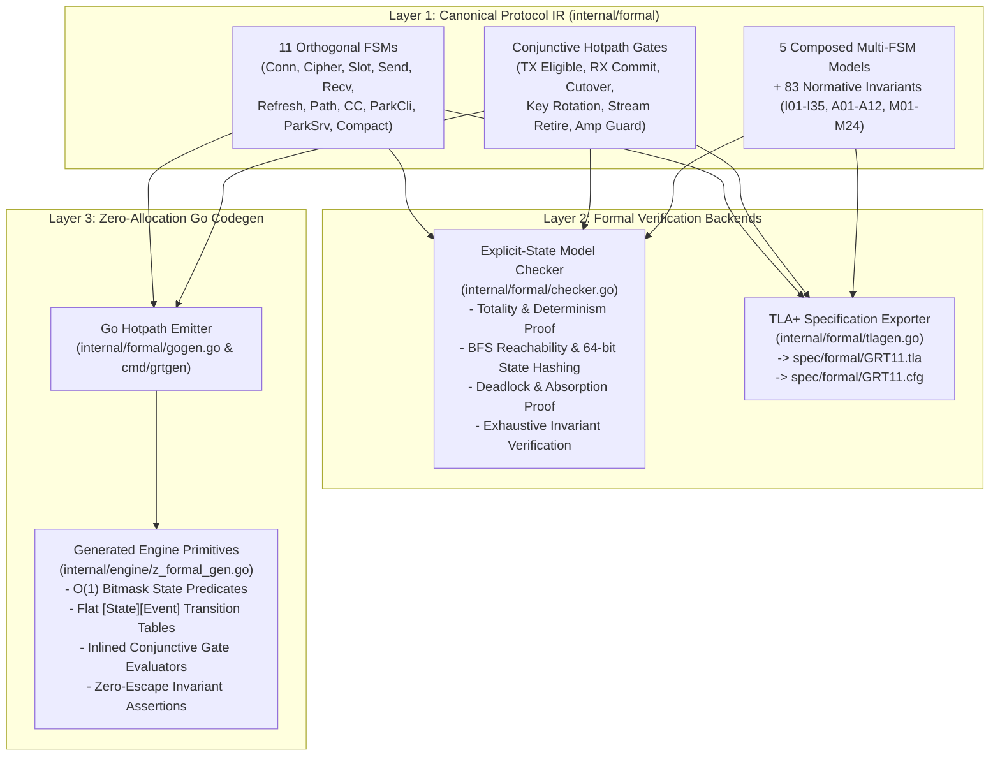

# GRT/1.1 Formal Verification and Single-Source IR-to-Go Code Generation Architecture

## 1. Executive Summary and Feasibility Analysis

GRT/1.1 is explicitly structured around **single-writer deterministic transactions** (Section 22), **orthogonal component finite-state machines (FSMs)** over fixed-width integer registers (Sections 4.6, 12.5–12.7, 15, 17.7, 19, 20, 21, 23.2, 35.3, 35.9, 36.8), **conjunctive boolean emission/commit gates** (Section 22.3), and **83 normative invariants** (`I01`–`I35`, `A01`–`A12`, `M01`–`M24`).

This structure makes GRT/1.1 uniquely suited for a **Single-Source Intermediate Representation (IR)** architecture where a single canonical definition of all protocol state machines, guards, gates, and invariants simultaneously drives:
1. **Exhaustive Formal Verification** (both a custom explicit-state model checker in Go and an automatic TLA+ specification exporter for TLC/Apalache).
2. **Ultra-High-Performance Go Code Generation** (`internal/engine/z_formal_gen.go`) that compiles state predicates, transition tables, conjunctive gate evaluators, and invariant verifiers into zero-allocation (`0 allocs/op`), branchless/bitmask Go primitives executed directly on the `internal/engine` hotpath.

### 1.1 Architectural Trade-Off: TLA+-to-Go vs. Single-Source Typed IR

We evaluated three candidate pipelines for bridging formal verification and production Go code:

| Criterion | Approach A: Handwritten TLA+ $\rightarrow$ Transpile to Go | Approach B: Handwritten Go $\rightarrow$ Extract Model | Approach C (Selected): **Single-Source Typed Protocol IR $\rightarrow$ (1) Explicit-State Model Checker + TLA+ Exporter, (2) Zero-Alloc Go Codegen** |
|---|---|---|---|
| **Type Safety & Register Semantics** | Weak: TLA+ is untyped set theory (`Nat`, `SUBSET`); mapping to `uint8`/`uint16`/`uint64` bitfields and fixed-point `32.32` registers requires fragile heuristics. | Strong in Go, but extraction loses high-level declarative intent. | **Exact**: IR natively models fixed-width enums (`uint8`), bitmask predicates (`uint16`/`uint32`), bounded integer domains, and atomic register actions. |
| **Determinism vs. Non-Determinism** | TLA+ `Next` is inherently a disjunction of non-deterministic existential quantifiers (`\E p \in Paths : ...`), which maps poorly to deterministic single-writer transition functions. | Deterministic, but environment non-determinism (loss, reordering, adversarial inputs) must be bolted on separately. | **Separated by Construction**: Transitions `(State, Event, Guard) -> (NextState, ActionMask)` are strictly deterministic (enforced by Checker Rule `D01`), while environment/adversary inputs are non-deterministically enumerated by the model checker and TLA+ `Next`. |
| **Hotpath Performance in Go** | Poor: TLA+ transpilers (e.g., PlusCal/PGo) emit heap-allocated maps/slices, interface boxing, and multi-pass guard closures. | Fast, but prone to human drift between spec tables and handwritten `if`/`switch` chains. | **Optimal (`0 allocs/op`)**: Generates `const` bitmasks (`(1 << st) & mask != 0`), flat `[numStates][numEvents]` transition tables stored in read-only data segments, and inlined conjunctive gate functions. |
| **Verification Depth & CI Speed** | External JVM/TLC startup overhead; slow state hashing on set structures. | Only random simulation (`internal/sim`), not exhaustive state-space proof. | **Dual-Engine**: In-process explicit-state BFS checker verifies all 11 component FSMs and 5 composed protocol models in `< 50 ms` during `go test ./...`, while `spec/formal/GRT11.tla` provides full external TLA+/TLC compatibility. |

---

## 2. System Architecture Pipeline



---

## 3. Layer 1: Canonical Protocol IR Specification (`internal/formal`)

### 3.1 Orthogonal Finite-State Machines Modeled in the IR

Every state machine defined in `spec/GRT11.md` is represented as an immutable `MachineSpec` descriptor in `internal/formal/spec.go`:

| Machine ID | Spec Section | States (`uint8`) | State Predicate Sets (Bitmasks) | Engine Type Binding |
|---|---|---|---|---|
| `ConnLifecycle` | Section 20.1–20.3 | `PRE_HS`, `RETRY_WAIT`, `HS_SENT`, `EARLY_SENDING`, `ESTABLISHED`, `REKEYING`, `MIGRATING`, `PARKED_LOCAL`, `PARKED_REMOTE`, `CLOSING`, `DRAINING`, `QUIESCING`, `DEAD` (13 states) | `KeyBearing`, `Terminating`, `AppSendEligible`, `Parked`, `HandshakeActive`, `Terminal` | `connState` (`internal/engine/types.go`) |
| `CipherSelection` | Section 4.6 | `CIPHER_UNSELECTED`, `CIPHER_AES256_GCM`, `CIPHER_XCHACHA20_POLY1305` (3 states) | `Selected`, `Locked` | `uint8` (`Conn.core.cipher`) |
| `StreamSlot` | Section 12.1, 21.1 | `SLOT_EMPTY`, `SLOT_ACTIVE`, `SLOT_RETIRE_SENT`, `SLOT_RETIRE_PENDING`, `SLOT_RETIRED_WAIT_OPEN`, `SLOT_EXHAUSTED` (6 states) | `OpenEligible`, `RetireInFlight`, `Terminal` | `slotState` (`internal/engine/types.go`) |
| `StreamSend` | Section 12.5, 21.1 | `SEND_IDLE`, `SEND_OPEN`, `SEND_FIN`, `SEND_DONE`, `SEND_RESET` (5 states) | `Writable`, `FinSignaled`, `Terminal` | `sendState` (`internal/engine/types.go`) |
| `StreamRecv` | Section 12.6, 21.1 | `RECV_IDLE`, `RECV_OPEN`, `RECV_SIZE_KNOWN`, `RECV_DONE`, `RECV_RESET` (5 states) | `AcceptsData`, `FinalSizeBound`, `Terminal` | `recvState` (`internal/engine/types.go`) |
| `KeyRefresh` | Section 19, 21.2 | `REFRESH_IDLE`, `REFRESH_COLLECTING`, `REFRESH_STAGED`, `REFRESH_COMMITTED`, `REFRESH_GRACE`, `REFRESH_REKEY_DONE` (6 states) | `NextSlotOccupied`, `PrevSlotDecryptEligible`, `CommitPending` | `refreshState` (`internal/engine/refresh.go`) |
| `PathLifecycle` | Section 17.1, 17.7, 21.3 | `PATH_FREE`, `PATH_VALIDATING`, `PATH_REACHABLE`, `PATH_READY`, `PATH_ACTIVE`, `PATH_OLD`, `PATH_FAILED` (7 states) | `ControlSendEligible`, `BulkDataEligible`, `ValidationComplete`, `Retained` | `pathState` (`internal/engine/types.go`) |
| `CongestionControl` | Section 15.1–15.4, 21.4 | `CC_SLOW_START`, `CC_CONGESTION_AVOIDANCE`, `CC_RECOVERY`, `CC_PERSISTENT_CONGESTION` (4 states) | `CwndGrowing`, `InRecovery` | `pathRec` CC mode (`internal/engine/loss.go`) |
| `ParkClient` | Section 35.9 | `PCLI_ACTIVE`, `PCLI_REQUESTING`, `PCLI_PARKED`, `PCLI_WAKING`, `PCLI_ABORTED` (5 states) | `TimersSuppressed`, `BulkTxBlocked`, `WakePending` | `parkClient` (`internal/engine/park.go`) |
| `ParkServer` | Section 35.3 | `PSRV_ACTIVE`, `PSRV_PARKED`, `PSRV_WAKE_SENT`, `PSRV_EXPIRED` (4 states) | `LeaseActive`, `ProbingMuted`, `WakeOutstanding` | `parkServer` (`internal/engine/park.go`) |
| `MemoryCompaction` | Section 36.8 | `MEM_ACTIVE_HOT`, `MEM_IDLE_WARM`, `MEM_PARKED_COMPACT`, `MEM_QUOTA_PRESSURE`, `MEM_REHYDRATING`, `MEM_DRAINING` (6 states) | `ScratchRetained`, `ZeroAllocAdmissionRequired` | `connCore` compaction phase |

### 3.2 Guarded Deterministic Transitions and Total Input Semantics

Per Section 20.2 ("Total input handling"), a state machine in GRT/1.1 must never have an undefined `(State, Event)` combination. Every `MachineSpec` defines:
- `States []StateSpec`: Ordered state declarations (`0 .. N-1`) with explicit bitmask group memberships and terminal/initial flags.
- `Events []EventSpec`: Ordered input symbols (`0 .. M-1`) representing wire frames, timer expirations, or local API calls.
- `Transitions []TransitionSpec`: Explicit transitions `(FromState, Event, GuardID) -> (ToState, ActionMask, ErrorCode)`.
- `DefaultDisposition`: For any `(State, Event)` pair not matched by an explicit transition, the IR requires an explicit total fallback (`DispositionIgnore`, `DispositionProtocolError`, or `DispositionInvalidState`), guaranteeing **Total Input Completeness**.

### 3.3 Conjunctive Boolean Gates (`GateSpec`)

Section 22.3 specifies that packet emission, packet commit, path promotion, and stream retirement are governed by conjunctive boolean gates ($G = \bigwedge_{i=1}^{k} p_i$). Modeling these gates in the IR as bitmask operations over condition flags allows:
1. The model checker to verify that no action fires unless all required safety preconditions hold (e.g., `TX_DATA_GATE` requires `StateAppSendEligible && PathBulkDataEligible && !ParkedBulkBlocked && CwndAllows && PaceAllows && AmpAllows && KeyBelowHardLimit`).
2. The Go code generator to emit branchless bitwise gate checks (`(flags & requiredMask) == requiredMask`) that execute in a single clock cycle.

---

## 4. Layer 2: Formal Verification Engine (`internal/formal/checker.go` & `tlagen.go`)

### 4.1 Exhaustive Explicit-State Model Checker

The built-in model checker (`internal/formal/checker.go`) performs two levels of verification during `go test ./internal/formal/...`:

#### Level 1: Structural & Algebraic Verification of All 11 Component FSMs
For every `MachineSpec` $M = (S, E, T, s_0, S_{\text{term}})$:
1. **Determinism Check (`D01`)**: Verifies that no two transitions share the same `(FromState, Event, GuardID)` tuple.
2. **Totality Check (`T01`, Section 20.2)**: Verifies that the generated transition matrix $M[s][e]$ is completely populated for all $|S| \times |E|$ pairs without unmapped holes.
3. **Reachability & Dead-State Check (`R01`)**: Runs Breadth-First Search (BFS) from $s_0$ to prove that every declared state $s \in S$ is reachable via a finite trace of legal events.
4. **Terminal Absorption Check (`A01`, Section 20.1)**: Verifies that for every terminal state $s_{\text{term}} \in S_{\text{term}}$ (e.g., `DEAD`, `SLOT_EXHAUSTED`, `SEND_DONE`, `SEND_RESET`, `RECV_DONE`, `RECV_RESET`) and every event $e \in E$, $M[s_{\text{term}}][e]$ remains in $s_{\text{term}}$ and emits no state-mutating or wire-emitting action.
5. **Termination Reachability Check (`L01`)**: Verifies by backward reachability from $S_{\text{term}}$ that no non-terminal state is trapped in an inescapable cycle unable to reach termination (`DEAD` or slot retirement).

#### Level 2: Composed Multi-Component State-Space Exploration & Invariant Proofs
Beyond single FSMs, protocol bugs arise at the **composition boundary** between interacting subsystems. `internal/formal/models.go` defines five composed state-space models with bounded integer state vectors packed into 64-bit canonical state fingerprints:

1. **Composed Model 1: Connection + Handshake + Cipher + Key Refresh (`ModelConnCrypto`)**
   - Tracks `(connState, cipherState, refreshState, activeEpoch, nextEpochReady, prevEpochGrace, pnBelowSoftLimit, pnBelowHardLimit, closeEmitted, ioPins)`.
   - Explores all interleavings of handshake completion, cipher locking, key refresh initiation/staging/commit/confirm, grace expiration, soft/hard PN limits, and local/remote close/drain/quiesce.
   - Proves invariants:
     - `I01` (Cipher immutability after selection)
     - `I04` (No application data before key-bearing state)
     - `I19` / `I20` (3-slot key epoch monotonicity; `KEY_COMMIT` never installs `ACTIVE` before `NEXT` is staged; `PREV` is wiped on grace expiry)
     - `I21` (Hard AEAD limit `2^32` prevents sealing and forces termination if unrefreshed)
     - `I28` / `A08` (`DEAD` requires `ioPins == 0`; `QUIESCING` blocks all new TX/RX while draining pins).

2. **Composed Model 2: Path Validation + Anti-Amplification + Migration Cutover + ECN (`ModelPathMigration`)**
   - Tracks `(activePathState, candPathState, oldPathState, candRxPkts, candTxPkts, candRxBytes, candTxBytes, candValidated, candBaseMTU1200, cutoverBarrierPN, maxOldPathPN, ecnState, pmtuProbing, paceTokens2M)`.
   - Explores peer rebinding, local probe seeding, challenge/response validation (small vs. 1200B), `PATH_INTENT` cutover barriers, late old-path packets (`pn < cutover_pn` vs. `pn >= cutover_pn`), PMTU probes above `2*M`, and ECN disabling on migration.
   - Proves invariants:
     - `M01` (Fresh authenticated packet on new tuple never promotes without challenge/response)
     - `M02` (Unvalidated candidate strictly obeys `txBytes <= 3*rxBytes` AND `txPkts <= 3*rxPkts`)
     - `M06` (Promotion to `READY`/`ACTIVE` requires both token validation AND 1200B base-size proof)
     - `M07` (At most 1 `ACTIVE`, 1 `CANDIDATE`, and 1 `OLD` path)
     - `M09` (Late old-path packet with `pn < cutover_pn` never reverses an accepted migration)
     - `I15` (PMTU probe with `target > 2*M` clamps pacing charge to `2*M` so `READY`/`ACTIVE` paths never deadlock PMTU discovery).

3. **Composed Model 3: Stream Slot + Send Half + Recv Half + Flow Control + Retirement (`ModelStreamLifecycle`)**
   - Tracks `(slotState, sendState, recvState, initiatorRole, gen, openAcked, txHigh, sendLimit, rxHigh, recvLimit, finalKnown, finAcked, retireAcked)`.
   - Explores stream open, credit grants (`MAX_STREAM_DATA`, `MAX_SLOTS`), normal `FIN` vs. `RESET_STREAM` / `STOP_SENDING` preemption, out-of-order data arrival before `FIN`, and generation retirement (`STREAM_RETIRE` $\rightarrow$ `RETIRE_ACK` $\rightarrow$ `gen + 1` or `SLOT_EXHAUSTED`).
   - Proves invariants:
     - `I10` (Slot generation increments strictly on `RETIRE_ACK` and never wraps past `MaxGeneration`)
     - `I11` (`txHigh <= sendLimit` and `rxHigh <= recvLimit` on all transitions)
     - `I12` (`final_size` is immutable once known on either send or recv half)
     - `I13` (`STREAM_RETIRE` is never emitted before both local halves are terminal: `send in {DONE, RESET}` and `recv in {DONE, RESET, STOPPED}`)
     - `M21` (Stale-generation frames never mutate active slot state or allocate credit).

4. **Composed Model 4: Mobile Parking Lease + Wake Handshake + Path Readiness (`ModelMobileParking`)**
   - Tracks `(connState, parkCliState, parkSrvState, pathState, leaseGranted, leaseExpired, wakeSeq, creditBacked)`.
   - Explores `PARK_REQUEST`, `PARK_GRANT` (accepted/refused/duplicate), lease expiry during sleep, NAT rebinding while parked, `PARK_WAKE`, and `PARK_AWAKE`.
   - Proves invariants:
     - `M15` (Duplicate `PARK_REQUEST`/`PARK_GRANT` never extends initial lease expiry)
     - `M16` (Parking preserves stream/replay/key state without silent discard)
     - `M17` (Wake never resumes bulk application transmission before path is `READY`/`ACTIVE` and credit backing is verified).

5. **Composed Model 5: Sent Ledger + In-Flight Accounting + Async I/O Ownership (`ModelLedgerAccounting`)**
   - Tracks `(pnStatus[0..2], inFlightBytes, cwnd, ssthresh, ccState, ioOwnedPins, ackedCount)`.
   - Explores `RESERVED` $\rightarrow$ `SUBMITTED` $\rightarrow$ `EMITTED` / `BURNED`, duplicate `ACK`s, `ACK` arriving while `SUBMITTED` (before CQE reap), `LOST` declaration, `ABANDONED` declaration on epoch/path retirement, and zero-copy notification fences.
   - Proves invariants:
     - `A01` / `A04` (An `ACK` for a `RESERVED` or `BURNED` packet is rejected with `ACK_RANGE_ERROR`; an `ACK` for a `SUBMITTED` packet waits for I/O acceptance rather than corrupting state)
     - `I14` (`inFlightBytes` is decremented at most once per emitted packet across any combination of `ACK`, `LOST`, and `ABANDONED`)
     - `M11` / `M12` (Buffer memory remains pinned until zero-copy notification completes, independent of logical `ACK` or `LOST`).

### 4.2 TLA+ Specification Exporter (`internal/formal/tlagen.go`)

`internal/formal/tlagen.go` translates the exact same IR (`MachineSpec`, `GateSpec`, and composed models) into `spec/formal/GRT11.tla` and `spec/formal/GRT11.cfg`.
- Every FSM state enum becomes a TLA+ constant set.
- Every deterministic transition table becomes a TLA+ action operator (`ConnLifecycleStep(s, ev)`, `StreamSlotStep(s, ev)`, etc.).
- Every safety invariant becomes a TLA+ `INVARIANT` predicate verified by `TLC`.
- A unit test (`TestTLAExportUpToDate`) ensures `spec/formal/GRT11.tla` never drifts from the IR.

---

## 5. Layer 3: Ultra-High-Performance Go Code Generation (`internal/formal/gogen.go`)

### 5.1 Zero-Allocation Design Principles

To guarantee ultra-high throughput and zero GC pressure on the packet processing hotpath, the Go code generator (`internal/formal/gogen.go` $\rightarrow$ `internal/engine/z_formal_gen.go`) adheres to four mechanical sympathy rules:

1. **Bitmask State Classifiers (`O(1)` ALU Register Test)**:
   Every state machine with $|S| \le 16$ states assigns each state $s \in [0, |S|-1]$ to bit $2^s$ in a `uint16` constant mask.
   For example, instead of branching across 9 cases in `Conn.keyBearing()`:
   ```go
   const fsmConnMaskKeyBearing uint16 = (1 << stEarlySending) | (1 << stEstablished) | ...
   func fsmConnIsKeyBearing(s connState) bool {
       return (uint16(1)<<uint(s))&fsmConnMaskKeyBearing != 0
   }
   ```
   The Go compiler inlines this into a single bit-shift and `BT`/`TEST` instruction with zero branches.

2. **Flat Read-Only Transition Lookup Tables (`[NumStates][NumEvents]fsmStepResult`)**:
   Each `fsmStepResult` is a 4-byte value struct (`next uint8`, `disp uint8`, `action uint16`) packed into a static 2D array `[NumStates][NumEvents]fsmStepResult`. Stepping any protocol FSM takes a single bounds-checked array read in L1 cache with **0 heap allocations** and **0 pointer indirections**.

3. **Branch-Flattened Conjunctive Gate Evaluators**:
   For hotpath gates (Section 22.3: `TX_ELIGIBLE`, `RX_DECRYPT`, `MIGRATION_CUTOVER`, `STREAM_RETIRE`, `AMP_GUARD`), the generator emits both flag-packing helpers and direct inlined boolean evaluators that combine bitmask state checks with integer bounds checks.

4. **Compile-Time & CI Equivalence Verification**:
   `TestGeneratedEngineUpToDate` in `internal/formal/formal_test.go` regenerates the Go source in memory and compares it byte-for-byte with `internal/engine/z_formal_gen.go`. Any modification to the IR or manual edit to the generated file fails CI immediately unless regenerated via `go generate ./...`.

### 5.2 Engine Integration Points

`internal/engine/z_formal_gen.go` is wired directly into `internal/engine`:
- **`internal/engine/lifecycle.go`**: `keyBearing(s)` and `terminating(s)` delegate directly to the generated bitmask classifiers `fsmConnIsKeyBearing(s)` and `fsmConnIsTerminating(s)`, while `setState` validates lifecycle transitions against the generated transition matrix.
- **`internal/engine/streamops.go`**: `slotLocalDone(s)` uses the generated `fsmSendIsTerminal(s.send.state)` and `fsmRecvIsTerminal(s.recv.state)` bitmask classifiers; retirement transitions verify against `fsmSlotCanTransition`.
- **`internal/engine/path.go` & `internal/engine/tx.go`**: Path state eligibility (`fsmPathIsBulkDataEligible`, `fsmPathIsControlSendEligible`) and TX/RX gate checks use the generated predicates.
- **`internal/engine/refresh.go`**: Key refresh state transitions validate against the generated `KeyRefresh` FSM.
- **`internal/engine/park.go`**: Client and server parking lease transitions validate against the generated `ParkClient` and `ParkServer` FSMs.
