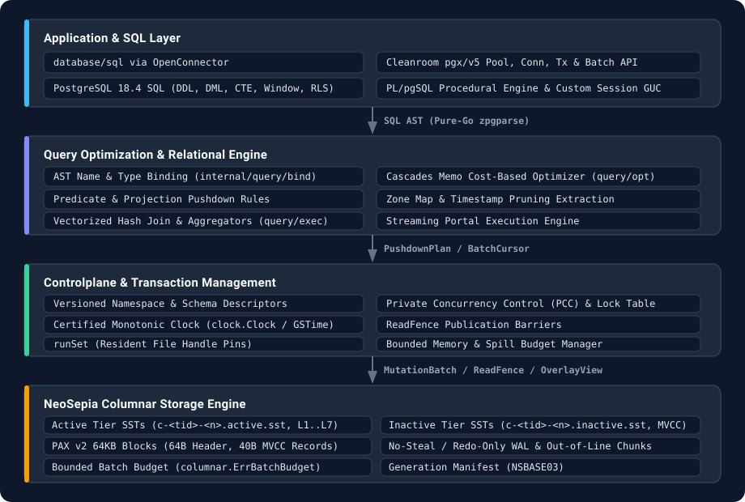
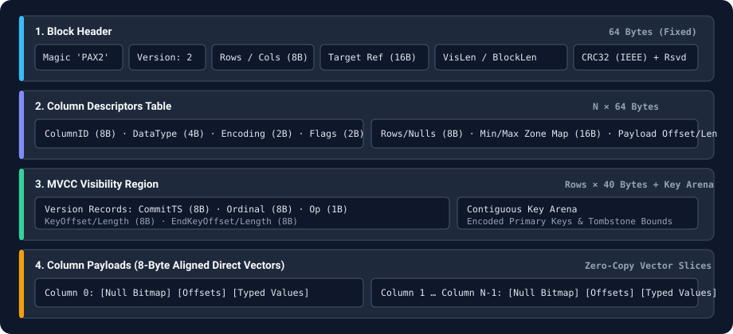
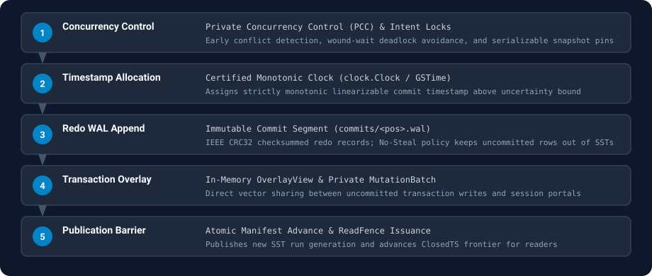
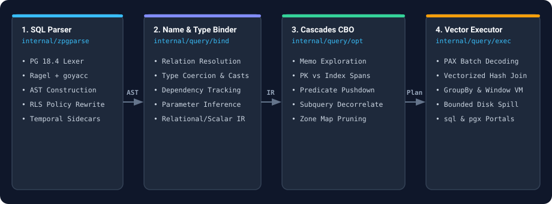

# SuperSQL

`SuperSQL` is an embedded relational database engine written in pure Go (`CGO_ENABLED=0`). It combines PostgreSQL 18 SQL and PL/pgSQL execution with **NeoSepia**, a local columnar storage backend built around 64 KB PAX v2 blocks, dual-tier leveled compaction, and certified-timestamp serializable MVCC.

SuperSQL runs in-process over a local directory without an external server or C library dependencies. Point lookups, multi-statement serializable transactions, and vectorized analytical scans share one storage engine and one transaction manager.

## Installation

`github.com/gosuda/supersql-alpha` is hosted in a private repository:

```sh
GOPRIVATE=github.com/gosuda/supersql-alpha go get github.com/gosuda/supersql-alpha@<commit-sha>
```

Set `GOPRIVATE` (or `GONOSUMDB`) so the Go toolchain fetches the module directly from Git rather than the public checksum database, and configure Git credentials (`ssh` or a `GITHUB_TOKEN` helper) for `github.com`.

---

## 1. Architecture



---

## 2. Package Map

| Layer | Package Path | Core Types & Entry Points | Responsibility |
| :--- | :--- | :--- | :--- |
| **Root Driver API** | `.` | `Open()`, `OpenConnector()`, `Connector`, `Catalog` | `database/sql` connector (`sql.OpenDB`) and direct catalog execution |
| **Cleanroom pgx API** | `pgx/` | `OpenPool()`, `Pool`, `Conn`, `Tx`, `Batch`, `NamedArgs` | In-process `pgx/v5`-compatible pool, transactions, batching, and generic row collectors |
| **Clock & Time** | `clock/`, `clock/gstime/` | `Clock`, `ReadFence`, `Epoch`, `Provider` | Certified monotonic clock contract and GSTime synchronization provider |
| **Model & Columnar** | `internal/model/`, `internal/columnar/` | `DataType`, `Value`, `ObjectRef`, `Batch`, `Vector` | Object identifiers, SQL type layouts, columnar vectors, null bitmaps, and batch budgets |
| **SQL Parser & AST** | `internal/zpgparse/` | `Parse()`, `Split()`, `Fingerprint()`, `Deparse()` | Pure-Go PostgreSQL 18 lexer, parser, AST, and deparser (generated via Ragel + `goyacc`) |
| **Controlplane** | `internal/controlplane/` | `Catalog`, `Namespace`, `SchemaJob`, `Statistics` | Versioned catalog descriptors, schema change jobs, and table statistics |
| **Transactions** | `internal/dataplane/txn/` | `Manager`, `Txn`, `PCCLock`, `SnapshotPin` | Private Concurrency Control (PCC), lock table, snapshot pins, and commit sequencing |
| **Storage Backend** | `internal/dataplane/storage/neosepia/` | `Backend`, `paxBlock`, `sstWriter`, `runGeneration` | PAX v2 block encoding, active/inactive SST compaction, redo WAL, and recovery |
| **Query Session** | `internal/query/session/` | `Transactions`, `Settings`, `Prepared`, `Rows` | Session settings (GUC), prepared statements, cursors, and `AS OF SYSTEM TIME` routing |
| **Query Binder** | `internal/query/bind/` | `Binder`, `Scope`, `BoundStatement` | Name and type resolution, catalog dependency declarations, and constraint checks |
| **Query Optimizer** | `internal/query/opt/` | `Memo`, `Optimizer`, `PhysicalPlan` | Cascades cost-based optimizer, join ordering, index selection, and predicate pushdown |
| **Query Execution** | `internal/query/exec/` | `Pipeline`, `BatchCursor`, `HashJoin`, `Expr` | Vectorized operators, expression VM, window evaluation, and ~3,400 built-in functions |

Reference manuals for the public Go API, SQL compatibility matrix, built-in function/operator catalog, SQLSTATE codes, configuration structs, and on-disk storage format live under [`docs/reference/`](docs/reference/) and are generated from source by `go run ./internal/tools/docgen`.

---

## 3. On-Disk Layout & PAX v2 Format

### 3.1 Directory Layout

A database directory has the following structure (see [`docs/reference/storage-format.md`](docs/reference/storage-format.md) for the exact binary specification):

```
<Data Directory>/
├── database.state                       # Published state: magic, generation, log position, fence, clock scales
├── database.state.pending               # Staging file for atomic state replacement; removed on recovery
├── fence.secret                         # HMAC secret for ReadFence verification, created on first open
├── rls_meta.json                        # Durable role and Row-Level Security policy metadata
├── tmp/                                 # Spill directory for query and compaction buffers
├── commits/<020d>.wal                   # Immutable redo WAL segment per committed log position
├── commits/.<020d>.pending              # Staging file for an in-flight WAL segment
├── runs/<020d>.runs                     # Incremental run manifest for one log position
├── runs/<020d>-<8hex>.sst               # PAX v2 SSTable run file
├── runs/base-<020d>.runs                # Base manifest (NSBASE03) produced by background maintenance
├── runs/.base.pending                   # Staging file for a base manifest rewrite
├── .lock                                # Process-exclusive directory lock held while open
└── .checkpoint-<hex>/                   # Hard-linked consistent snapshot directory for hot backups
```

### 3.2 64 KB PAX v2 Block Layout (`pax_format.go`)

Each SSTable block (default 64 KB) uses 8-byte aligned little-endian fields so vectors can be sliced without per-row deserialization:



---

## 4. Transactions, MVCC & Crash Recovery



### 4.1 Certified-Clock MVCC & Time-Travel Queries
- **`AS OF SYSTEM TIME <timestamp>`**: Historical queries read a fixed snapshot verified against a sequencer-issued `ReadFence` (`ClosedTS`, `LogPosition`, `Epoch`).
- **Active / Inactive Tier Separation**:
  - `activeTier` (`c-<tid>-<n>.active.sst`): Holds only the latest committed version for each primary key across leveled runs ($L_1 \dots L_7$). Latest-state OLTP reads never walk historical version chains.
  - `inactiveTier` (`c-<tid>-<n>.inactive.sst`): Holds superseded historical versions grouped by time window. Once the retention watermark passes a window's upper bound, the file is unlinked in $O(1)$ time.

### 4.2 Crash Recovery & Checksum Verification
- **No-Steal Redo Recovery**: Uncommitted mutations remain in transaction-private memory overlays and never touch SST files. On startup after an unclean stop, `neosepia.Open` scans `commits/` in log-position order, verifies contiguous log positions and monotonic commit timestamps, replays committed segments missing from the run set, and deletes `.pending` staging files.
- **Torn-Write Rejection**: Every WAL segment and PAX block carries an IEEE CRC32 checksum. Any checksum mismatch or ordering violation aborts `Open` with `storage.ErrCorruptStorage` rather than exposing partial state.

---

## 5. Resource Bounds

- **Batch & Decode Memory Caps**: `columnar.ErrBatchBudget` and `blockLimits.MaxDecodedBytes` cap per-query vector allocation across scans, hash joins, sorts, and aggregations. When a query's working set exceeds its in-memory allowance, operators spill to `tmp/` up to the configured spill budget.
- **File Descriptor Budgeting (`runSet`)**: `runSetLimits` (`MaxBytes`, `MaxFiles`, `MaxPins`) bounds open SST file handles and pinned run generations so concurrent readers cannot exhaust OS file descriptors (`ulimit -n`).

---

## 6. Query Processing Pipeline



---

## 7. Usage

### 7.1 Standard `database/sql` API

SuperSQL does not register a global DSN driver (`sql.Open("supersql", ...)` is rejected because a certified clock cannot be passed in a connection string). Construct a `Connector` with `OpenConnector` and pass it to `sql.OpenDB`. On shutdown, close `sql.DB` first, then the `Connector`, then the clock provider.

<!-- docgen:begin readme-example -->

```go

import (
	"context"
	"database/sql"
	"fmt"
	"io"

	supersql "github.com/gosuda/supersql-alpha"
	"github.com/gosuda/supersql-alpha/clock"
)

// runReadme is the README quick start: open a connector, wrap it in database/sql, run DDL, a transaction and a query.
func runReadme(ctx context.Context, clk clock.Clock, dir string, out io.Writer) error {
	connector, err := supersql.OpenConnector(ctx, supersql.OpenOptions{Directory: dir, Clock: clk})
	if err != nil {
		return err
	}
	db := sql.OpenDB(connector) // db.Close also closes the connector
	defer db.Close()
	if _, err := db.ExecContext(ctx, "CREATE TABLE accounts (id INT PRIMARY KEY, name VARCHAR, balance INT)"); err != nil {
		return err
	}
	if _, err := db.ExecContext(ctx, "CREATE INDEX idx_acc_name ON accounts(name)"); err != nil {
		return err
	}
	tx, err := db.BeginTx(ctx, nil)
	if err != nil {
		return err
	}
	for _, row := range []string{"(1, 'Alice', 50000)", "(2, 'Bob', 85000)"} {
		if _, err := tx.ExecContext(ctx, "INSERT INTO accounts (id, name, balance) VALUES "+row); err != nil {
			_ = tx.Rollback()
			return err
		}
	}
	if err := tx.Commit(); err != nil {
		return err
	}
	rows, err := db.QueryContext(ctx, "SELECT id, name, balance FROM accounts WHERE name = 'Alice'")
	if err != nil {
		return err
	}
	defer rows.Close()
	for rows.Next() {
		var id, balance int64
		var name string
		if err := rows.Scan(&id, &name, &balance); err != nil {
			return err
		}
		fmt.Fprintf(out, "Account: %d | %s | %d\n", id, name, balance)
	}
	return rows.Err()
}
```

<!-- docgen:end readme-example -->

### 7.2 Cleanroom `pgx/v5`-Compatible API (`github.com/gosuda/supersql-alpha/pgx`)

Applications written for `pgx/v5` and `pgxpool` can use the built-in `github.com/gosuda/supersql-alpha/pgx` package directly. It has zero external `jackc/pgx` dependencies and runs in-process over `supersql`:

```go
pool, err := pgx.OpenPool(ctx, supersql.OpenOptions{Directory: dir, Clock: clk})
if err != nil {
	return err
}
defer pool.Close()

_, err = pool.Exec(ctx,
	`INSERT INTO accounts (id, name, balance, tags) VALUES (@id, @name, @balance, @tags)`,
	pgx.NamedArgs{"id": 1, "name": "Alice", "balance": 50000, "tags": []string{"vip", "founder"}},
)

rows, err := pool.Query(ctx,
	`SELECT id, name, balance, tags FROM accounts WHERE id = ANY(@ids)`,
	pgx.NamedArgs{"ids": []int64{1, 2}},
)
accounts, err := pgx.CollectRows(rows, pgx.RowToStructByName[Account])
```

Supported `pgx` primitives:
- `Pool`, `PoolConn`, `Conn`, `Tx` (including nested `tx.Begin(ctx)` via `SAVEPOINT`)
- `Begin`, `BeginTx`, `BeginFunc`, `BeginTxFunc`
- `CommandTag`, `Rows`, `Row`, `FieldDescription`
- `NamedArgs` (`@param` rewriting), native Go slice parameters and targets (`[]string`, `[]int64`, `[]int`, `[]float64`, `[]bool`), UUID (`[16]byte`), and JSONB (`map[string]any`, `json.RawMessage`)
- `Batch` / `SendBatch` and `CopyFrom` (`CopyFromRows`, `CopyFromSlice`)
- Generic collectors: `CollectRows`, `AppendRows`, `CollectOneRow`, `CollectExactlyOneRow`, `ForEachRow`, `RowTo`, `RowToAddrOf`, `RowToMap`, `RowToStructByName`, `RowToStructByNameLax`, `RowToStructByPos`

### 7.3 SQL Feature Highlights

- **Queries (DQL)**:
  - Set operations (`UNION`, `UNION ALL`, `INTERSECT`, `EXCEPT`)
  - Joins (`INNER`, `LEFT`, `RIGHT`, `FULL OUTER`, `CROSS`, `LATERAL`)
  - Common Table Expressions (`WITH`, `WITH RECURSIVE`), window functions, `GROUPING SETS`, `ROLLUP`, `CUBE`
  - Derived tables, scalar and correlated subqueries (`EXISTS`, `IN`, `ANY`, `ALL`)
  - Row locking (`SELECT ... FOR UPDATE`, `FOR NO KEY UPDATE`, `FOR SHARE`, `FOR KEY SHARE`)
  - Point-in-time historical reads (`SELECT ... FROM tbl AS OF SYSTEM TIME <timestamptz>`)
- **Mutations (DML)**:
  - Multi-row `INSERT`, `INSERT ... SELECT`, `INSERT ... ON CONFLICT DO NOTHING / DO UPDATE`
  - `UPDATE ... FROM`, `DELETE ... USING`, `MERGE INTO ... USING ...`
  - `RETURNING` projections on `INSERT`, `UPDATE`, and `DELETE`
  - `COPY ... FROM STDIN` and `COPY ... TO STDOUT`
- **Schema & Procedural (DDL / PL/pgSQL)**:
  - Tables, composite primary/unique/foreign keys, `CHECK` constraints, secondary indexes (including partial and `INCLUDE` covering indexes)
  - Views, materialized views (`CREATE MATERIALIZED VIEW`, `REFRESH MATERIALIZED VIEW`), sequences, domains, enums, composite types, ranges
  - Functions, procedures, `DO $$ ... $$` anonymous blocks, and triggers in SQL and `PL/pgSQL`
- **Multi-Tenant Security & Session GUC**:
  - **Row-Level Security (RLS)**: `ALTER TABLE ... ENABLE / DISABLE / FORCE / NO FORCE ROW LEVEL SECURITY`, `CREATE / ALTER / DROP POLICY ... AS PERMISSIVE | RESTRICTIVE FOR ALL | SELECT | INSERT | UPDATE | DELETE TO <role> USING (...) WITH CHECK (...)`, plus `pg_policies` and `pg_roles` catalog views
  - **Role Management**: `CREATE / ALTER / DROP ROLE [BYPASSRLS | SUPERUSER]`, `SET [LOCAL] ROLE`, `RESET ROLE`, `SHOW role`
  - **Custom GUC Parameters**: Qualified session settings (`SET [LOCAL] app.tenant_id = '...'`, `current_setting('app.tenant_id', true)`, `set_config('app.tenant_id', '...', true)`)
  - **Automatic Isolation Escalation**: Driver and SQL requests for `READ UNCOMMITTED`, `READ COMMITTED`, or `REPEATABLE READ` automatically escalate to `SERIALIZABLE` by default (`SET supersql.compat_isolation = 'off'` switches the session to strict `0A000` rejection)

### 7.4 Regular Expression Semantics

Regular expression operators and functions use Go's `regexp` (RE2) engine. Backreferences and lookarounds are rejected so every pattern evaluates in linear time without catastrophic backtracking.

---

## 8. Intentional Departures from PostgreSQL Server

SuperSQL omits server-only and heap-specific PostgreSQL features that do not apply to an embedded columnar engine. Every excluded feature fails deterministically with SQLSTATE `0A000` (see [`docs/reference/sql-compatibility.md`](docs/reference/sql-compatibility.md)):

1. **Heap Storage Maintenance (`VACUUM`, `FREEZE`, `CLUSTER`, `ctid`, `xmin`)**: Rejected with `0A000`. Background compaction and retention pruning run automatically inside the maintenance loop started by `Open` (`OpenOptions.Maintenance`).
2. **Server Process & Host Filesystem Access**: Functions that inspect server processes (`pg_stat_activity`, `pg_backend_pid`) or read host files (`pg_read_file`, `COPY ... FROM '/path'`, `COPY ... PROGRAM`) are excluded.
3. **C Extensions & External Runtimes**: `CREATE EXTENSION` for C shared libraries and untrusted languages (`plpython3u`, `plperl`) are omitted to preserve pure-Go portability.
4. **Non-B-Tree Index Access Methods (`GIN`, `GiST`, `SP-GiST`, `BRIN`)**: Primary storage uses PAX v2 SSTables with zone maps; secondary indexes use ordered key runs.
5. **XML & Legacy Encodings**: XML functions (`XMLPARSE`, `XMLTABLE`) and non-UTF-8 server encodings are omitted.

---

## 9. Regenerating the SQL Parser (`internal/zpgparse`)

With Ragel installed on `PATH`:

```sh
go generate ./internal/zpgparse/...
CGO_ENABLED=0 go test ./internal/zpgparse/...
```

`go generate` invokes `go tool goyacc` (`github.com/vitessio/goyacc` pinned in `go.mod`). Edit `gram.y` and `scan.rl` rather than the generated `y.go` or `scan.go`.

---

## 10. Known Limitations

Documented behaviors and scope boundaries tracked in [`docs/RELEASE_BLOCKERS.md`](docs/RELEASE_BLOCKERS.md):

- **PL/pgSQL `%TYPE` in routine signatures is an upstream superset.** Upstream `libpg_query` leaves `LookupTypeName` unimplemented for `%TYPE` in routine signatures; SuperSQL resolves the referenced column type.
- **RE2 regular expressions, not Tcl ARE.** Backreferences and lookarounds are rejected (§7.4).
- **Embedded single-process engine, not a network server.** There is no wire-protocol listener and no `pg_hba.conf`; one process owns the data directory lock (`.lock`) and the certified clock. In-process multi-tenant roles (`CREATE ROLE`, `SET [LOCAL] ROLE`) and Row-Level Security (`CREATE POLICY`) are supported.
- **Catalog locks serialize concurrent sessions across uncommitted DDL.** Statements in transaction blocks and writes acquire shared locks on the catalog collections until transaction end. While session A holds uncommitted DDL (`BEGIN; CREATE TYPE t ...`), session B waits if a transaction block or a write touches catalog state, and an idle open transaction (`BEGIN; SELECT 1`) blocks concurrent DDL in other sessions. Autocommit reads run as implicit read-only snapshot reads and do not wait; uncommitted objects are invisible to them (`42704`). Wait durations are unbounded by default; bound them with `SET lock_timeout` (`55P03`), `SET statement_timeout` (`57014`), `SET idle_in_transaction_session_timeout` (`25P03`), or context deadlines.
- **PostgreSQL regression corpus coverage.** The differential test suite against live `postgres:18.4` passes 114 steps with 0 mismatches, and unsupported server features fail with `0A000` per [`docs/reference/sql-compatibility.md`](docs/reference/sql-compatibility.md).

## 11. License

BSD-3-Clause. See [`LICENSE`](LICENSE), [`THIRD_PARTY_NOTICES.md`](THIRD_PARTY_NOTICES.md), and [`internal/zpgparse/UPSTREAM`](internal/zpgparse/UPSTREAM).
