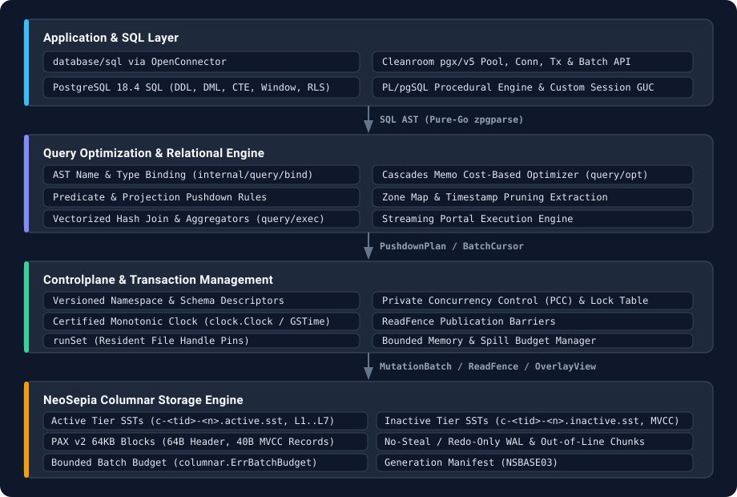
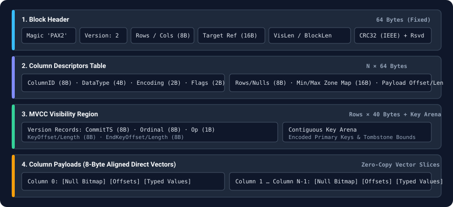
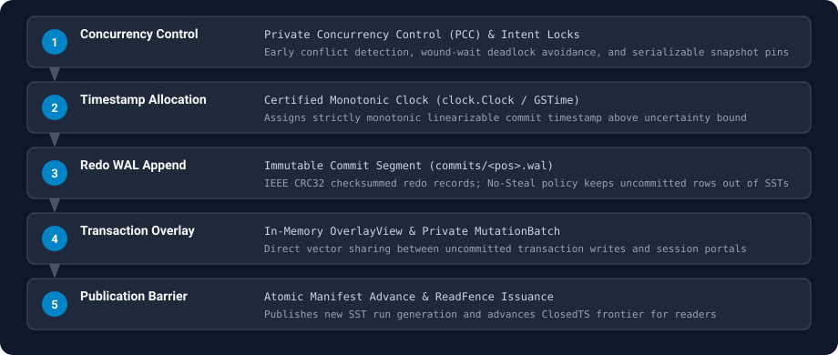

# SuperSQL Architecture

This document describes the internal architecture of SuperSQL: its package layout, the **NeoSepia** columnar storage engine, the certified-clock MVCC transaction engine, controlplane metadata and background maintenance, the Cascades query pipeline, native Row-Level Security (RLS), and bounded resource management.

For exact binary constants, generated Go API signatures, configuration envelopes, SQL compatibility tables, and SQLSTATE references, see [`docs/reference/`](reference/).

---

## 1. System Overview



SuperSQL is an embedded, single-process relational database written in pure Go (`CGO_ENABLED=0`). A single host process owns the data directory lock (`.lock`), the storage engine (`neosepia`), the transaction manager (`txn`), and the query runtime. OLTP point lookups, serializable multi-statement transactions, historical time-travel queries, and vectorized analytical scans all execute over one unified columnar storage layout.

### Package Map

| Layer | Package Path | Core Types & Entry Points | Responsibility |
| :--- | :--- | :--- | :--- |
| **Root Driver API** | `.` | `Open()`, `OpenConnector()`, `Connector`, `Catalog`, `CompactionConfig`, `QueryObserver`, `DatabaseMetrics`, `Subscription`, `RestorePITR()`, `*supersql.Error` | `database/sql` connector (`sql.OpenDB`), direct catalog execution, hot/incremental/encrypted backup & PITR, observability hooks, in-process pub/sub, and structured SQLSTATE errors |
| **Cleanroom `pgx` API** | `pgx/` | `OpenPool()`, `OpenPoolWithConfig()`, `Pool`, `Conn`, `Tx`, `Batch`, `NamedArgs`, `Notification`, `*PgError` | In-process `pgx/v5`-compatible pool, transactions, implicit-tx batching, `WaitForNotification`, `pgtype` wrappers, hooks, and generic row collectors |
| **PG Wire Listener** | `pgwire/` | `NewServer()`, `NewServerFromCatalog()`, `Server`, `Config`, `Notification` | Optional pure-Go PostgreSQL v3.0 TCP wire protocol server (Simple/Extended Query, binary/text codecs, TLS, auth, `CancelRequest`, async `'A'` `NotificationResponse`) |
| **Clock & Time** | `clock/`, `clock/local/`, `clock/gstime/` | `Clock`, `localclock.New()`, `ReadFence`, `Epoch`, `Provider` | Certified monotonic clock contract, standalone single-process local clock (`clock/local`), and GSTime synchronization provider |
| **Model & Columnar** | `internal/model/`, `internal/columnar/` | `DataType`, `Value`, `ObjectRef`, `PrivilegeGrant`, `CollationMetadata`, `Batch`, `Vector` | Object identifiers, SQL type layouts, ACL/collation/GIN descriptors, columnar vectors, null bitmaps, and batch budgets |
| **SQL Parser & AST** | `internal/zpgparse/` | `Parse()`, `Split()`, `Fingerprint()`, `Deparse()` | Pure-Go PostgreSQL 18 lexer, parser, AST, and deparser (generated via Ragel + `goyacc`) |
| **Controlplane** | `internal/controlplane/` | `Catalog`, `Namespace`, `SchemaJob`, `IndexPlan`, `Statistics`, `RetentionCoordinator`, `Maintenance` | Versioned MVCC catalog descriptors, B-tree & GIN index lifecycle/backfill, statistics, retention, incremental backups, and PITR |
| **Transactions & Pub/Sub** | `internal/dataplane/txn/`, `internal/dataplane/notify/` | `Manager`, `Transaction`, `lockRegistry`, `WaitGraph`, `Overlay`, `notify.Hub` | Strict 2PL / PCC concurrency control, sharded lock table, deadlock detection, spill-backed overlays, commit sequencing, and bounded in-process `LISTEN`/`NOTIFY` fanout |
| **Storage Backend** | `internal/dataplane/storage/neosepia/` | `Backend`, `paxBlock`, `sstWriter`, `runSet`, `memtable` | PAX v2 SSTables, Bloom filters, zone maps, TOAST blobs, WAL group commit & archiving, optional `NSE1` AES-256-GCM chunked encryption, dual-tier compaction, and crash recovery |
| **Query Session** | `internal/query/session/` | `Transactions`, `Settings`, `Prepared`, `CatalogAccess`, `NotifyConfig` | Session settings (GUC), prepared statements, plan cache, cursors, roles, `SECURITY DEFINER` role switching, transactional `LISTEN`/`NOTIFY`, and `AS OF SYSTEM TIME` routing |
| **Query Binder** | `internal/query/bind/` | `Binder`, `Scope`, `BoundStatement`, `CheckObjectPrivilege` | Name/type/collation resolution, catalog dependency declarations, object-level `GRANT`/`REVOKE` enforcement, RLS policy expansion, and constraint checks |
| **Query Optimizer** | `internal/query/opt/` | `Memo`, `Optimizer`, `PhysicalPlan`, `span`, `GINAccess` | Cascades cost-based optimizer, join reordering, B-tree span & GIN predicate extraction, sort elimination, and predicate pushdown |
| **Query Execution** | `internal/query/exec/` | `Pipeline`, `BatchCursor`, `GINScan`, `HashJoin`, `TopK`, `Expr`, `BufferStats` | Vectorized operators (`BatchRows=1024`), GIN posting scans with residual recheck, `EXPLAIN (ANALYZE, BUFFERS)` instrumentation, spill engines, pure-Go ICU collations, and ~3,400 built-in functions |

---

## 2. NeoSepia Storage Engine

NeoSepia (`internal/dataplane/storage/neosepia`) is an immutable, log-structured columnar storage engine designed for mixed transactional and analytical workloads.

### 2.1 Directory Layout

See [`docs/reference/storage-format.md`](reference/storage-format.md) for exact magic headers, struct byte sizes, and recovery invariants.

```text
<Data Directory>/
├── database.state                       # Published state (NSDB0002): magic, generation, log position, fence, lease horizon, clock scales
├── database.state.pending               # Staging file for atomic state replacement; removed on recovery
├── encryption.meta                      # Present when AES-256-GCM at-rest encryption is enabled (key fingerprint, never raw key)
├── fence.secret                         # HMAC-SHA256 secret for ReadFence verification, created atomically on first open
├── tmp/                                 # Spill directory for query operators, transaction overlays, and compaction buffers
├── commits/<020d>.wal                   # Immutable redo WAL segment per committed log position (group-committed; optionally NSE1-encrypted)
├── commits/.<020d>.pending              # Staging file for an in-flight WAL segment
├── runs/<020d>.runs                     # Incremental single or coalesced run manifest (NSRUNS01 / NSRUNS02)
├── runs/<020d>-<8hex>.sst               # PAX v2 SSTable run file (NSSST004; optionally NSE1-encrypted) with Bloom filters, zone maps, and TOAST blobs
├── runs/base-<020d>.runs                # Base manifest (NSBASE04) with pruned transaction horizon produced by maintenance
├── runs/.base.pending                   # Staging file for a base manifest rewrite
├── .lock                                # Process-exclusive directory lock held while open
└── .checkpoint-<hex>/                   # Hard-linked consistent snapshot directory for hot/incremental backups
```

### 2.2 64 KB PAX v2 Block Layout & TOAST (`NSSST004`)

Each SSTable data block (default 64 KB) uses 8-byte aligned little-endian PAX (Partition Attributes Across) columns so vectorized scans slice column arrays directly without per-row deserialization:



Key `NSSST004` storage features:
- **Out-of-Line TOAST Blobs**: Variable-length column values exceeding 64 KiB are written out-of-line into the SST's blob section and referenced by a compact inline pointer, keeping PAX data blocks dense for scan throughput while supporting multi-megabyte values.
- **Per-SST Bloom Filters**: Each SSTable carries an `xxh3`-hashed Bloom filter over its keys so point lookups skip non-matching runs in $O(1)$ without reading data blocks.
- **SST-Index Zone Maps**: Block index entries store per-column min/max summaries, enabling range scans and predicate pushdown to prune entire 64 KB blocks before decoding.
- **16-Shard LRU Block Cache & Bounded FD Pool**: Decoded PAX blocks are cached in a 16-shard LRU cache, and open SST file handles are managed by a bounded LRU file-descriptor pool (`runSet`) so concurrent readers cannot exhaust OS descriptor limits (`ulimit -n`).
- **Binary-Search Point Lookups**: Point `Get` requests perform $O(\log N)$ binary search over block key arrays inside `activeTier` runs and allow concurrent readers on a shared snapshot.

### 2.3 Write Path: WAL Group Commit & In-Memory Memtable

- **WAL Group Commit**: Concurrent commits batch their WAL writes and `fsync` calls while preserving strictly monotonic commit timestamps and contiguous log positions.
- **Write-Behind Memtable & Coalesced Flushes (`NSRUNS02`)**: Committed mutations are buffered in an in-memory memtable and flushed into coalesced PAX SST runs rather than emitting one tiny SST per small commit, dramatically reducing write amplification and file count.

### 2.4 Dual-Tier Compaction (`activeTier` / `inactiveTier`)

- **`activeTier` ($L_1 \dots L_7$)**: Retains only the latest committed version for each key across leveled runs. Latest-state OLTP reads never walk historical version chains.
- **`inactiveTier`**: Stores superseded historical versions grouped by time window using multi-writer streaming compaction. Once the retention watermark advances past a window's upper bound, the entire inactive file is unlinked in $O(1)$ time.
- **Base Manifest Pruning (`NSBASE04`)**: Maintenance rewrites `runs/base-<pos>.runs`, pruning retired transaction records below the compacted frontier and keeping an $O(1)$ covered-fence index.

### 2.5 Crash Recovery, At-Rest Encryption, Incremental Backups & PITR

- **No-Steal Redo Recovery**: Uncommitted writes live only in transaction-private overlays and never touch SSTs. On startup, `neosepia.Open` validates `database.state` (`NSDB0002`), verifies the persisted `ReadFence` and lease horizon (`ClosedTS`), replays any committed `commits/<pos>.wal` segments newer than the run manifest, discards `.pending` staging files, and fails fast (`storage.ErrCorruptStorage`) on any CRC32 mismatch or ordering violation.
- **Pure-Go AES-256-GCM Encryption (`NSE1`)**: When `OpenOptions.EncryptionKey` (32 bytes) is configured, WAL segments, newly written SST runs, and backups are transparently wrapped in authenticated 64 KiB `NSE1` AES-256-GCM chunks bound with chunk-index AAD; `encryption.meta` verifies key fingerprints on reopen without persisting raw key material. Unencrypted databases remain byte-for-byte compatible.
- **Hot, Incremental & PITR Backups**: `Catalog.Backup` / `CreateHotBackupWithOptions` produce full consistent snapshots (optionally encrypted); `CreateIncrementalBackup` records only SST runs and WAL segments added since a base manifest (`incremental.json`); `WALArchiveDir` / `EnableWALArchive` continuously archive committed WAL segments; and `RestorePITR` / `RestorePITRFromChain` replay archived WAL segments up to a target timestamp or log position.

---

## 3. Transactions, Certified Clocks & Concurrency Control



### 3.1 Certified-Clock MVCC & Time Travel

- **Clock Abstraction (`clock/`)**: Every transaction timestamp and snapshot `ReadFence` (`ClosedTS`, `LogPosition`, `Epoch`, HMAC tag) is anchored to a certified monotonic clock:
  - `clock/local`: Zero-dependency monotonic clock for standalone single-process deployments.
  - `clock/gstime`: Externally synchronized certified clock provider with automatic epoch rotation.
- **Serializable Isolation**: SuperSQL enforces serializable isolation via strict pessimistic concurrency control (PCC / Strict 2PL) over certified MVCC snapshots. By default (`supersql.compat_isolation = 'on'`), weaker requested isolation levels automatically escalate to `SERIALIZABLE`; setting `supersql.compat_isolation = 'off'` rejects non-serializable requests with `0A000`.
- **`AS OF SYSTEM TIME <timestamptz>`**: Historical read-only queries execute against a pinned MVCC snapshot verified by a `ReadFence` without acquiring write locks.

### 3.2 Locking, Savepoints, Deadlock Detection & Transactional `LISTEN`/`NOTIFY`

- **Sharded `lockRegistry`**: Key-span locks, row locks (`FOR UPDATE`, `FOR NO KEY UPDATE`, `FOR SHARE`, `FOR KEY SHARE`, `NOWAIT`, `SKIP LOCKED`), and advisory locks are partitioned across a sharded lock registry to reduce contention under high concurrency.
- **Shared $O(V + E)$ `WaitGraph`**: Transaction locks and session advisory locks share one wait-for graph that detects deadlocks across mixed lock types in $O(V + E)$ time and aborts a victim with SQLSTATE `40P01`.
- **Strict 2PL Savepoints & Non-Bricking Statement Rollback**: `ROLLBACK TO SAVEPOINT` and statement-level errors revert only uncommitted overlay mutations while retaining Strict 2PL locks until transaction end, ensuring a failed statement inside an explicit `BEGIN` block does not brick subsequent rollback or savepoint recovery.
- **Spill-Backed Write Overlays**: Transaction write buffers (`Overlay`) track mutations in memory up to their configured byte budget and spill automatically to `tmp/` for large bulk transactions.
- **Atomic Commit Publish & `notify.Hub`**: `Manager.submit` publishes committed state atomically so readers never observe torn visibility. Pending `NOTIFY` / `pg_notify()` events are staged per transaction (with savepoint truncation support), discarded on `ROLLBACK`, deduplicated per commit batch, and fanned out non-blockingly through `notify.Hub` to bounded per-session ring queues consumed by `Catalog.Subscribe`, `pgx.Conn.WaitForNotification`, and `pgwire` `'A'` push frames.

---

## 4. Controlplane, Auto-`ANALYZE` & Observability

- **Versioned MVCC Catalog (`internal/controlplane/catalog/`)**: Tables, B-tree and GIN indexes, views, sequences, functions, domains, enums, composite types, collations, roles, ownership metadata, ACL grants, and RLS policies are stored as versioned catalog descriptors inside NeoSepia itself. DDL operations participate in full MVCC transactions and are included automatically in backups.
- **Per-Session Sequence State**: Sequence `nextval`/`currval`/`lastval` tracking is isolated per session while durable sequence advances persist transactionally.
- **Schema & Online Index Jobs (`internal/controlplane/schema/`)**: Background index backfills (both B-tree and GIN posting lists) are driven by an event-signaled `IndexJobScheduler` (`Wake()` with exponential backoff) and a `JobStore` that prunes terminal job records to bound catalog growth.
- **Statistics & Background Auto-`ANALYZE` (`internal/controlplane/statistics/`, `maintenance.go`, `observability.go`)**: `ANALYZE` collects row counts, NDV, null fractions, and MCV/histogram summaries consumed by the optimizer. A thread-safe mutation tracker triggers background Auto-`ANALYZE` once modified rows exceed `AutoAnalyzeMinRows + AutoAnalyzeScaleFactor * liveRows` (default `50 + 0.2 * liveRows`, configurable via `MaintenanceConfig`), or on demand via `Catalog.RunAutoAnalyze(ctx)`.
- **Observability Hooks & Live Metrics**: `OpenOptions.Observer` and `OnSlowQuery` emit structured `QueryEvent` records (`SQL`, `Duration`, `PlanningDuration`, `RowsAffected`, `SharedHitBlocks`, `SharedReadBlocks`, `SpillBytes`, `Err`), and `Catalog.Metrics(ctx)` exposes live counters, cache hit/miss rates, WAL/run backlog, and Auto-`ANALYZE` run totals.
- **Retention Coordinator (`internal/controlplane/retention/`)**: Tracks active snapshot pins and advances the storage history floor safely (closing snapshot readers before triggering storage collection) so `inactiveTier` files can be reclaimed.

---

## 5. Query Processing Pipeline


### 5.1 Parsing, Binding, RBAC & Native RLS (`internal/zpgparse`, `internal/query/bind`)

- **Pure-Go PostgreSQL 18 Parser**: `internal/zpgparse` implements a complete Ragel + `goyacc` PostgreSQL 18 grammar, statement splitter, query fingerprinter, and AST deparser with zero CGo (`libpg_query` is not linked).
- **Object-Level RBAC & `SECURITY DEFINER`**: The binder enforces schema `USAGE`/`CREATE` and object-level `SELECT`/`INSERT`/`UPDATE`/`DELETE`/`TRUNCATE`/`EXECUTE` ACLs (respecting ownership, `PUBLIC`, and transitive role memberships; superusers bypass). `SECURITY DEFINER` routines execute under their owner's role with unconditional `defer` restoration of the caller's role.
- **Native RLS**: When Row-Level Security is enabled on a target relation, the binder injects `PERMISSIVE`/`RESTRICTIVE` `USING` predicates wrapped in a `SecurityBarrier` (preventing leaky-operator pushdown bypasses) and attaches per-branch `WITH CHECK` enforcement for `INSERT`, `UPDATE`, and `MERGE`.
- **Pure-Go ICU Collations**: Predefined ICU collations (`"en-US-x-icu"`, `"ko-KR-x-icu"`, `"ja-JP-x-icu"`, `-u-ks-level2`, `-u-kn-true`, etc.) and catalog-defined `CREATE COLLATION` descriptors are resolved in the binder and executed via pooled `golang.org/x/text/collate` collators with UCA sort-key encoding for indexes and `ORDER BY`.

### 5.2 Cascades Cost-Based Optimizer (`internal/query/opt`)

- **B-tree Span Extraction & GIN Index Planning**: Extracts tight B-tree index bounds for built-in types, `UUID`, `VARCHAR`/`BPCHAR`, `NUMERIC`, user-defined domains and enums, `LIKE 'prefix%'`, `= ANY($1)`, and parameterized (`$1`) predicates. Recognizes GIN-indexable predicates (`jsonb` `@>`/`?`/`?|`/`?&`, arrays `@>`/`&&`, `tsvector` `@@`) and emits `GIN Index Scan` plans over posting lists `(token, base_pk)` with full residual recheck.
- **Statistics-Driven Costing & Join Reordering**: Wires persisted `ANALYZE` / Auto-`ANALYZE` statistics into Cascades cardinality estimation, supports join key commutation, pushes filters through joins (respecting `SecurityBarrier` boundaries), and reorders joins beneath `Aggregate`, `Limit`, `Distinct`, `Window`, and `SetOp`.
- **Order Exploitation**: Recognizes reverse index scans (`ScanReverse`) and eliminates redundant `Sort` operators when an access path already satisfies the required `ORDER BY`.
- **Plan Caching**: Prepared and repeated statements reuse cached physical plans validated against catalog descriptor versions and RLS/role context.

### 5.3 Vectorized Execution Engine & `EXPLAIN (ANALYZE, BUFFERS)` (`internal/query/exec`, `internal/query/explain`)

- **Columnar Vectorization**: Operators exchange 1,024-row (`BatchRows = 1024`) columnar batches (`internal/columnar`) with reusable builders and expression VM registers to minimize per-row allocations.
- **GIN Posting Scans**: Evaluates the query expression once at scan open, prefix-scans posting entries for extracted tokens, intersects (`RequireAll`) or unions candidate primary keys, fetches visible MVCC base rows, and rechecks the full `WHERE` predicate (falling back safely to a sequential scan when a query produces no selective tokens).
- **External Spill Operators**:
  - **Recursive Partitioned `HashJoin`**: Spills skewed or oversized build/probe partitions recursively to `tmp/`.
  - **Bounded-$K$ Heap `TopK`**: `ORDER BY ... LIMIT K` maintains a bounded heap instead of sorting the full input.
  - **External Merge `Sort`, `Aggregate` (`DISTINCT`/`ORDER BY`/Grouping Sets), `Window`, and `SetOp`**: Respect `work_mem` bidirectionally and spill intermediate partitions to `tmp/` while keeping `OutputMemory` batches sized for large TOAST values.
- **`EXPLAIN (ANALYZE, BUFFERS)`**: Instruments shared block cache hits/reads and temp spill read/write 8 KiB blocks across TEXT, JSON, YAML, and XML formats.
- **Built-in Catalog & PL/pgSQL**: Provides ~3,400 PostgreSQL built-in functions/operators, RE2 linear-time regular expressions, and a cancellable PL/pgSQL runtime (including interruptible loops).

---

## 6. Resource Bounds

Every layer enforces explicit memory, spill, and descriptor budgets rather than relying on unbounded heap growth:

- **Query Memory & `work_mem`**: `runtime.Query` tracks `WorkMemory`, `OutputMemory`, and `SpillBytes` independently. Exceeding configured bounds fails cleanly with SQLSTATE `53200` / `53100` instead of OOM-crashing the host process.
- **Storage Envelope (`CompactionConfig` / `neosepia.Limits`)**: Bounds open file handles, pinned run generations, decoded block cache bytes, WAL segment sizes, and scan plan memory.
- **Timeouts**: Supports `statement_timeout` (`57014`), `lock_timeout` (`55P03`), `idle_in_transaction_session_timeout` (`25P03`), and Go `context.Context` cancellation throughout parsing, locking, scanning, and PL/pgSQL execution.

---

## 7. Regenerating Generated Sources

### SQL Parser (`internal/zpgparse`)

With Ragel installed on `PATH` (`goyacc` is pinned via `tool` in `go.mod`):

```sh
go generate ./internal/zpgparse/...
CGO_ENABLED=0 go test ./internal/zpgparse/...
```

Edit `gram.y` and `scan.rl` rather than the generated `y.go` or `scan.go`.

### Built-in Tables & Reference Documentation

```sh
go generate ./internal/query/bind ./internal/query/builtin
go run ./internal/tools/docgen
```
